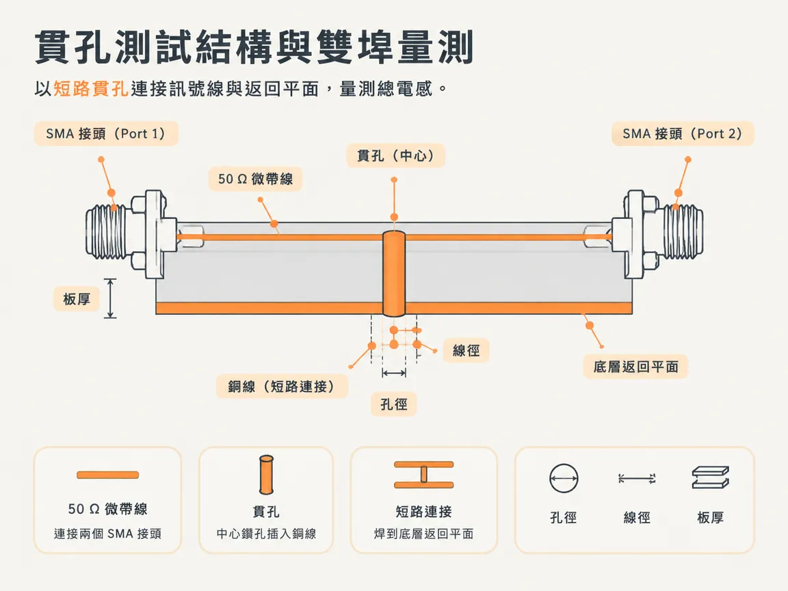
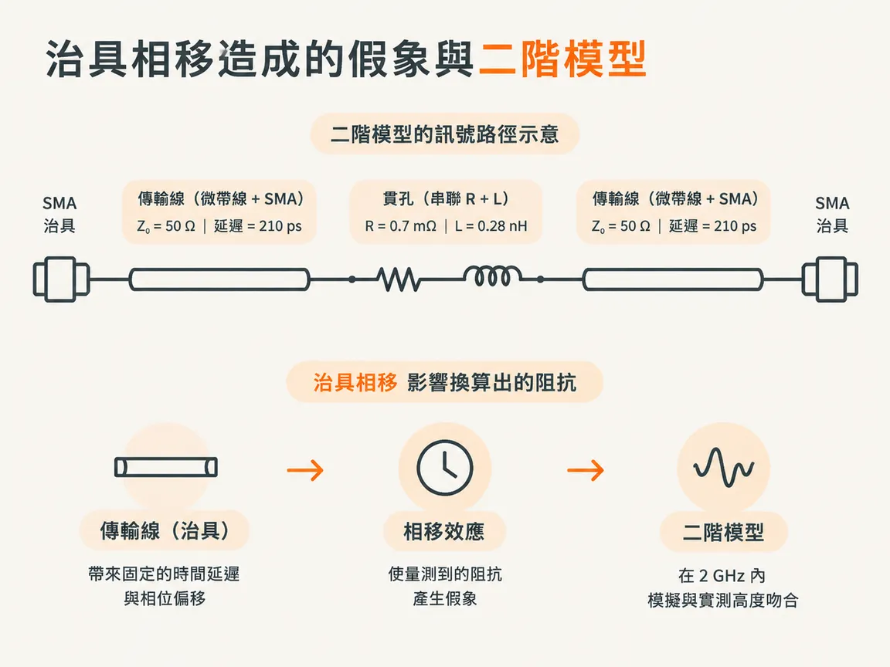
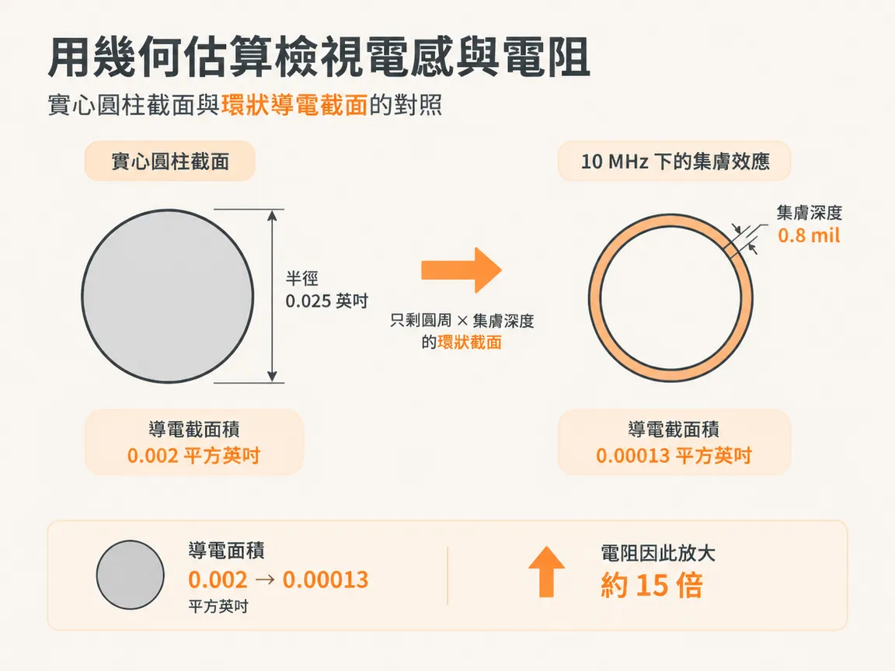

# 萃取貫孔的 R 與 L：雙埠量測模型與幾何估算驗證

在電源完整性（PDN）設計中，電路板貫孔（via）的寄生電阻通常只有幾毫歐姆，寄生電感也只有幾百皮亨（pH）。測量這類微小阻抗時，常採用雙埠分流技術。高頻下將量測數據換算為電阻與電感時，同樣會看到電阻隨頻率上升、電感隨頻率下降的趨勢。

透過簡單的短路測試板，可以利用前述包含治具的傳輸線二階模型萃取出貫孔數值，並藉由幾何結構估算檢查萃取結果是否合理。

## 貫孔測試結構與雙埠量測

為了萃取微帶線訊號線與返回路徑之間短路貫孔的總電感，實驗採用一塊雙層測試板。這塊測試板包含一條貫穿連接兩個 SMA 接頭的 50 Ω 微帶線。

製作時，在微帶線訊號線正中間鑽出直徑 50 mil（千分之一英吋）的孔，插入一根直徑 50 mil 的銅線（半徑 $r = 0.025$ 英吋），長度為電路板厚度 0.064 英吋。這根銅導線焊接在頂層訊號線與底層返回平面之間，將訊號線直接短路到地。微帶線與兩端 SMA 接頭作為連接 VNA 的治具。

使用雙埠量測取得 S 參數後轉換為阻抗。若直接套用一階串聯 RL 模型詮釋，將量測阻抗實部視為電阻 $R$、虛部換算為電感 $L$，曲線會再次呈現電感隨頻率下降、電阻隨頻率升高的現象。

## 治具相移造成的假象與二階模型

這種隨頻率變化的現象不是貫孔本身的物理特性，而是治具相移導致的量測假象。詮釋量測時，必須將連接待測物的治具納入模型。

這裡採用與分析線圈時完全相同的拓撲結構：一段理想傳輸線連接一組理想串聯 $R$ 與 $L$。在 2 GHz 量測頻寬內，代入下列參數後，二階模型模擬阻抗與實測阻抗高度吻合：

- 電阻 $R = 0.0007\ \Omega$（即 $0.7\text{ m}\Omega$）
- 電感 $L = 0.28\text{ nH}$
- 傳輸線特性阻抗 $Z_0 = 50\ \Omega$
- 傳輸線時延 $TD = 210\text{ ps}$

實測阻抗實部與等效單元件電感曲線，在 2 GHz 內由傳輸線饋入 $R$、$L$ 的二階模型完整重現。

## 用幾何估算檢視電感與電阻

萃取出 $0.7\text{ m}\Omega$ 與 $0.28\text{ nH}$ 後，需要檢查數值是否符合貫孔實體的物理幾何尺寸。

貫孔實體可視為一段短圓柱體，物理參數如下：

- 銅的體電阻率 $\rho = 0.7 \times 10^{-6}\ \Omega\text{-inches}$
- 貫孔長度 $\text{Len} = 0.064\text{ inches}$
- 貫孔半徑 $r = 0.025\text{ inches}$

返回路徑距離該貫孔相對較遠，可用短圓柱導線的部分自感（partial self-inductance）近似貫孔總電感。根據直導線部分自感公式計算，預測的貫孔總電感為 $0.29\text{ nH}$。這與二階模型萃取出的 $0.28\text{ nH}$ 吻合，證實萃取出的電感值合乎幾何特徵。

直流串聯電阻部分，以幾何截面積（$\pi r^2 \approx 0.002\text{ inches}^2$）算出的理論直流電阻約為 $0.02\text{ m}\Omega$。模型萃取出的電阻為 $0.7\text{ m}\Omega$，約為理論直流值的 35 倍。這個差距來自兩個因素：VNA 的量測雜訊底限（noise floor），以及高頻下的集膚效應。

在 10 MHz 頻率下，銅的集膚深度約為 0.8 mil（$0.0008\text{ inches}$）。電流不再流經整個 $0.002\text{ inches}^2$ 的幾何截面積，而是集中在圓周乘上集膚深度的環狀截面：

$$2\pi r \times 0.0008\text{ inches} = 0.00013\text{ inches}^2$$

截面積縮小後，10 MHz 下的交流電阻是直流值的 $0.002 / 0.0013 \approx 15$ 倍。這個數值與萃取得到的 $0.7\text{ m}\Omega$ 相差在兩倍以內。在實際量測中，隨頻率平方根增加的集膚電阻，容易被治具相移引起的表觀電阻上升掩蓋。綜合考量雜訊底限與高頻損耗後，萃取出的電阻值落在合理範圍內。

## 正確詮釋雙埠量測結果

無論導線迴路還是短路貫孔，雙埠分流法能測量更小、更高頻的阻抗，但在詮釋數據時需要排除治具影響。

高頻下，連接待測物與 SMA 接頭之間的治具會產生不可忽略的相移。建立傳輸線模型後，就能將待測物本身的極低阻抗特性與治具影響分離，得到符合實體結構的電阻與電感值。

處理完短路貫孔這類低感、低阻結構後，相同的傳輸線模型修正原則，也能套用在去耦電容（MLCC）的等效串聯參數萃取上。
