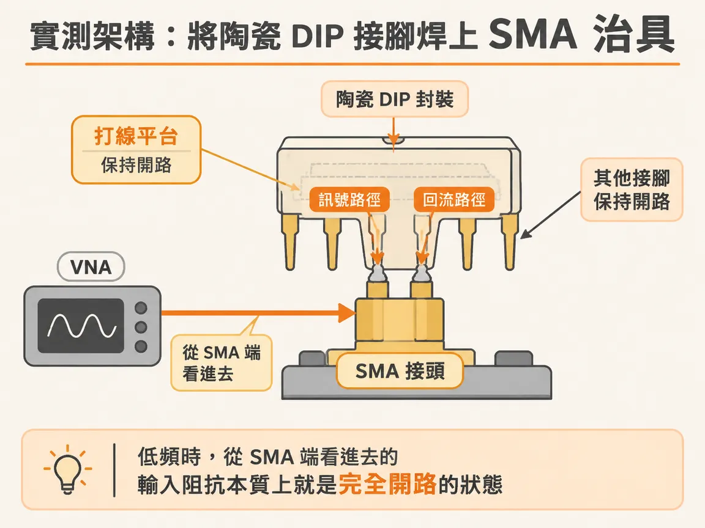
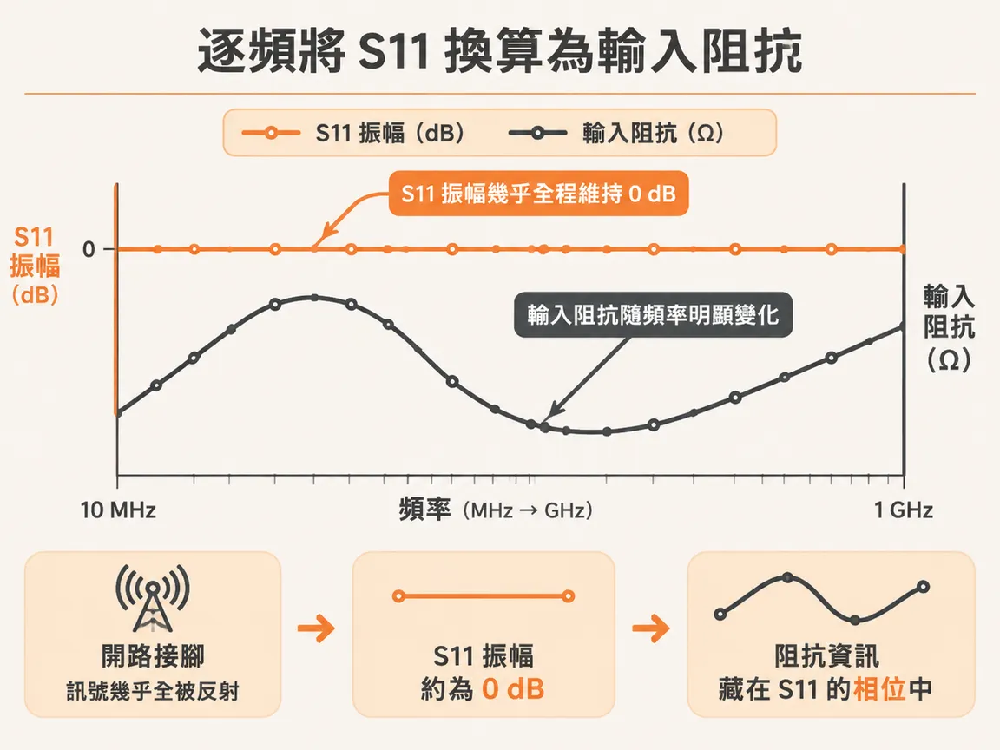
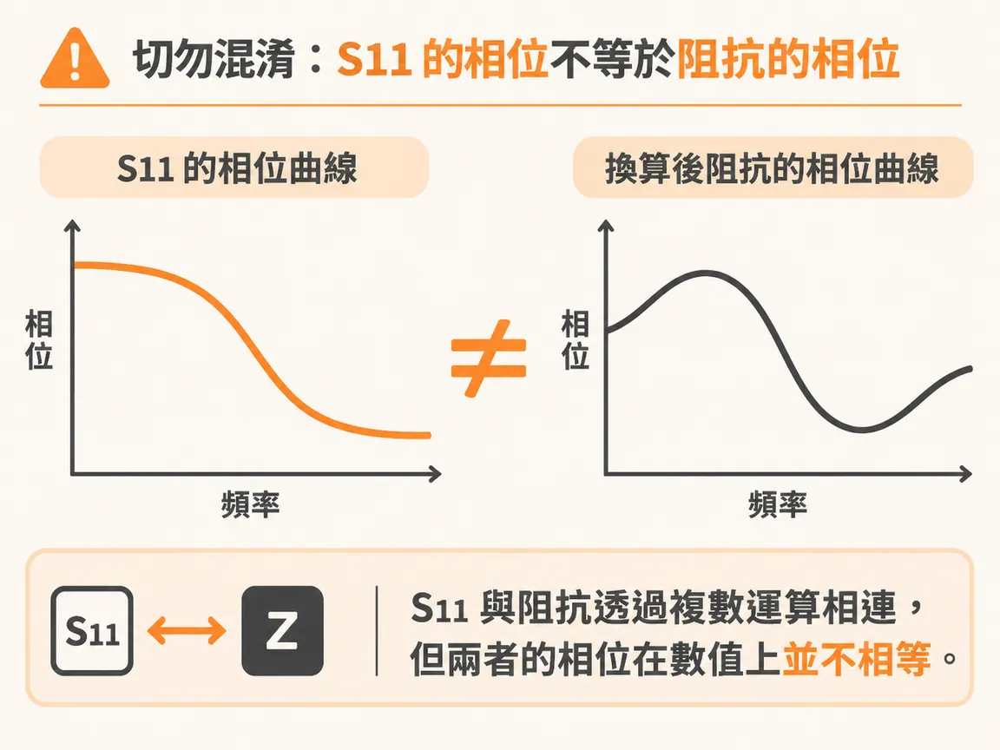
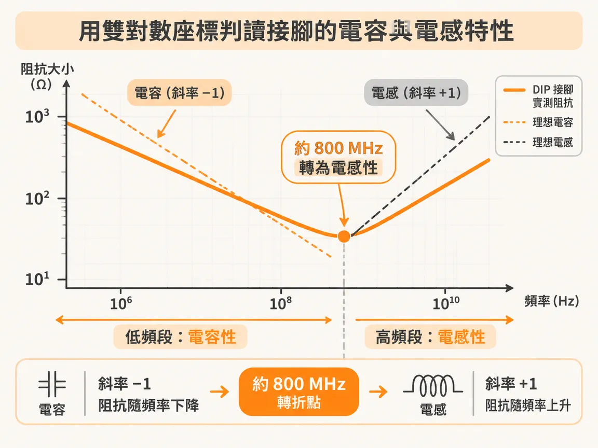

# 從 DIP 接腳的 S11 換算阻抗：為什麼關鍵資訊全在相位裡？

在掌握了透過 $S_{11}$ 換算阻抗的公式後，實際應用到實體零件上時，會觀察到一個反直覺的現象：量測一對開路的封裝接腳時，$S_{11}$ 的振幅從頭到尾幾乎都是 0 dB。如果振幅是一條平坦的直線，阻抗的頻率特性到底藏在哪裡？

了解這個轉換過程，不僅能釐清阻抗資訊在反射波中的分佈，還能看清接腳從電容性轉為電感性的高頻行為。

## 實測架構：將陶瓷 DIP 接腳焊上 SMA 治具

為了透過 VNA 測量阻抗，可以將常見的陶瓷雙列直插封裝（DIP）焊接在 SMA 接頭上，當作連接儀器的治具。

在這個測試結構中，挑選兩個相鄰的接腳，分別作為訊號路徑與返回路徑。封裝內部的打線平台（bonding shelf）保持開路，外側所有接腳也都懸空、不接任何元件。此時從 SMA 接頭看進去，低頻時的輸入阻抗本質上就是完全開路的狀態。

量測時，VNA 在設定的頻率範圍內逐步發出正弦波，並在每個頻率點測量從接腳反射回來的正弦波，藉此得到各頻率點的散射參數 $S_{11}$。

## 逐頻將 S11 換算為輸入阻抗

在 10 MHz 到 1 GHz 的整個量測頻率範圍內，可以利用複數代數運算，逐頻將測得的 $S_{11}(f)$ 換算為待測物（DUT）的複數輸入阻抗 $Z_{\text{DUT}}(f)$。這個轉換在任何 SPICE 模擬軟體中都能執行，也可以直接透過複數代數公式計算。

當將測得的 $S_{11}$ 與轉換後的輸入阻抗畫在 10 MHz 到 1 GHz 的線性頻率座標上對照時，會發現一個關鍵現象：

在整個量測頻段中，因為接腳末端完全開路、沒有吸收能量的負載，訊號幾乎全數被反射回來，$S_{11}$ 的振幅（magnitude）幾乎全程維持在 0 dB。既然振幅大小沒有明顯變化，這代表所有與接腳阻抗相關的細節與資訊，實際上幾乎全被編碼在 $S_{11}$ 的「相位（phase）」之中。

## 切勿混淆：S11 的相位不等於阻抗的相位

換算出來的阻抗，其大小與相位確實和同一頻率下的 $S_{11}$ 大小與相位直接相關，但兩者的數學關係非常複雜。光看 $S_{11}$ 的相位曲線，無法直接看出阻抗的相位走勢。

這是一個極為重要的觀念：雖然反射損耗（$S_{11}$）和阻抗都是具有大小與相位的複數，但**反射損耗的相位和阻抗的相位完全是兩回事**。阻抗的相位是由各頻率下 $S_{11}$ 的大小與相位經由複數公式綜合運算得來的結果，判讀資料時不能把兩者混為一談。

## 用雙對數座標判讀接腳的電容與電感特性

觀察阻抗隨頻率變化的圖表時，若將阻抗大小和頻率同時放在雙對數（log-log）座標軸上，判讀會容易許多：

- 理想電容的阻抗在雙對數圖上是一條斜率為 $-1$ 的直線。
- 理想電感的阻抗在雙對數圖上則是一條斜率為 $+1$ 的直線。

如果我們將這對 DIP 接腳的阻抗大小畫在雙對數圖、相位畫在線性-對數（linear-log）圖上，接腳的物理行為便一目了然：在低頻時，曲線呈現斜率為 $-1$ 的直線，代表接腳主要表現為電容性；隨著頻率升高，大約到了 800 MHz 附近，曲線轉折向上，轉為呈現電感性。

## 以量測為基礎的建模：拆解互連線

低頻段呈現電容特性的現象，為建立簡單的模型提供了關鍵線索。在模擬環境中，用最簡單的單一理想電容模型來比對實測數據，結果顯示一個約 4.8 pF 的理想電容，就能相當精準地吻合低頻段的實測阻抗。

藉由 VNA 測量反射損耗、換算出阻抗，再帶進模擬環境中擬合出理想電路拓撲並提取參數的流程，稱為「以量測為基礎的建模」（measurement-based modeling），有時也被稱作「拆解互連線」（hacking the interconnect）。

替實體互連線建立出可縮放的等效模型後，就能進一步修改參數、探討各種假設情境（what-if questions），找出高頻互連行為背後的根本成因。
