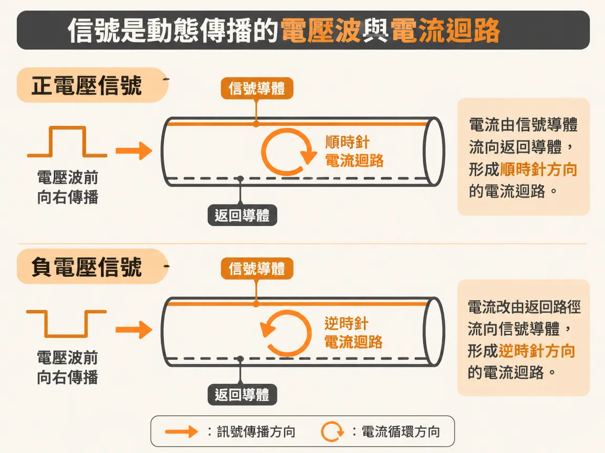
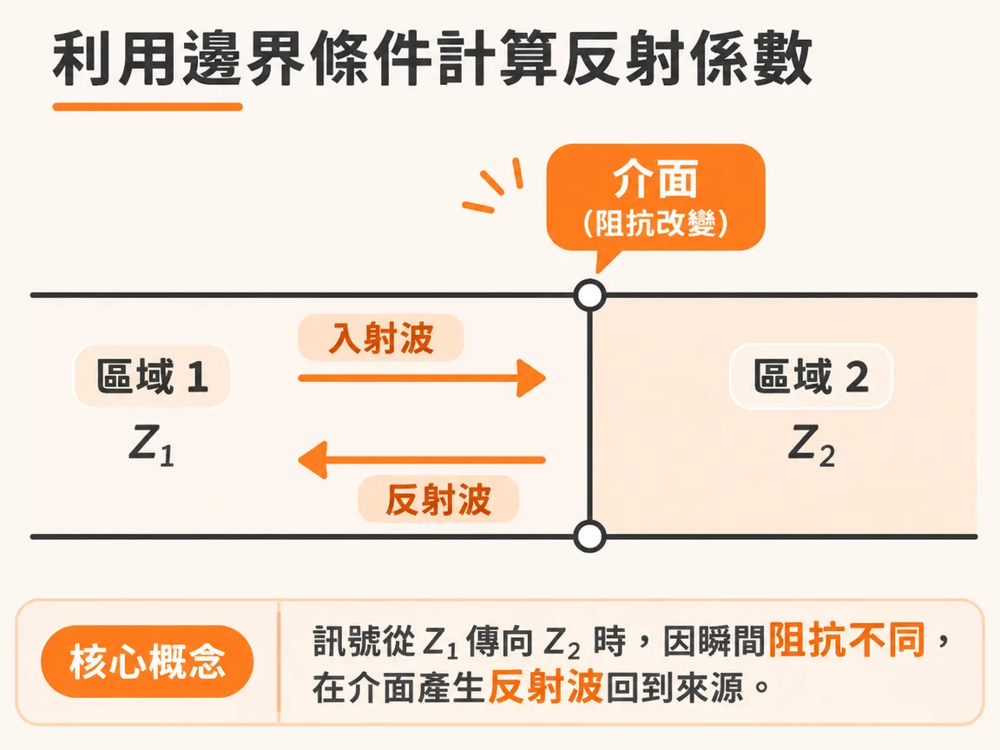
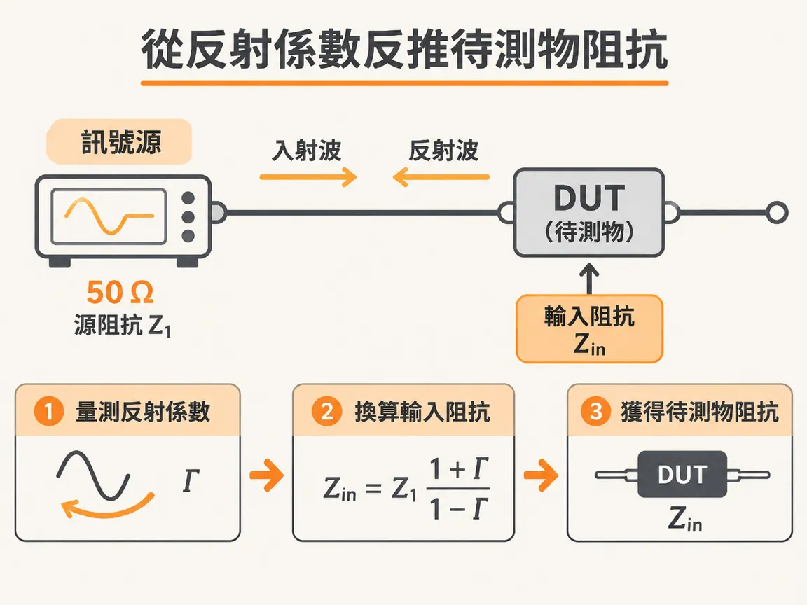
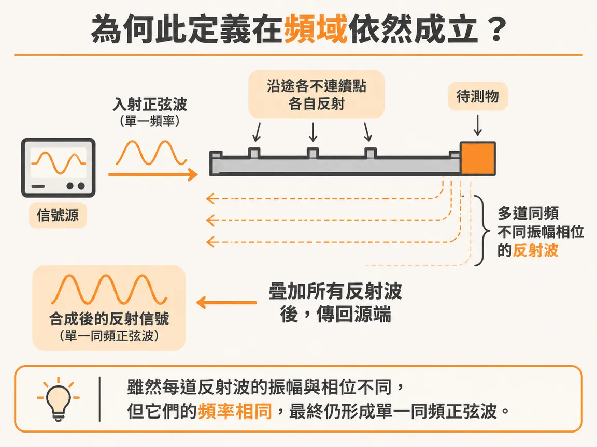

# 從信號反射推導待測物阻抗：反射係數在時域與頻域的物理意義

在高速數位系統中，我們很難直接用探針量測特定位置的電壓與電流比值。
信號在互連線中不是靜止的電位，而是以電磁波形式高速前進。
利用信號在介面上的反射來定義並計算阻抗，是高頻量測中最核心的方法。

## 信號是動態傳播的電壓波與電流迴路

信號本質上是動態的，同時包含傳播中的電壓波與電流迴路。
信號一旦出發，就會沿著互連線持續朝特定方向前進。

當電壓施加在傳輸線的信號路徑與返回路徑兩條導體之間時，兩導體間的電壓差會以周圍介質中的電磁波速度向前傳播。
伴隨電壓波前移動的，還有一個電流波前。
這個電流波前同時具備兩個方向：

* 傳播方向：沿著傳輸線前進的方向。
* 循環方向：在信號導體與返回導體之間流動的迴路方向。

當一個正電壓信號從左向右傳播時，電流在信號路徑與返回路徑之間流動，形成一個由左向右傳播、以順時針方向循環的電流迴路。
如果是負電壓信號從左向右傳播，電流波依然由左向右前進，但電流會改由返回路徑流向信號導體，呈現逆時針方向循環。

電磁波在傳播時，隨時都在感受沿途每一步的瞬間阻抗（instantaneous impedance）。
只要傳輸線各處的瞬間阻抗維持定值，電壓波與電流波就能毫無失真地前進。
一旦結構或材料改變導致瞬間阻抗產生變化，交界面就會激發出反射波，穿透過去的波也會隨之失真。

## 利用邊界條件計算反射係數

當信號從左向右前進，抵達瞬間阻抗不同的介面時，它感受到了阻抗變化，因而產生一束朝相反方向（從右向左）傳回訊號源的反射信號。

將介面兩側的電壓與電流比值（V/I）定義為該區域的阻抗，配合交界面上的電壓與電流邊界條件，可以導出反射係數（reflection coefficient，通常記為 ρ）：

ρ = Vr / Vi = (Z2 - Z1) / (Z2 + Z1)

其中：
* ρ 為反射係數。
* Vi 為區域 1 中由左向右前進的入射電壓。
* Vr 為區域 1 中由右向左傳播的反射電壓。
* Z1 為區域 1 的瞬間阻抗。
* Z2 為區域 2 的瞬間阻抗。

這個關係式在時域與頻域中都成立。
在時域中，行進波前各處在任何時間瞬間，都遵循這個電壓與阻抗的比例關係。

## 從反射係數反推待測物阻抗

在實際量測中，如果訊號源端的阻抗 Z1 是精確已知的數值，就能藉由量測反射係數，反推引發反射的第二個阻抗 Z2。
將上述反射係數公式移項整理後，便能得到：

Z2 = Z1 × (1 + ρ) / (1 - ρ)

工程量測中最常見的設定，是將訊號源阻抗 Z1 固定為 50 Ω。
當行進波抵達待測物（DUT, Device Under Test）的端子並產生反射時，測量反射係數即可推導出該雙端子待測物的輸入阻抗 Zin：

Zin = 50 Ω × (1 + ρ) / (1 - ρ)

透過反射來定義阻抗的方法，形式上雖然不同於傳統的電壓除以電流（V/I），但在物理本質上完全等效。
這裡測得的數值是待測物的「輸入阻抗」。
若待測物是單純的分立元件（例如理想電阻或電容），輸入阻抗就等於該元件本身的阻抗。

## 為何此定義在頻域依然成立？

在頻域中，所有信號都被視為正弦波，具備頻率、振幅與相位三項要素。
頻域的電壓信號以複數表示，這代表電壓比值、反射係數以及阻抗全都是複數。

如果待測物是一個延伸結構（例如裝在治具末端的理想電阻），入射信號就不只在最終的電阻處反射。
信號進入治具前端時就會產生第一道反射。
接著信號穿過治具傳向待測物，在沿途每一個阻抗不連續點引發反射與多次來回彈跳（multiple bounces）。

當入射信號是單一頻率的正弦波時，傳回訊號源的淨反射信號，是來自每一個介面反射、包含所有來回彈跳正弦波的疊加總和。
這些反射波雖然各自具有不同的振幅與相位，但它們的頻率全數相同。

線性系統具備一項關鍵特性：將一群頻率相同、但振幅與相位各異的正弦波疊加在一起時，合成出來的波形依然是相同頻率的正弦波。

反射正弦波最終測得的複數振幅與相位，完整打包了從 50 Ω 訊號源端看進去時，整個待測物系統的「總整合輸入阻抗」（total integrated input impedance）。
這個結果以複雜的方式取決於整個分散互連結構上的阻抗分佈。

這套以反射波定義輸入阻抗的架構，比單純的節點 V/I 更具一般性，推展到極高頻率時也完全適用。
實務量測上，使用向量網路分析儀（Vector Network Analyzer, VNA），從受控的 50 Ω 阻抗端發射單頻正弦波進入待測物。
儀器精確量測反射波相對於入射波的振幅大小與相位差（即複數反射係數 ρ），再透過公式換算出包含治具與待測物在內的完整頻域阻抗特性。
