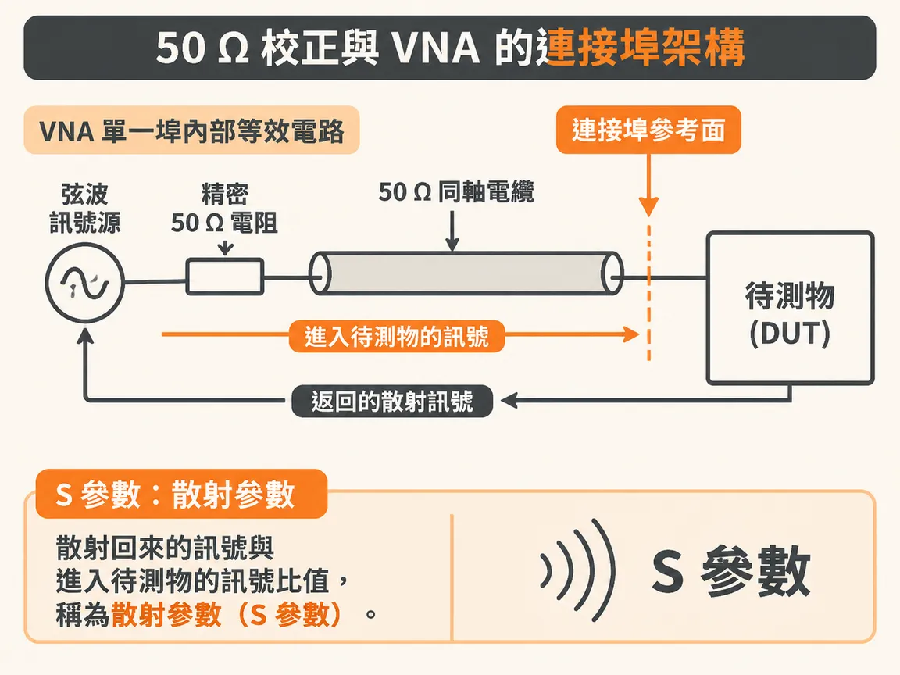
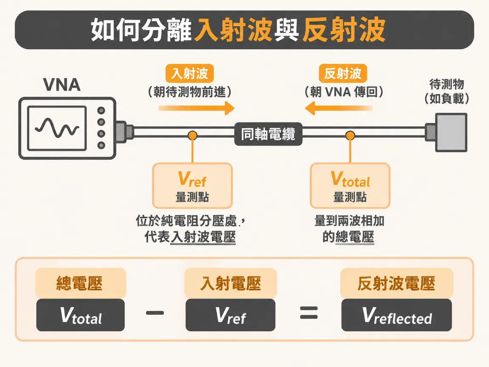
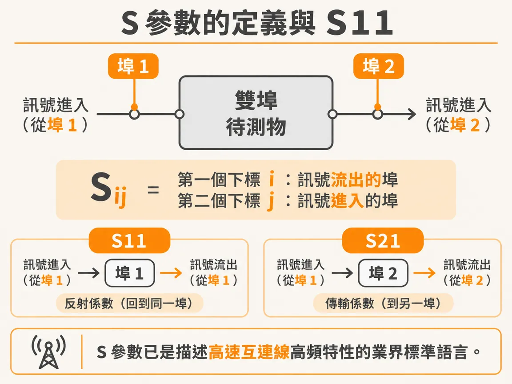
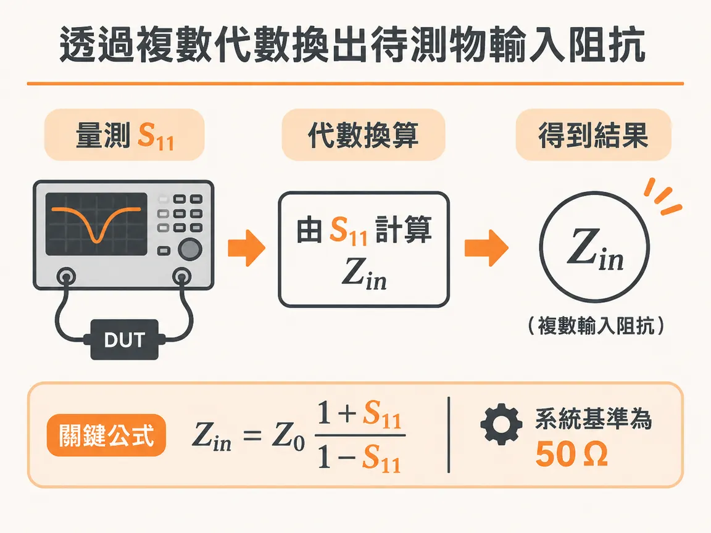

# 用 VNA 與 S11 量測阻抗：從 50 Ω 校正、分離波形到阻抗轉換

在電路板上量測高頻訊號時，示波器通常是第一線工具。

將探棒接在運作中電路板的兩條導線之間，示波器螢幕會顯示隨時間變化的瞬態電壓波形。

這個波形只代表量測點當下的總電壓，無法看出訊號的傳遞方向。

若量測點在互連線中段，測到的電壓其實是朝相反方向傳遞的兩個電壓波重疊後的數值。

只看示波器畫面，沒有額外的計算與分析，無法把往左與往右傳遞的訊號分開。

向量網路分析儀（Vector Network Analyzer，VNA）的設計目的剛好相反。

它能在同一個連接埠上，分別量測朝正反兩個方向傳遞的波，精確取得兩者的振幅與相位。

這也是名稱中「向量（Vector）」的由來。

VNA 憑藉這項能力，成為高頻下精準量測待測物（DUT）阻抗的核心儀器。

## 50 Ω 校正與 VNA 的連接埠架構

VNA 發展至今已有五十多年歷史，具備完整的數學描述架構。

VNA 與待測物相連的界面稱為「埠」（port）。

量測前，校正基準面通常會延伸並校正至連接電纜的末端。

校正後，從待測物端看進 VNA 連接埠，每個埠的信號源阻抗都是精密的 50 Ω。

這項阻抗特性包含了儀器內部的端接電阻與外部連接的精密同軸電纜。

當量測開始時，VNA 內部的訊號源會向連接埠發送弦波訊號，同時量測從待測物反射回連接埠的弦波。

發出的弦波有一部分會進入待測物。

另一部分則因界面阻抗不匹配而散射，並傳回訊號源。

散射回來的訊號與進入待測物的訊號比值，稱為散射參數（Scattering parameter，簡稱 S 參數）。

VNA 單一埠的內部等效電路包含三個關鍵部分（這也是 SPICE 模擬常採用的架構）：
1. 產生弦波的內部訊號源，串聯一個精密的 50 Ω 電阻。
2. 特性阻抗為精密 50 Ω 的同軸電纜，負責把訊號導引至待測物輸入端。
3. 兩組內部電壓量測點，分別用來取得入射訊號與總訊號的振幅及相位。

連接埠的參考面設在電纜與待測物交界處。

電路中明確包含訊號路徑與返回路徑。

## 如何分離入射波與反射波

在同一條同軸電纜裡，入射波朝待測物前進，反射波朝 VNA 傳回。

VNA 不是靠實體屏障把兩道波拆開，而是透過電阻分壓電路與向量減法。

內部訊號源產生弦波電壓時，電壓會先經過內部精密的 50 Ω 串聯電阻，再進入 50 Ω 傳輸線。

串聯電阻與傳輸線特性阻抗相同，電壓會剛好對半分配。

剛進入 50 Ω 電纜的電壓，恰好是訊號源電壓的一半。

儀器內部在純電阻分壓處設有一個量測點 Vref，直接測量這個基準電壓。

由於分壓比例固定，Vref 的振幅與相位就等於打入待測物的入射波電壓（Vincident）。

入射波抵達待測物時，只要待測物的輸入阻抗不是 50 Ω，就會產生淨反射波。

這個反射波可能是待測物內部多次反射疊加後的結果，會沿著同一條電纜傳回 VNA 內部。

電纜上有另一個內部量測點 Vtotal，由精密電壓表量測該點的總電壓振幅與相位。

在這個位置上，電壓表本身就跟示波器一樣，無法光靠單點量測直接區分由左向右與由右向左的電壓波，量到的是兩者相加的總和：

Vtotal = Vincident + Vreflected

入射波 Vincident 已在前段的純電阻分壓點獨立取得。

將量測到的總電壓減去入射電壓，就能算出反射波電壓：

Vreflected = Vtotal - Vincident

傳回 VNA 連接埠的反射波抵達信號源時，會被 50 Ω 串聯電阻完全吸收端接。

訊號不會再次反射回待測物，確保量測環境穩定。

## S 參數的定義與 S11

取得獨立的 Vreflected 與 Vincident（即 Vref）後，VNA 就能計算反射係數。

兩者的振幅與相位都經過測量，算出的反射係數包含實部與虛部，屬於複數。

待測物若有多個連接埠，會為每個埠編上數字代號。

S 參數以雙下標表示：第一個下標代表訊號流出的埠，第二個下標代表訊號進入的埠。

以單埠量測而言，最重要的就是 S11。S11 代表訊號從 port 1 輸入待測物、又從 port 1 反射流出的比值。

這就是 port 1 的反射係數，工程上也稱為反射損耗（return loss）。

若待測物有第二個埠，從 port 1 輸入、從 port 2 流出的訊號比值則是 S21。

S21 的振幅常以 dB 表示，稱為插入損耗（insertion loss）。

S 參數已是描述高速互連線高頻特性的業界標準語言。

## 透過複數代數換出待測物輸入阻抗

在 S 參數架構中，S11 與反射係數相同。

VNA 連接埠的基準阻抗校正為精密的 50 Ω，S11 與待測物輸入阻抗（Zin）的關係為：

S11 = (Zin - 50) / (Zin + 50)

只要透過基礎的代數移項整理，就能將待測物輸入阻抗表示為 S11 的函數：

Zin = 50 × (1 + S11) / (1 - S11)

這項轉換不需要替待測物建立等效電路模型，也沒有任何簡化假設。

純粹利用複數代數運算，就能把量測到的複數 S11 直接換算為該頻率下的複數阻抗。

用 S11 定義輸入阻抗，在頻域上等價於傳統的「電壓除以電流（V/I）」。

高頻下極難以傳統方式精確取得單點的瞬時電壓與電流。

VNA 透過 50 Ω 系統、波的分離與 S11 運算，能在極寬的頻率範圍內精確量測阻抗，量測上限甚至可超過 50 GHz。
