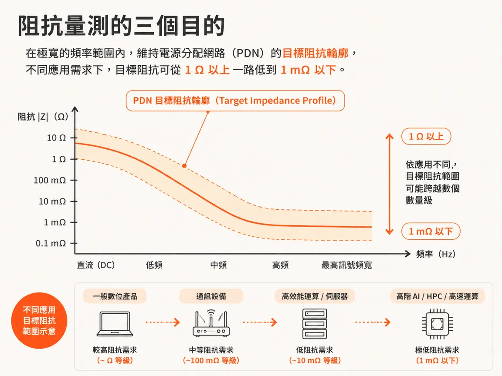
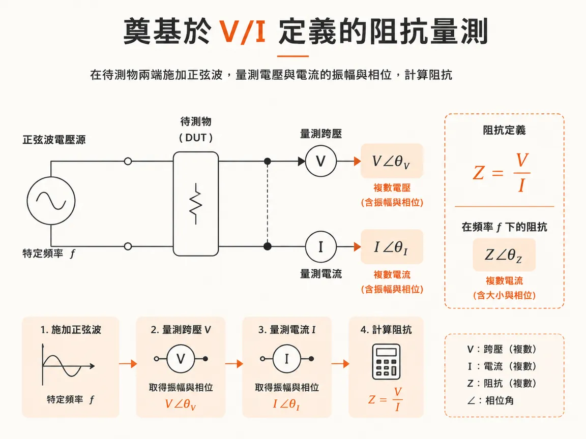
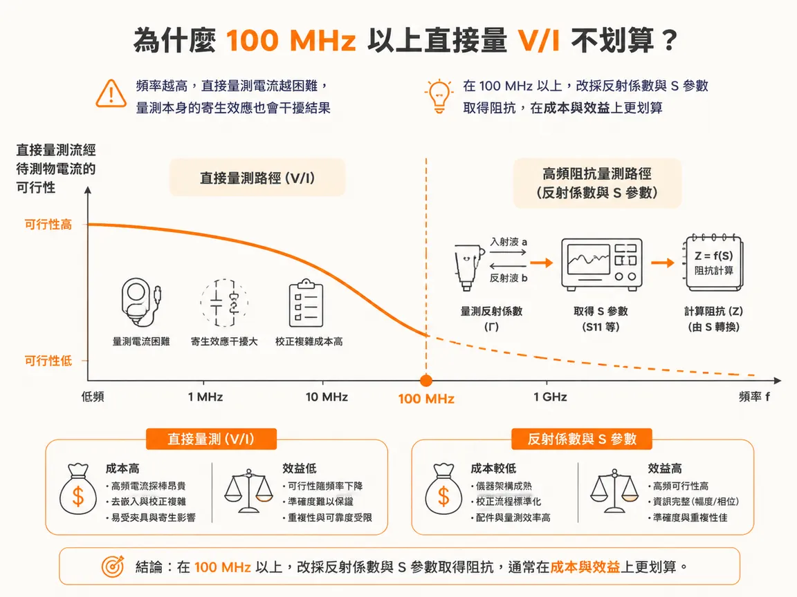

# 為什麼要量測低阻抗？從量測的三大目的到 V/I 定義的頻率極限

在高速數位產品中，電源分配網路（PDN）設計的核心，是在極寬的頻率範圍內——從直流（DC）一路延伸到最高訊號頻率的頻寬——維持特定的目標阻抗輪廓（target impedance profile）。依據應用場景不同，目標阻抗可能從 1 Ω 以上，一路壓低到某些嚴苛應用下的 1 mΩ 以下。

在規劃每個 PDN 零件與整個系統時，模擬分析是不可或缺的一環。然而，實際量測系統組件並將數據回頭與模擬校對（correlation），重要性完全不亞於模擬本身。

## 阻抗量測的三個目的

量測在 PDN 開發流程中扮演三個關鍵角色：

1. **驗證實體零件的效能規格**：確認製造出來的實際元件確實符合原本要求的規格。
2. **驗證模擬工具與建模流程的準確度**：除了檢驗工具本身算得準不準，也確認將實體電路轉換為模擬環境的建模流程有沒有失真。
3. **作為整體系統的最終檢驗與除錯工具**：確認整個 PDN 的實際阻抗是否已足夠接近目標阻抗；如果未達標，量測數據便是大幅加速除錯流程的核心依據。

在工程實務上，這項任務相當棘手：不僅要量出低至 1 mΩ 的超低阻抗，而且量測頻率往往還需要一路延伸到 1 GHz 以上。

## 奠基於 V/I 定義的阻抗量測

雙端元件阻抗最基本的一個定義，就是兩端的跨壓與流經電流的比值。電路模擬中的阻抗分析功能，以及低頻下量測元件阻抗的儀器，基本上都建立在這種 V/I 定義之上。

具體做法是：在待測物（DUT）兩端施加特定頻率的正弦波電壓，並同時量測流過待測物的電流振幅與相位。阻抗的計算方式如下：

- $Z(f)$ 為待測物的阻抗
- $V(f)$ 為量測到的跨端複數電壓
- $I(f)$ 為流經待測物的複數電流

跨端電壓與流經電流的比值，連同彼此的相位差，就構成了待測物在該頻率下的阻抗。許多入門級的阻抗分析儀，內部運作正是採用這套邏輯：由正弦波電壓源驅動訊號，再量測流過待測物的電流。

## 為什麼 100 MHz 以上直接量 V/I 不划算？

這種量測方式在頻率升高時會遇到瓶頸。它的頻率上限，取決於實務上直接量測「流經待測物電流」的最高可用頻率。

隨著頻率進入射頻範圍，直接在電路上準確擷取電流變得極為困難，量測電路本身的寄生效應也會嚴重干擾結果。當頻率超過 100 MHz 時，硬要直接量測電流並用 V/I 計算阻抗，儀器架構與校正成本都會大幅暴增。因此在 100 MHz 以上的頻段，改採其他阻抗定義（例如透過高頻反射與 S 參數等方式）來取得阻抗，在成本與效益上通常划算許多。

