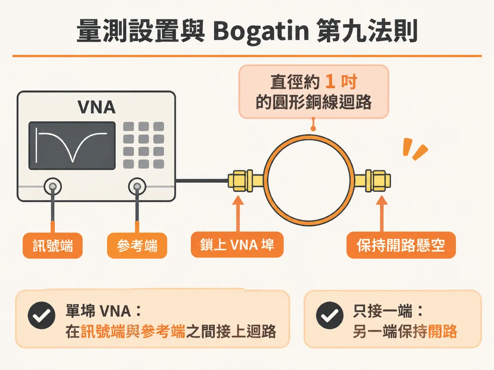
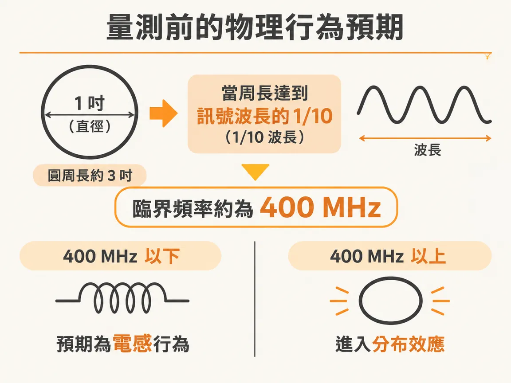
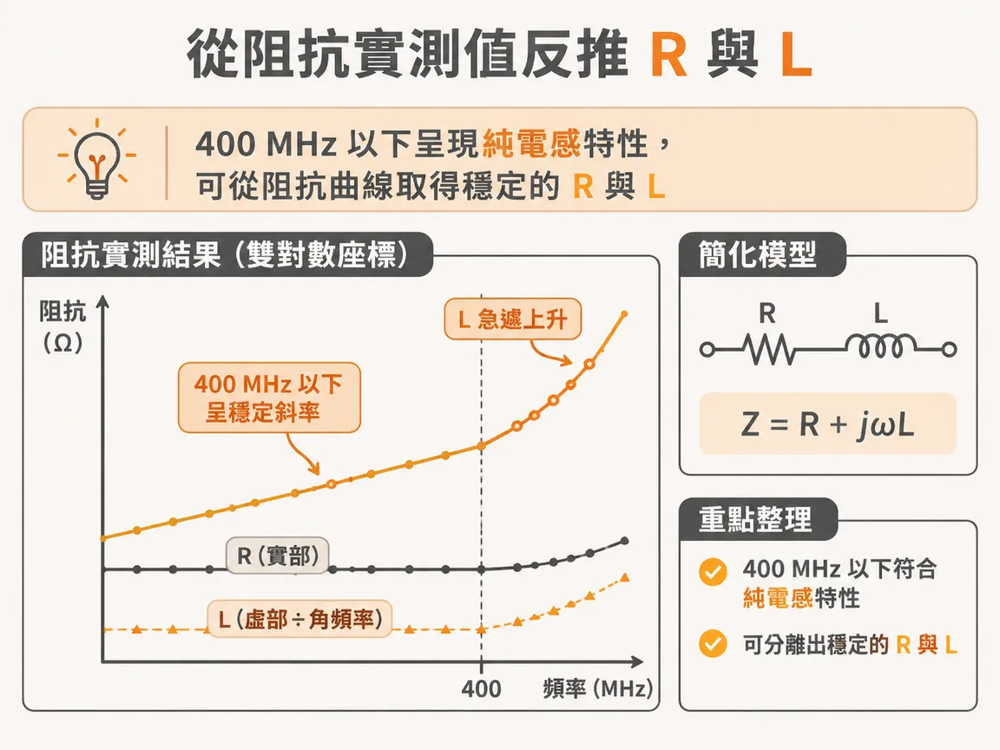

# 以單埠 VNA 量測 1 吋銅迴路阻抗：預期 R+L 行為與反推參數

評估電源分配網路（PDN）或高頻電路的寄生元件時，通常需要量測微小導線或金屬結構的阻抗。
向量網路分析儀（VNA）能精準量測待測物（DUT）的高頻阻抗。
如果量測前沒有先建立物理預期，螢幕上的曲線很容易淪為難以判讀的雜訊或假象。

以一個直徑約 1 吋的微型銅線迴路為例。
先從結構尺寸預估電氣特性，再利用單埠 VNA 的反射損耗（return loss，即 S11 的振幅與相位），便能反推等效電阻與電感。

## 量測設置與 Bogatin 第九法則

量測配置是將一個直徑約 1 吋的圓形銅線迴路，接在單埠 VNA 的訊號端與參考端之間。
迴路兩端雖然各焊了一個 SMA 接頭，但量測時只把其中一端鎖上 VNA 埠，另一端保持開路懸空。

把量測到的反射損耗轉成阻抗之前，必須先遵循一項工程準則——Bogatin 第九法則（Bogatin’s Rule #9）：

> 絕不在沒有預期結果前就動手做量測或模擬。
> 如果出現意料之外的結果，不是直覺有誤，就是量測或模擬的設定和預想不同。
> 不管是哪一種，找出兩者的差異都非常關鍵。
> 只要結果符合預期，就能確定自己正在掌握真實物理現象，這對建立工程信心至關重要。

## 量測前的物理行為預期

將數據換算為阻抗前，需先推估銅線迴路的物理表現。

在低頻段，閉合的金屬迴路本質上就是一個電感。
訊號波長一旦縮短至接近迴路的實體尺寸，集中參數模型就會失效。
直徑 1 吋的圓形迴路，圓周長大約是 3 吋。
迴路周長達到訊號波長的十分之一（1/10 波長）時，集中參數模型便不適用。
這個臨界頻率大約是 400 MHz。

在 400 MHz 以下的頻段，可以做出兩點預期：
1. 迴路阻抗呈現理想電感特性，阻抗大小（Z）在低頻時極低，隨頻率線性增加。
2. 串聯電阻（R）非常小，且可能因為集膚深度（skin depth）隨頻率升高而略微變大。

## 從阻抗實測值反推 R 與 L

利用反射損耗換算出的待測物阻抗，在 400 MHz 以下確實符合純電感的斜率。
把這個結構簡化為理想電阻與理想電感的串聯模型，阻抗公式如下：

阻抗 Z 等於串聯電阻 R 加上虛數單位乘上角頻率與電感的乘積（Z = R + jωL）：
- Z 為待測物的總阻抗。
- R 為銅迴路的串聯電阻。
- ω 為角頻率（2π × 頻率）。
- L 為迴路的等效電感。

在各個頻率點，只要利用阻抗的實部與虛部，就能透過基本代數拆解出 R 與 L：
- 電阻 R 等於阻抗實部（Re(Z)）。
- 電感 L 等於阻抗虛部除以角頻率（Im(Z) / ω）。

計算出的電感值在 400 MHz 以下維持恆定。
頻率超過 400 MHz 後，萃取出的電感值迅速飆升，符合尺寸大於十分之一波長時的分布參數效應（distributed effects）。

## 數據背後的三個關鍵疑問

萃取出的 R 與 L 數據延伸出三個關鍵問題：
1. 量到的電感值中，有多少來自銅迴路本身，又有多少來自未校正的 SMA 治具接頭？
2. 電阻隨頻率上升的現象，是否確實源自集膚深度效應？
3. 阻抗低於約 0.1 Ω 時，為什麼萃取出的數據會出現明顯雜訊與劇烈跳動？

單埠 VNA 量測高頻阻抗相當方便。
量測極低阻抗（如小於 0.1 Ω）的待測物時，容易受限於儀器動態範圍與治具接觸阻抗，因而產生量測假象（artifacts）。
掌握這類儀器限制，是正確解讀實測數據的必要條件。
