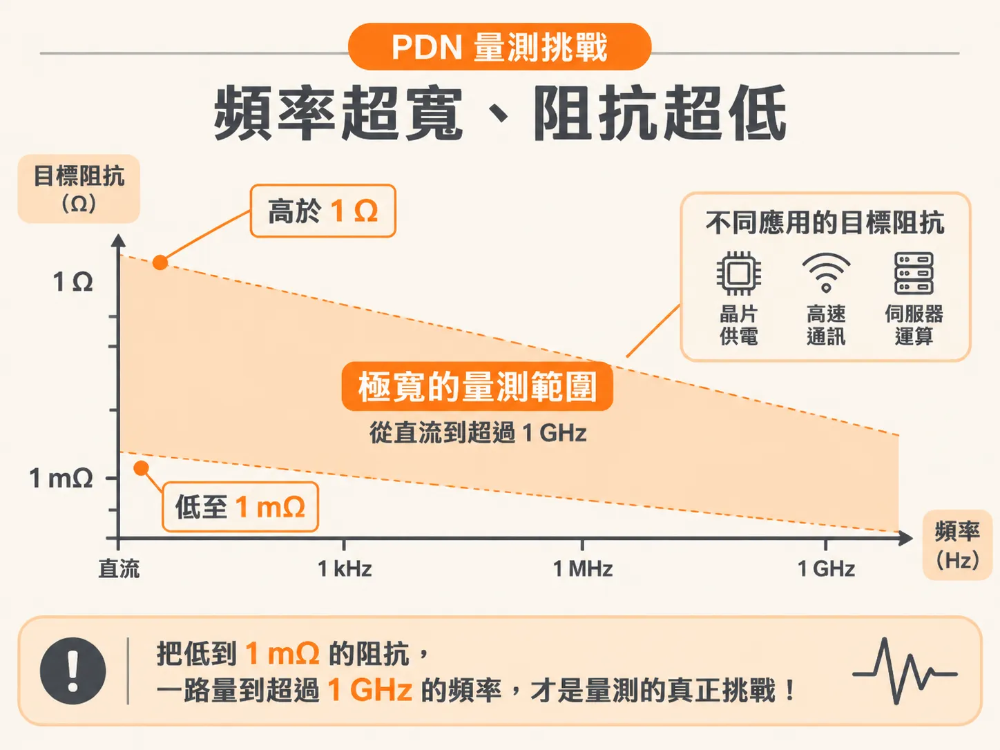
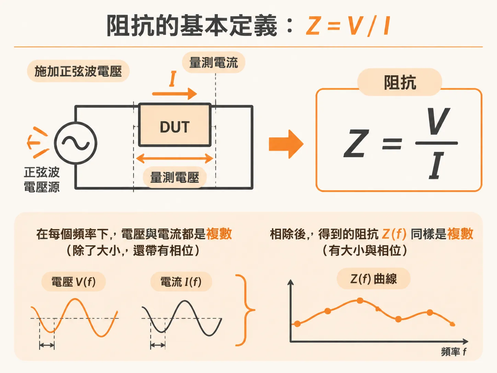
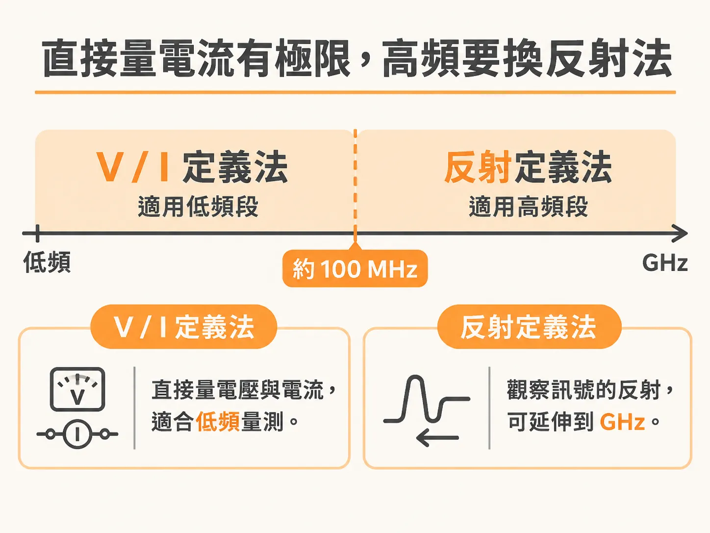

# 為什麼要量測低阻抗？

模擬跑完了，PDN 的阻抗曲線每一處都壓在目標阻抗線之下，看起來很安全。但曲線是算出來的，板子是做出來的。電容裝上去之後實際剩多少電感、佈局有沒有照設計規則走，這些問題只有一個答案來源：量測。

## 設計目標是一條很寬的頻率曲線

穩健的電源分配網路（PDN，power delivery network）設計，是在對一條「目標阻抗」曲線做設計。目標阻抗（target impedance）是允許出現的最大阻抗，頻率範圍從 DC 一直延伸到最高頻訊號的頻寬。

不同應用的目標阻抗差異極大。有的應用高於 1 Ω 就夠用；有的應用要壓到 1 mΩ 以下。1 mΩ 是非常小的數字：一根導線、一個接觸點的電阻都比它大。所以量測要能分辨的不是歐姆級的差異，而是毫歐姆級的差異。

頻率那端也一樣。曲線要畫到最高頻訊號的頻寬，量測就得跟上。把兩端合起來看，這個領域的量測挑戰就是一句話：把低到 1 mΩ 的阻抗，一路量到超過 1 GHz 的頻率。

## 量測的任務：驗零件、驗模型、驗整條鏈

模擬是分析流程裡不可少的一部分。量測的重要性一點也不低，而且同時扮演幾個角色。

第一，驗證做出來的零件符合規格。第二，驗證模擬工具本身夠不夠準，還有「把實體設計轉成模擬環境」這個流程有沒有做對。模型再漂亮，轉檔或建模的過程有偏差，模擬結果就不可信。這只有量測看得出來。

第三，也是最終的檢查：整個 PDN 生態系合起來的總結果，是不是貼近目標阻抗。這是製造完成後的總驗收。量出來不符合時，量測就是加快 debug 的工具：先找出哪一段對不上，再回頭修。

## 阻抗的第一個定義：Z = V/I

「量阻抗」到底是在量什麼？回到最根本的定義。對一個兩端元件，阻抗等於跨在它兩端的電壓，除以流過它的電流。

在頻域做這件事：對待測物（device under test，DUT）施加某一個頻率的正弦波電壓，量出流過它的電流的振幅與相位。每個頻率點都這樣做，就得到一條 Z(f) 曲線。V(f) 與 I(f) 都是複數——除了大小，還帶著相位——所以相除得到的 Z(f) 也是複數。

為什麼一定要管相位？因為電容與電感的電壓電流不同相。阻抗的實部對應電阻行為，虛部對應電抗行為。只記大小、丟掉相位，等於把「這一段是容性還是感性」的資訊丟掉了。

## 低階阻抗分析儀就是這樣做的

這個定義不只是理論。很多低階阻抗分析儀就是照它做的：正弦波電壓源驅動待測物，量出流過它的電流。跨壓除以電流、連同相位一起看，就是待測物的阻抗。電路模擬裡的阻抗分析，以及低頻量測元件阻抗，同樣建立在這個定義上。

## 天花板：直接量電流的極限

V/I 這條路有一個明確的天花板：你能直接量到電流的最高實用頻率。頻率越高，要直接抓出流過待測物的電流就越困難。

實務上的分界點大約在 100 MHz。超過這個頻率，阻抗有另一種定義可用：不直接量電流，而是看訊號的反射。這條路線能把量測推到非常高的頻率。

把範圍合起來看：低頻用 V/I 的定義直接量，過了 100 MHz 左右交棒給反射定義，一路推到 GHz；阻抗下限則要能分辨 1 mΩ 等級。
