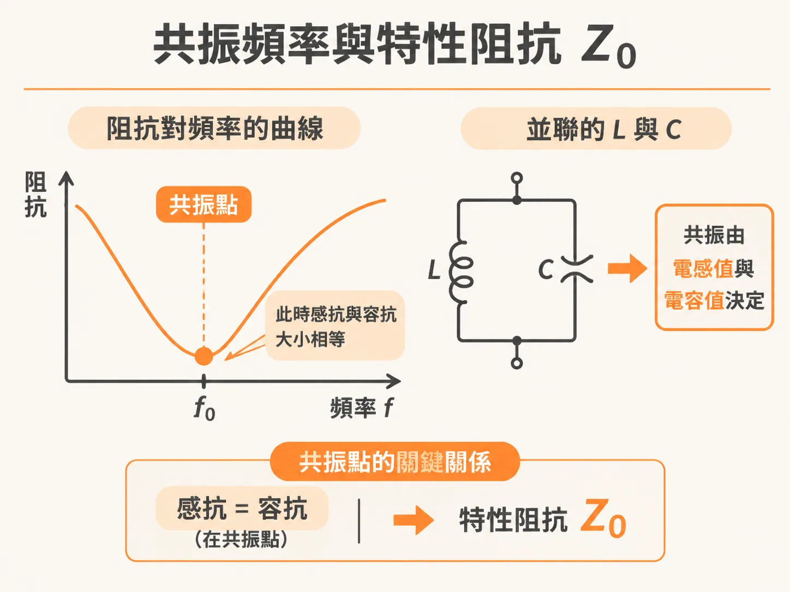
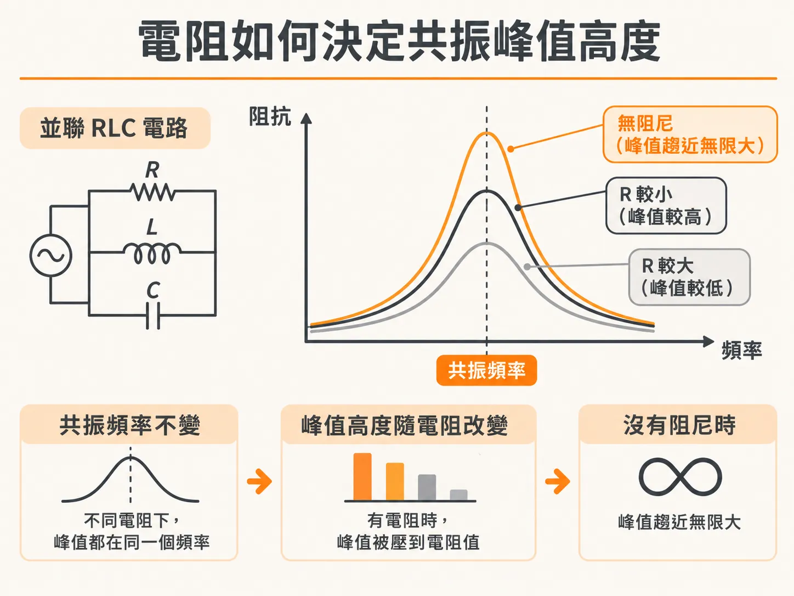

# 並聯 RLC 電路的共振頻率、特性阻抗與峰值阻抗

在高速數位系統的電源完整性（PDN）設計中，電路常會出現由電感與電容形成的諧振架構。無論是串聯還是並聯 RLC 電路，工程師在評估阻抗曲線時，主要關注三個關鍵特徵：

- 共振頻率（Resonant frequency）
- 共振時的最小或最大阻抗值
- 阻抗波谷（dip）或波峰（peak）的頻寬與寬廣程度

阻抗曲線出現極小值或極大值的位置，分別對應串聯共振頻率（SRF）與並聯共振頻率（PRF）。這兩個頻率都直接由電路中的電感值 $L$ 與電容值 $C$ 決定。

## 共振頻率與特性阻抗 $Z_0$

在共振點上，感抗與容抗的大小相等。求解角頻率 $\omega$ 與共振頻率 $f$ 的關係式為：

$$\omega = \frac{1}{\sqrt{LC}}$$

$$f = \frac{1}{2\pi\sqrt{LC}}$$

在計算工程參數時，若電感 $L$ 以奈亨（nH）為單位、電容 $C$ 以奈法（nF）為單位，即可快速換算出共振頻率。

共振發生時，感抗或容抗的絕對值大小被稱為該電路的「特性阻抗」（characteristic impedance），記作 $Z_0$：

$$Z_0 = \sqrt{\frac{L}{C}}$$

需要特別注意的是，RLC 電路裡的特性阻抗 $Z_0$，純粹是描述該 RLC 電路本身電抗特性的數值，與均勻傳輸線（transmission line）的特性阻抗概念完全無關，兩者不能混為一談。

## 電阻如何決定共振峰值高度

電路中的電阻元件，在共振頻率處扮演著決定阻抗大小的關鍵角色。

如果電路中完全沒有電阻帶來的阻尼（damping），並聯電路的阻抗峰值會趨近無限大，而串聯電路的阻抗極小值則會趨近於零。電阻所提供的阻尼效果，正是讓這些極值拉離極端狀態的主要機制：

- **串聯 RLC 電路**：在串聯共振頻率（SRF）下，感抗與容抗剛好互相抵消，整體的串聯阻抗最小值就等於電阻值 $R$。
- **並聯 RLC 電路**：在並聯共振頻率（PRF）下，感抗與容抗同樣互相抵消，此時電路的阻抗達到最大值（峰值），而這個最大峰值的高度正好就是並聯電阻值 $R$。

因此，在並聯 RLC 電路中，只要知道電感與電容，就能決定共振發生的位置與特性阻抗 $Z_0$；而要控制共振峰值究竟會衝到多高，關鍵就在於並聯電阻 $R$ 的阻尼大小。
