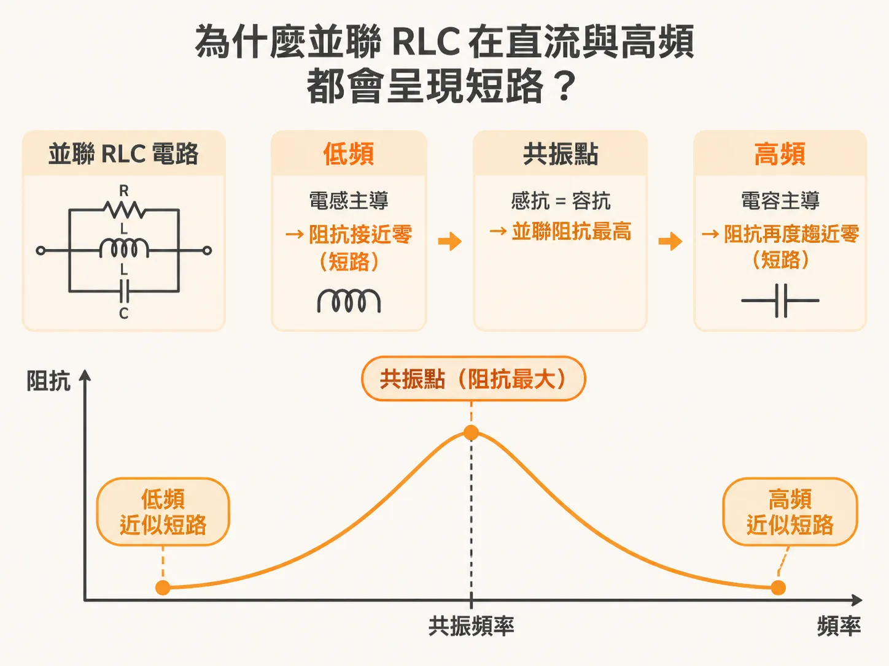
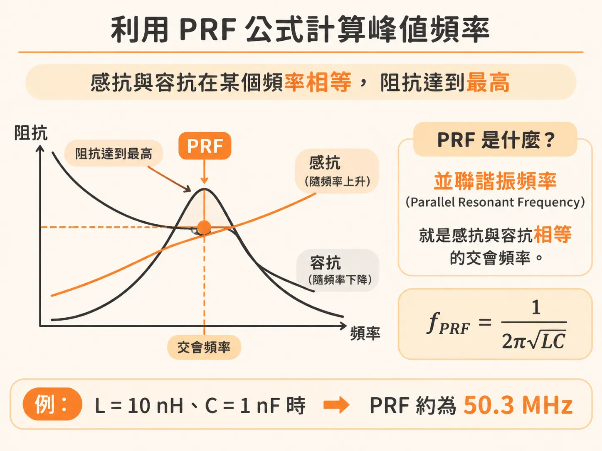

# 並聯 RLC 電路的阻抗行為與並聯諧振頻率計算

在高速數位電路的電源分配網路（PDN）設計中，阻抗曲線如果出現過高的峰值，往往會引發嚴重的電壓漣波與雜訊問題。要掌握這些峰值的成因，最實用且關鍵的基礎就是並聯 RLC 電路模型。

## 為什麼並聯 RLC 在直流與高頻都會呈現短路？

在理想的並聯 RLC 電路中，電阻（R）、電感（L）與電容（C）三個元件彼此並聯。如果以一組常見的數值為例（電阻 1 kΩ、電感 10 nH、電容 1 nF），它的阻抗隨頻率變化的行為可以分成低頻、高頻與共振點三階段來理解：

- **低頻階段（直流短路）**：在低頻時，整個電路的阻抗完全由並聯的電感主導。對於直流（DC）訊號而言，理想電感的阻抗為零，相當於直接短路；隨著頻率逐漸上升，電感的阻抗才會跟著增加。
- **高頻階段（高頻短路）**：到了高頻時，電容的阻抗會隨著頻率增高而持續下降，並主導整個電路的行為。當頻率極高時，電容的阻抗趨近於零，電路再度形同短路。

因為直流時電感把訊號短路到地，極高頻時電容又把訊號短路到地，整個並聯架構的阻抗只會在某個特定的中間頻率衝上最高點。

## 並聯諧振峰與電阻的阻尼角色

當頻率從低頻往高頻移動時，電感的感抗會不斷增加，而電容的容抗則不斷減少。當這兩個數值剛好相等時，電感與電容的並聯阻抗會達到最大值。

這個阻抗最高點稱為「並聯諧振峰（parallel resonant peak）」。如果電路中只有 L 與 C 並聯，理論上在諧振點的阻抗會變成無限大。在實際架構中，因為有並聯電阻 R 的存在，整體的最高阻抗就會被限制在電阻值本身，電阻在此扮演了抑制、阻尼（damp out）諧振峰值的重要角色。

## 利用 PRF 公式計算峰值頻率

這個讓感抗與容抗完全匹配、阻抗達到最高的頻率，稱為並聯諧振頻率（Parallel Resonant Frequency, PRF）。它的數學條件與串聯諧振頻率相同，基本公式為：

PRF = 1 / (2π × √(L × C))

其中各參數的基本單位如下：
- PRF：頻率，單位為赫茲（Hz）
- L：電感值，單位為亨利（H）
- C：電容值，單位為法拉（F）

在高速數位與電源設計實務上，使用奈亨（nH）與奈法（nF）換算成百萬赫茲（MHz）會更加方便。若以上述範例的數值代入：電感 L = 10 nH、電容 C = 1 nF，算出的 PRF 正好是 50.3 MHz。在這個頻率點上，電路的阻抗會達到最高峰值，大小受限於 1 kΩ 的並聯電阻。

在設計 PDN 阻抗特性曲線時，曲線中冒出來的阻抗峰值幾乎都是由並聯 RLC 電路特性所產生的。只要理解電感、電容決定了峰值頻率位置，而電阻決定了峰值高度，就能在電路佈局中主動調整元件參數，壓低阻抗峰值，確保電源品質穩定。
