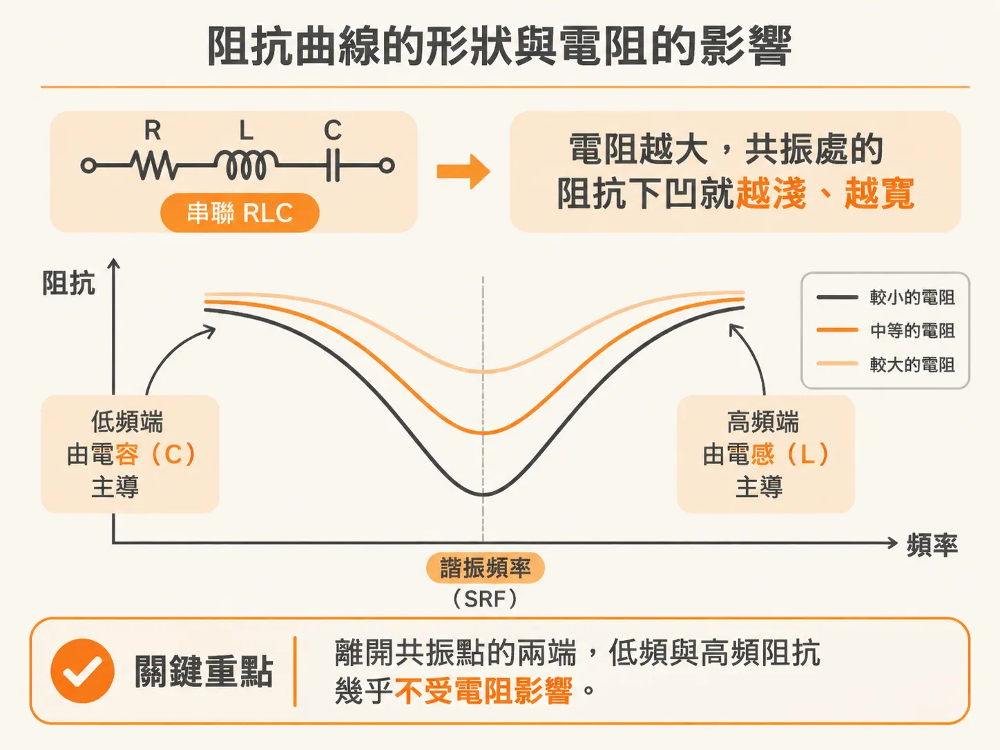
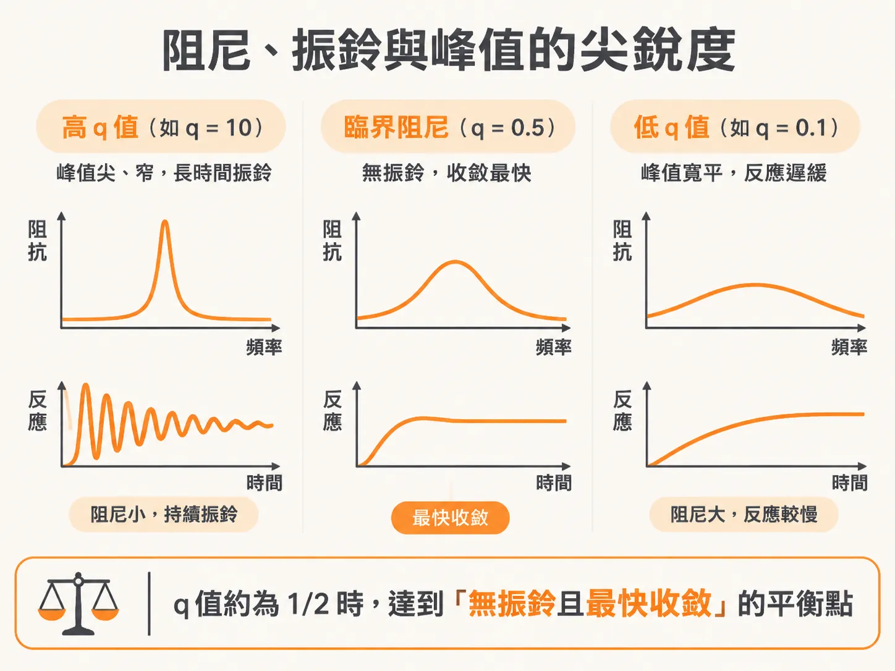
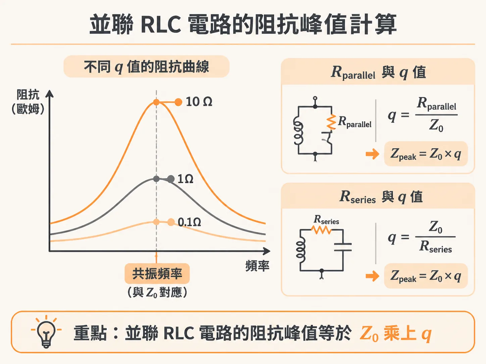

# 從特性阻抗與 q-factor 掌握諧振峰形狀與阻抗峰值

在電源分配網路（PDN）設計中，我們經常需要在阻抗曲線上觀察諧振造成的劇烈變化。有時曲線會出現尖銳高聳的突波，有時則是深陷的谷底。這些諧振峰究竟會有多尖銳？電源上的電壓或電流會因此振鈴多長時間？阻抗的極值又該如何計算？掌握特性阻抗與品質因數（q-factor），就能快速評估並解決這些問題。

## 阻抗曲線的形狀與電阻的影響

在一個串聯 RLC 電路中，當頻率遠離自諧振頻率（SRF）時，阻抗表現非常單純：低頻段完全由電容（C）主導，高頻段則完全由電感（L）主導。

真正產生變化的位置在諧振頻率附近。此時電路的阻抗大小主要取決於串聯電阻（Rseries）。當電阻值增加時，SRF 處的最小阻抗值會隨之上升，原本深陷的阻抗下凹（dip）變得較淺，視覺上也顯得較為平緩寬闊；但兩端極端頻率下的阻抗數值，幾乎不受電阻變化的影響。

阻抗曲線的形狀與相位之間存在著密切的關聯，這是 Kramers-Kronig 關係所導致的結果。阻抗曲線呈現平坦、數值幾乎保持恆定（行為類似理想電阻）的頻率範圍越寬，電路的相位就越接近理想電阻的 0 度。

## 什麼是 q-factor？

阻抗曲線的形狀並不只由串聯電阻決定，電感與電容的數值也扮演關鍵角色。在電路分析中，用來描述相對電阻大小及其對諧振影響的指標稱為「品質因數」（q-factor，或簡稱 quality）。

一般文獻有時會用大寫字母 Q 來表示，但為了避免與電容器所儲存的電荷量 Q 混淆，在電源完整性領域中更習慣使用小寫的 q-factor。

在諧振電路中，q-factor 具有多重物理意義：
1. 它是電路的「特性阻抗」（Z0）與「阻尼電阻」的比值。
2. 它也是「諧振頻率」與「半值全寬頻寬」（在阻抗最大值或最小值一半處所涵蓋的頻率跨度）的比值。

在串聯 RLC 電路中，特性阻抗 Z0 是電容抗與電感抗大小相等時的交會點數值，計算方式為：

Z0 = √(L / C)

而串聯電路的 q-factor 計算公式則是：

q = Z0 / Rseries = √(L / C) / Rseries

舉例來說，若電路的 L = 10 nH、C = 10 nF，特性阻抗 Z0 即為 √(10 nH / 10 nF) = 1 Ω。當串聯電阻 Rseries 為 1 Ω 時，q-factor 恰好為 1。如果將電阻分別設為 0.1 Ω、1 Ω 與 10 Ω，對應的 q-factor 就會分別是 10、1 與 0.1。

## 阻尼、振鈴與峰值的尖銳度

q-factor 本質上是系統阻尼大小的相對度量：
- **高 q-factor 系統（如 q = 10）**：系統阻尼極小，在諧振頻率下，每個振盪週期僅損失極小比例的儲存能量。此時電路在時域中會持續振鈴（ringing）很長一段時間，反映在頻域阻抗曲線上，就是一個又尖又窄的下凹或尖峰。在串聯電路中，這種時域振鈴表現在電流上。
- **低 q-factor 系統（如 q = 0.1）**：系統阻尼很大，儲存的能量在每個週期迅速耗散，時域振鈴很快就停下來，阻抗曲線的下凹則寬而平緩。
- **臨界阻尼（q = 0.5）**：當 q-factor 為 1/2 時，系統處於臨界阻尼狀態。這是在「無振鈴」前提下收斂速度最快（settling time 最短）的完美平衡點。q 值高於 1/2 會產生振鈴，低於 1/2 則會讓電路反應變得遲緩。

在串聯 RLC 電路中，諧振時的最低阻抗就等於 Rseries。利用特性阻抗與 q-factor，兩者的關係可以改寫為：

Rseries = Z0 / q

這說明了為什麼高 q-factor 電路的下凹看起來特別尖深：因為最低阻抗遠小於電路的特性阻抗。

## 並聯 RLC 電路的阻抗峰值計算

同樣的分析方法完全適用於並聯 RLC 電路。在並聯諧振時，阻抗會向上衝出一個尖峰，而時域中的振鈴則表現在電壓上。

並聯諧振的阻抗峰值（Zpeak），同樣由特性阻抗 Z0 與 q-factor 決定：
- **若阻尼電阻與 L、C 並聯（Rparallel）**：
  此時電路的 q-factor 為 Rparallel / Z0，因此諧振時的峰值阻抗即為：
  Zpeak = Rparallel = Z0 × q
- **若阻尼電阻是串聯在電容或電感端（Rseries）**：
  電路的 q-factor 為 Z0 / Rseries，這時換算出的等效峰值阻抗公式為：
  Zpeak = (Z0^2) / Rseries = Z0 × q

延續前面的數值設定，若並聯電路的 L = 10 nH、C = 10 nF，特性阻抗同樣是 Z0 = 1 Ω。當 q-factor 分別為 0.1、1 與 10 時，並聯諧振的峰值阻抗就直接對應為 0.1 Ω、1 Ω 與 10 Ω。

## PDN 設計中的工程應用

在設計高鐵速數位產品的電源分配網路時，阻抗尖峰往往會導致嚴重的電源漣波與雜訊，因此抑制並聯諧振峰的高度是核心目標。

要壓低並聯 RLC 電路的峰值阻抗，最有效的方法就是增加阻尼、降低 q-factor。在電路實作上，可以透過以下方式達成：
1. 增加電路的串聯電阻，或降低並聯電阻。
2. 將 q-factor 控制在接近 1 左右。也就是讓電阻值接近 RLC 電路的特性阻抗 Z0。要達到這點，工程上可以採用較大的電阻 R、較小的電感 L，或較大的電容 C。

評估 RLC 電路最重要的兩個指標就是特性阻抗 Z0 與 q-factor。只要記住「並聯電路的阻抗峰值約為 Z0 × q」以及「串聯電路的最低阻抗約為 Z0 / q」，就能在設計初期迅速掌握電路的尖銳程度與阻抗極限。
