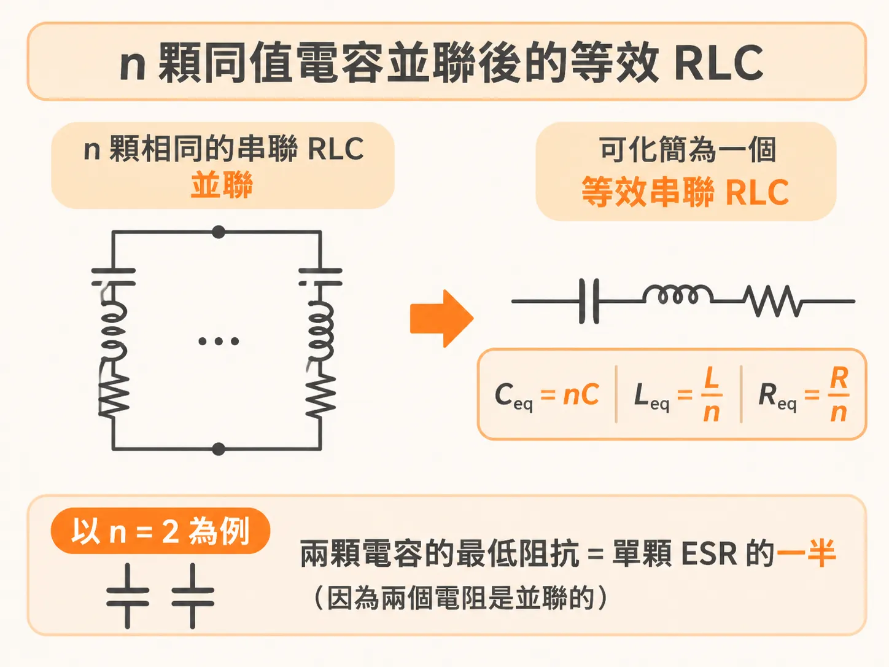
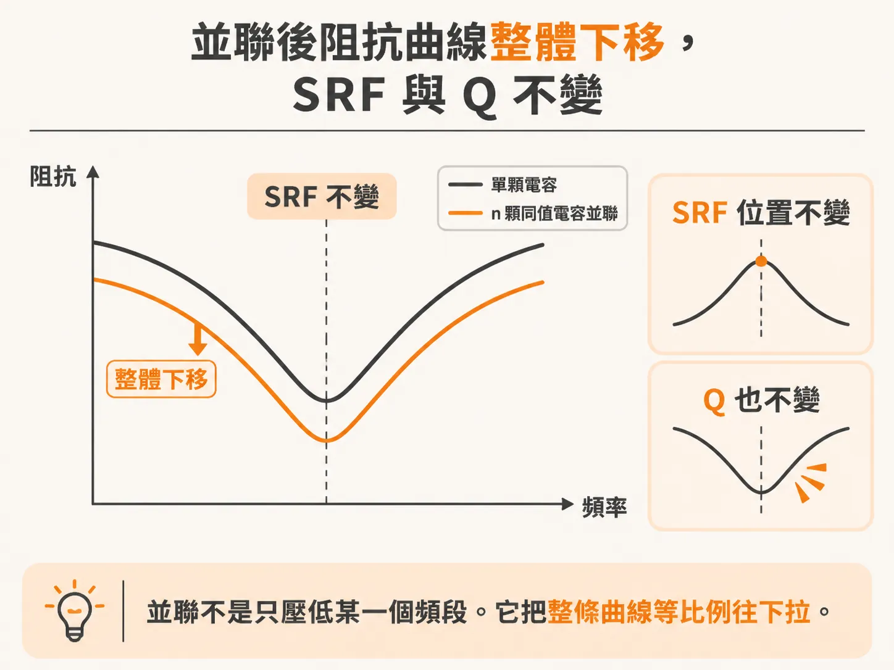
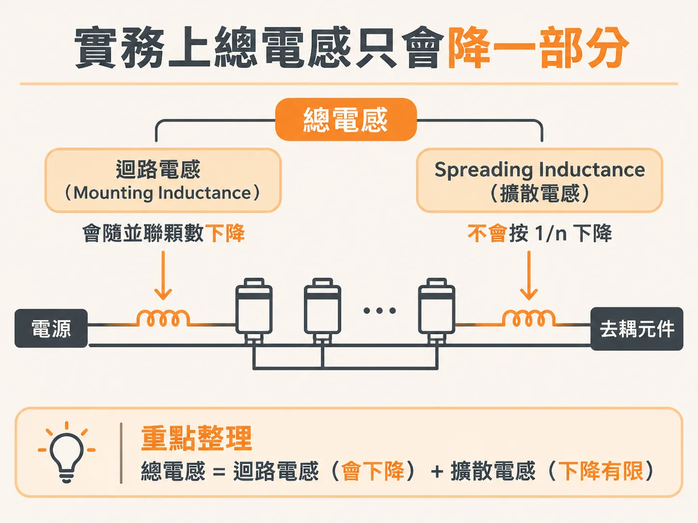

# 多顆同值電容並聯：阻抗縮小，SRF 與 q 不變

上一節把單顆電容的曲線拆成三段：谷的左邊看 C，谷底看 ESR，右邊看 ESL。順著這個谷往下問一個問題：同樣的電容再放一顆，曲線會變成什麼樣子？

在 PDN 上放一顆 0.1 µF 的電容，量到的阻抗曲線會在自振頻率之後往上爬。原因很簡單：真實電容不是只有電容，它還有串聯電感。

要壓低阻抗，最直覺的做法，是再放一顆一模一樣的電容。放 n 顆之後，等效的 C、L、R 會變成多少，要算清楚。哪些東西不會變，也要說清楚。

## 真實電容就是一個串聯 RLC

在大部分實務頻率下，一顆真實電容可以用三個理想元件串起來描述：電容 C、電感 L、電阻 R。

C 是等效電容，L 是等效串聯電感（ESL），R 是等效串聯電阻（ESR）。這三個值不是零件本身的大小，而是能讓串聯 RLC 的阻抗對上真實電容的那三個等效值。

這個串聯 RLC 的阻抗，低頻由 C 決定，往高頻由 L 決定。兩者大小相等的那個頻率，叫串聯自振頻率（SRF）。在 SRF 上，電容和電感的電抗互相抵消，阻抗只剩 R。所以 SRF 是整條曲線的最低點。

## n 顆相同電容並聯的等效值

把 n 顆完全相同的 RLC 並聯。低頻時，看到的是 n 個電容並聯，等效電容是原本的 n 倍。高頻時，看到的是 n 個電感並聯，等效電感是原本的 1/n。在 SRF 上，n 個電阻並聯，等效電阻是原本的 1/n。

用 C1、L1、R1 表示單顆的元素值，並聯後的等效值是：

- Cn = n × C1
- Ln = L1 / n
- Rn = R1 / n

用 n = 2 檢查最低阻抗：兩顆同值電容的 SRF 一樣，最低阻抗是單顆 ESR 的一半。因為兩個電阻是並聯的。

## 整條曲線往下縮，形狀不變

單顆電容的阻抗是 R1 + j(ωL1 − 1/(ωC1))。n 顆並聯，阻抗就是這個值除以 n。所以整條曲線在每一個頻率都縮小 n 倍，形狀完全一樣。

模擬 1 顆、2 顆、10 顆相同的 RLC 並聯，三條曲線形狀相同，只是每一段都往下移動。低頻段的等效電容變成 10 倍，高頻段的等效電感變成 1/10，SRF 上的最低阻抗變成 1/10。

並聯不是只壓低某一個頻段。它把整條曲線等比例往下拉。

## SRF 為什麼不變

SRF 由 L 和 C 決定：

SRF = 1 / (2π × √(L × C))

把 Ln 和 Cn 代進去，先看根號裡面：

Ln × Cn = (L1 / n) × (n × C1) = L1 × C1

乘積不變，開根號後也不變，所以 SRF 不變。L 小了 n 倍、C 大了 n 倍，兩者的效果剛好互相抵消。

## q 為什麼不變

q 值（q-factor）描述 SRF 這個最低點有多尖：

q = (1 / R) × √(L / C)

把三個等效值代進去。先算 √(L/C)：

√(Ln / Cn) = √((L1 / n) / (n × C1)) = (1 / n) × √(L1 / C1)

再除以 Rn = R1 / n：

qn = (n / R1) × (1 / n) × √(L1 / C1) = (1 / R1) × √(L1 / C1) = q1

兩個 n 互相消掉，q 不變。

所以並聯 n 顆同值電容，SRF 和 q 都不動。得到的是同一條曲線，只是整條下移 n 倍。同值並聯也不會冒出並聯共振的峰值，因為那個新行為來自兩顆電容的 SRF 不同。

## 實務上，L 只降一部分

公式說 Ln = L1 / n。這個關係在等效電路裡成立，放到真實電路板要打折扣。

一顆電容的總電感有兩段來源。第一段是電容接上板子的迴路電感，也就是 mounting inductance。第二段是電源層和地層腔體裡的 spreading inductance，也就是從電容位置到被去耦元件之間那一段。

mounting inductance 確實會隨並聯數量下降。spreading inductance 不會按 1/n 下降。多顆電容的 spreading 怎麼合併，取決於它們在電源層和地層裡電流分布的重疊程度，關係比較複雜。

所以並聯多顆同值電容，是工程上壓低電感的一個重要手段。但模型給的 1/n 是理想值，實際板子上降得比較少。
