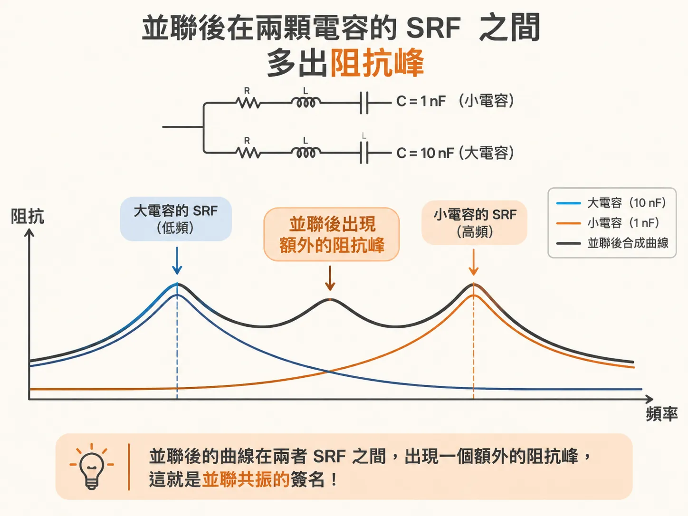
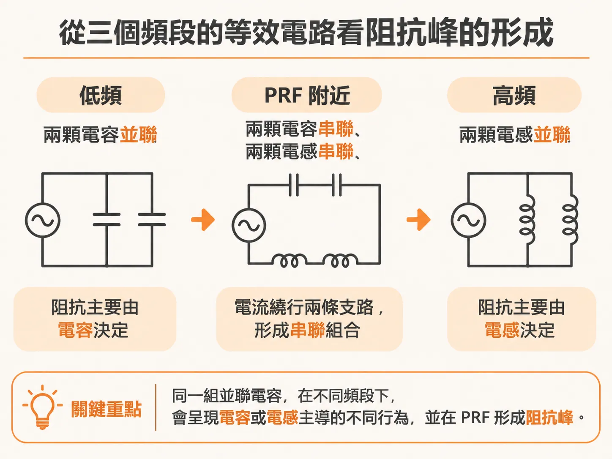
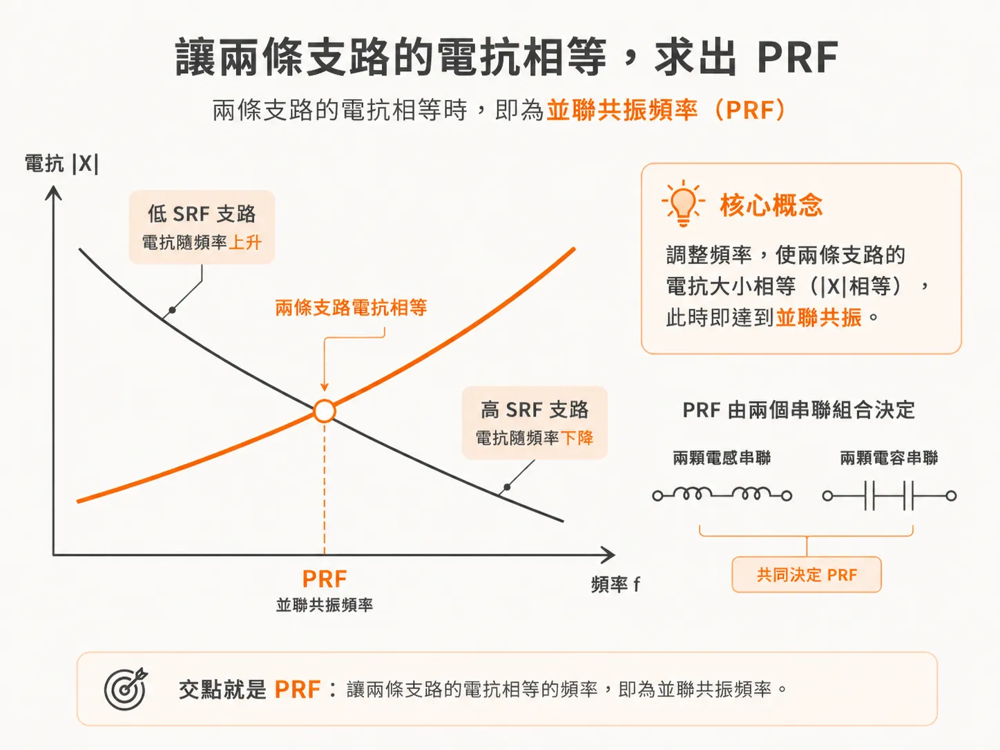

# 兩顆不同電容之間的並聯共振頻率

你把一顆 10 nF 和一顆 1000 nF 的電容並在 PDN 上。你預期阻抗曲線只是被壓低一段，結果兩條曲線之間冒出一根尖峰。

這根尖峰不是量測壞掉。它落在兩顆電容的 SRF（自共振頻率，阻抗最低的頻率）中間。位置可以用一條很簡單的式子算出來。

## 兩顆不同值，中間就多一根峰

兩顆相同值的電容並聯，曲線形狀不變，整條往下搬，SRF 也一樣。換成兩顆不同值，這件事就不成立。

模擬用 R = 0.01 Ω、L = 1 nH、C = 1 nF 與 C = 10 nF 兩條串聯 RLC 支路並在一起。大電容那條的 SRF 在低頻，小電容那條的 SRF 在高頻。合併後的曲線在兩個 SRF 之間出現一個阻抗峰。這就是並聯共振的簽名。

同一條曲線拆成三個頻段看，就清楚了：

- 低頻段，阻抗由電容主導。兩顆電容等於並聯，等效電容就是 C1 + C2。
- 高頻段，阻抗由電感主導。等效電感是兩顆電感的並聯值。
- 中間這一段是新的行為，也就是那根峰。

## 峰為什麼長在那裡

在並聯共振頻率（PRF，parallel resonant frequency）上，兩條串聯 RLC 支路仍然是並聯。電路被一個高阻抗定電流源激勵時，電流會在兩條支路之間來回跑。

量測點在電路中間，等於把這組並聯 RLC 推上共振，再量它產生的電壓。

共振時，電流繞著一個包含兩條支路的迴路跑。從這個迴路看，等效電容是兩顆電容的串聯，等效電感是兩顆電感的串聯。但從電流源的角度看，其中一部分等效電容與等效電感是並聯，於是形成並聯共振。

峰的成因可以用兩股作用解釋。低 SRF 那條支路一直想把總阻抗往上推，高 SRF 那條一直想把總阻抗往下拉。兩股力量交會的地方，就是阻抗最高點。

## 令 X1 = X2 解出 PRF

阻抗峰發生在兩條支路的電抗相等、而且交叉的地方。條件是：

X1 = X2

X1 是低 SRF 那條（大電容）支路的電抗，X2 是高 SRF 那條（小電容）支路的電抗。每一條支路的電抗都可以寫成 ωL 減掉 1/(ωC)：

X1 = ωL1 − 1/(ωC1)
X2 = ωL2 − 1/(ωC2)

在 PRF 上，大電容那條已經越過自己的 SRF，呈感性。小電容那條還在 SRF 之前，呈容性。兩者的電抗符號相反、大小相等，相加為零：

ωL1 − 1/(ωC1) + ωL2 − 1/(ωC2) = 0
ω(L1 + L2) = 1/(ωC1) + 1/(ωC2)

把 ω = 2πf 代回去，解出並聯共振頻率 PRF：

PRF = 1 / (2π × √( (L1 + L2) × C1·C2 / (C1 + C2) ) )

根號裡的兩項說明這條式子的意義。PRF 就是由「兩顆電感的串聯」和「兩顆電容的串聯」決定的共振。

符號對應如下：

- X1、X2：低頻 SRF 與高頻 SRF 兩條支路的電抗。
- L1、C1：大電容那一組的電感與電容，單位 nH 與 nF。
- L2、C2：小電容那一組的電感與電容，單位 nH 與 nF。
- PRF：並聯共振頻率，單位 MHz。

## 代入數字

兩條支路的電感都是 2 nH，小電容 10 nF，大電容 1000 nF。

串聯電感是 2 + 2 = 4 nH。串聯電容是 10 × 1000 / (10 + 1000)，大約 9.9 nF。把這兩個值代進式子，PRF 大約 25 MHz。

拿 L = 1 nH、C = 1 nF 與 C = 10 nF 那組曲線對照，模擬出來的峰正好落在式子預測的位置。你不需要先跑模擬才知道峰在哪。先把 PRF 算出來就夠了。

這根峰值得當成第一件事來看。並聯共振的峰是任何 PDN 最重要的特徵。只要板上有兩種值、SRF 不同的電容，兩者的 SRF 之間就會有 PRF。先算 PRF，再到曲線上看那個位置。你就不會把新長出來的峰誤認成別的東西。
