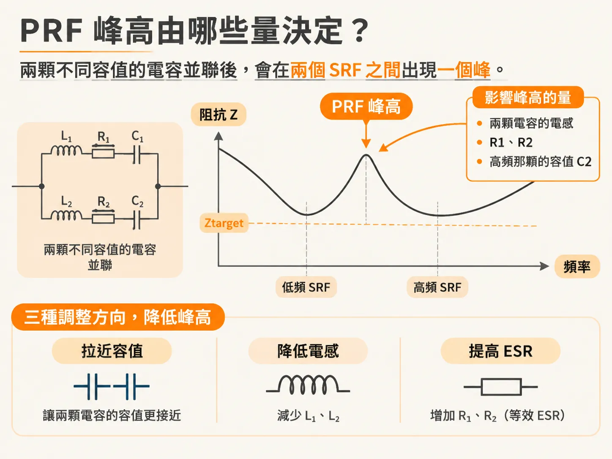
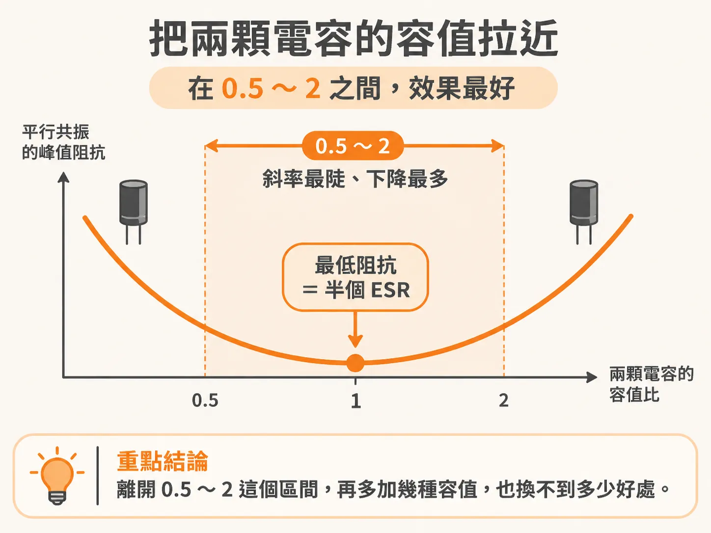
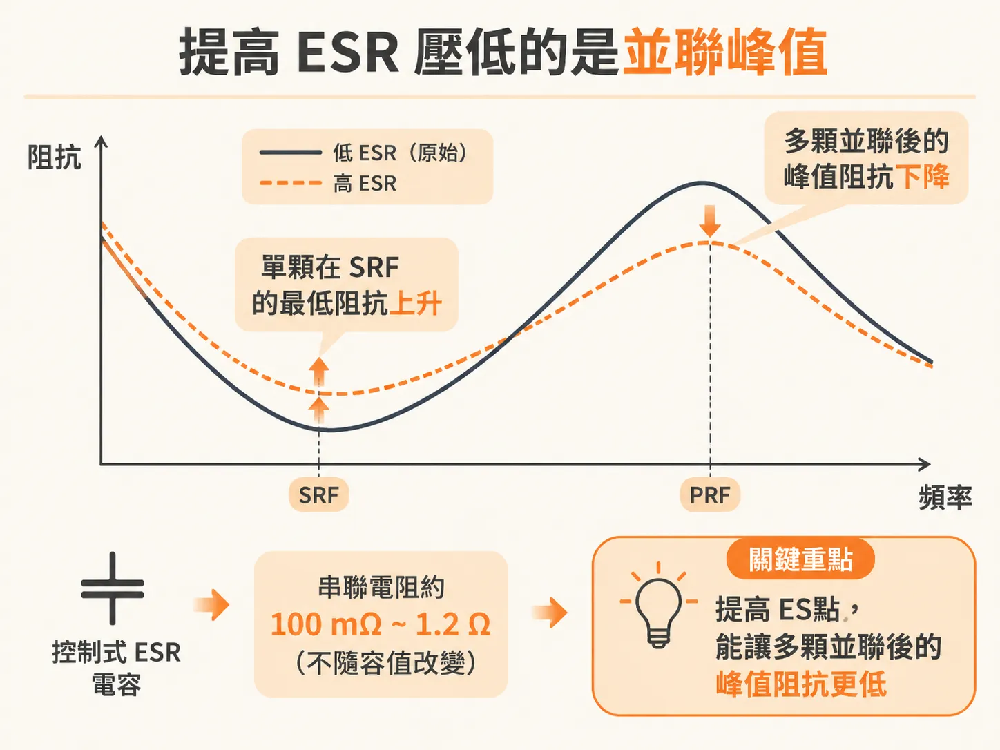
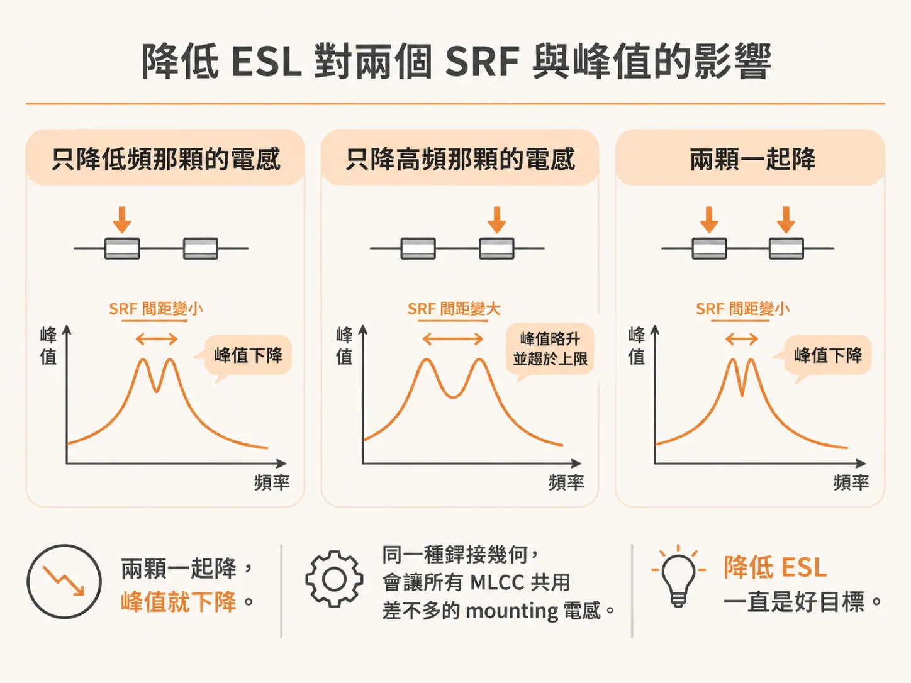

# PRF 處的峰值阻抗

上一節把 PRF 的位置算了出來，下一個問題是那根峰有多高。把兩顆容值不同的電容並聯在電源平面上，跑一次阻抗模擬：低頻段阻抗往下掉，高頻段阻抗也往下掉，中間卻冒出一個尖。這個尖卡在兩顆電容的 SRF 之間，高度可能超過目標阻抗 Ztarget，整條阻抗曲線就卡在這一點。

這個尖就是並聯共振。兩顆電容的 SRF 不同：一顆會把總阻抗往上抬，另一顆會把總阻抗往下壓，兩股力量在並聯共振頻率 PRF 交會。峰值有多高，決定這組電容能不能用。

峰值阻抗很難用解析式算準，但可以靠模擬看。當兩顆電容的容值差很大、ESL 相同時，峰值主要受幾個量支配：兩顆電容的電感、低頻那一顆的電阻 R1、高頻那一顆的電阻 R2，以及高頻那一顆的容值 C2。

這組關係直接指出三個可以調的槓桿：

- 把高頻那顆的容值做大，也就是把兩顆的容值拉近。
- 降低低頻那顆的等效串聯電感。
- 提高 R1 與 R2，也就是提高 ESR。

穩健的 PDN 設計，最重要的目標，是把每一個並聯峰都壓到 Ztarget 以下。做法不是去找一顆完美的電容，而是動這三個槓桿。

## 槓桿一：把容值拉近

用兩顆 RLC 並聯做掃描。
每顆的迴路電感固定 1 nH。
ESR 固定 50 mΩ。
一顆固定在 10 nF。
另一顆從 0.1 nF 掃到 1000 nF。
換算下來，兩顆的容值比從 1% 一路掃到 100 倍。
峰值阻抗的變化很清楚。

容值相同時，兩顆電容等於同一顆。
SRF 也一樣。
最低阻抗是單顆 ESR 的一半，因為兩個電阻並聯。
這是整條曲線上最低的一點。

比值偏離 1 之後，峰值就往上走。
而且兩側不對稱。
把第二顆做小，峰值升得很快。
把第二顆做大，峰值會停在一個上限。

拉近容值有效，但有效範圍有界。
曲線最陡、下降最多的一段，大約落在比值 0.5 到 2 之間。
離開這個區間，再多加幾種容值，也換不到多少好處。

這一點直接影響選料。
如果要「用最少的容值種類，換到最大的峰值下降」，就讓兩顆的容值落在彼此的兩倍之內。
兩倍之內換算成容值間隔，大約是每個 decade 三個值。

兩個前提要記住。
兩顆的 ESL 要接近。
上面的結論，是在 ESR 當常數、不隨容值改變的假設下得到的。

## 槓桿二：提高 ESR

ESR 提高，峰值下降。
模擬裡把 R1 或 R2 從 0.001 Ω 拉到 0.01 Ω，峰值就跟著往下走。
原因是並聯峰的高度，跟兩個串聯等效電阻的和有關。
電阻越大，阻尼越強。

真實電容比這個假設複雜一點。
容值小的電容，ESR 通常稍高。
這對「把容值拉近」的結論影響不大，因為兩顆容值接近時，ESR 也接近。
但如果兩顆差得很遠，C2 很小，實際的 ESR 反而會把峰值壓低。
壓低後的峰值，會比用常數 ESR 估的還低兩倍以上。
用常數 ESR 去估，在容值差很大時偏保守。

如果阻尼要靠 ESR，可以考慮控制式 ESR 電容。
這類電容的串聯電阻是設計出來的。
大約在 100 mΩ 到 1.2 Ω 之間。
而且不隨容值改變。
它帶來的好處，不是單顆在 SRF 的最低阻抗變高；那反而是缺點。
好處是多顆並聯之後的並聯峰變低。

## 槓桿三：降低 ESL

ESL 的影響，要看降哪一顆。
這裡容易搞錯。

只降 L1，也就是低頻那顆的電感：
它的 SRF 往高頻移動。
跟另一顆的 SRF 靠近。
峰值下降。

只降 L2：
第二顆的 SRF 往高頻移動。
兩個 SRF 反而分開。
峰值小幅上升。
最後趨於一個上限。

兩顆一起降，峰值就下降。
實務上這是最常見的情況。
同一種銲接幾何，會讓所有 MLCC 共用差不多的 mounting 電感。
降低 ESL 一直是好目標。

## 三個槓桿一起用

排在一起，順序就出來了。
先把容值拉進兩倍之內，換算成每個 decade 三個值。
再把 mounting ESL 壓低。
最後用 ESR 補阻尼。
三件事都做完，並聯峰才有機會全部落在 Ztarget 以下。

還有一個提醒。
標稱相同的電容，不同廠商的 ESR 可以差到三倍。
峰值對 ESR 這麼敏感，這個變異會直接反映在預測的峰值上。
要準，就量你實際要用的那顆。
不量，至少用「SRF 最低阻抗」對應的常數 R 去近似。
這個近似在 10 MHz 到 100 MHz 之間還不錯。
