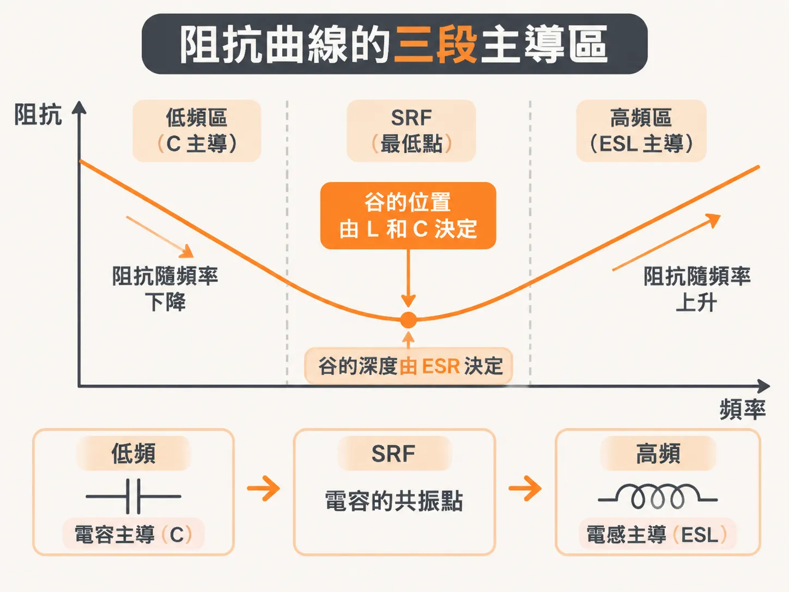
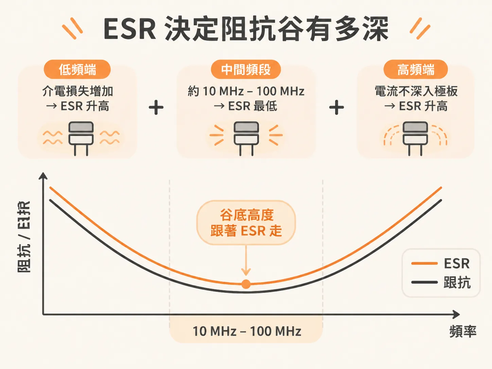
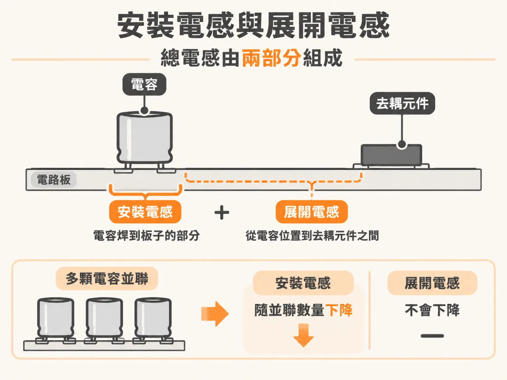

# 真實電容的等效電路模型

看 PDN 的阻抗曲線圖，一顆電容的曲線是一個谷形。理想電容的線一路往右下走：頻率越高，阻抗越低。真實 MLCC 焊上板子後，線先往下走、觸底，再往上爬。這個谷不是量測誤差，是真實電容的樣子。series RLC 能說明這個谷怎麼形成，以及 C、ESL、ESR 各決定哪一段。

## 真實電容只在很低頻才像電容

焊在板子上的真實電容，只在低頻表現得像理想電容。這個低頻遠低於 1 MHz。

大多數實務設計情況，一組簡單的理想 series RLC 電路就能準確描述真實電容。series RLC 是三個理想元件串在一起：電容 C、電感 L、電阻 R。

一顆焊在測試板上的 0603 MLCC，實測阻抗和理想 series RLC 的模擬曲線幾乎重合。真實電容複雜的阻抗行為，只靠三個理想元件就描述得很好。

## 三個元件各管一段

低頻時，阻抗由 C 決定。理想電容的阻抗隨頻率成反比下降，容量越大，阻抗越低。0.1 µF 的電容在 1 MHz 時，阻抗大約 1 Ω。

頻率往上升，L 的作用出現。電感的阻抗隨頻率上升。在某個頻率，C 和 L 的電抗互相抵消，阻抗只剩 R。這個頻率叫串聯自振頻率（series self-resonant frequency，SRF），也是曲線最低點。

過了 SRF，阻抗由 ESL 決定，隨頻率往上升。電容在高頻看起來像電感。

谷在哪個頻率，由 L 和 C 一起決定。谷有多深，由 ESR 決定。

## 谷底不會掉到零

series RLC 裡，阻抗的實部就是 R，不隨頻率變化。一階近似下，電容的 ESR 也是常數。在 SRF，阻抗最低值等於 ESR。谷底再低也有個底。

並聯也是同樣道理。n 顆完全相同的電容並聯，等效 C 變成 n 倍，等效 L 變成 1/n，等效 R 變成 1/n。SRF 不會移動，因為它由 L 和 C 的比例決定；兩邊同時縮放就抵掉了。

## ESR 決定谷有多深

ESR 來自兩個地方：電容裡一層層薄導體的串聯電阻，以及極板之間陶瓷材料的介電損失。

介電損失在低頻這一端比較明顯。它讓阻抗的實部往低頻升高。

導體損失在高頻這一端比較明顯。頻率越高，極板裡的電流越不願意離開基板的回流路徑，也越不容易深入到電容本體。這個情況和導體的集膚效應類似，所以阻抗的實部隨頻率上升。

兩股力量合起來，ESR 曲線變成兩頭高、中間低。最低點通常落在 10 MHz 到 100 MHz 之間。ESL 大約 1 nH 的電容，SRF 也差不多落在這段。

## 標稱一樣，ESR 可以差三倍

十五顆標稱完全相同的 100 µF、1210 MLCC，來自不同廠商，實測 ESR 從 0.003 Ω 到 0.01 Ω。差了三倍。

三倍不是小數目。峰值阻抗的預測直接受它影響。所以有兩條路：把可能用到的每顆電容都量過，把參數存進資料庫；或用一個常數 R 來近似。

常數 R 的取法是對上 SRF 谷底的阻抗值。這樣做，在 10 MHz 到 100 MHz 之間，常數 R 和隨頻率變化的 ESR 吻合得很好，整體阻抗曲線也沒有明顯差異。這個近似帶來的不準確，比零件之間本身的變異還小。

## ESL 是焊上去之後才算數

ESL 的定義要包含安裝條件：在某一種 mounted 配置下、用某一種方式量測，能對上真實電容行為所需的等效串聯電感。它不是元件 datasheet 上一個乾淨的數字。

真實電容的電感由兩部分組成。一部分是電容焊到板子的 interconnect loop inductance，也就是安裝電感（mounting inductance）。另一部分是電源與地腔體裡的展開電感（spreading inductance），指的是從電容的位置到它正在去耦的那顆元件之間的路徑。

多顆電容並聯時，隨數量下降的是安裝電感這一部分。展開電感不會這樣縮。它怎麼合成，要看各顆電容在電源與地腔體裡的電流分布重疊多少。

## 三個數字，換一顆不同型號也適用

這組模型不只對一般的 MLCC 有效。

一顆 0603 的 X2Y 形式電容，用六個 via 安裝，用 R = 0.01 Ω、C = 180 nF、L = 0.43 nH 這三個值，就能對上實測的阻抗曲線。這種設計把兩端的兩對 pad 接電源，中間那一對 pad 接地，接進系統的方式和兩端電容一樣。

這組模型可以拿來模擬一整排真實電容的行為。設計 PDN 的時候，就是靠調整這三個理想元件的值，去塑造整條阻抗曲線。

## 用三個問題看曲線

谷的左邊，C 決定阻抗怎麼降。谷底，ESR 決定阻抗能多低。谷的右邊，ESL 決定阻抗怎麼爬回去。谷落在哪個頻率，由 L 和 C 一起決定。

看到一顆電容在曲線上的位置，先問三個問題：SRF 在哪、谷底多深、右邊爬得多快。答案分別在 L 與 C、ESR、ESL 身上。
