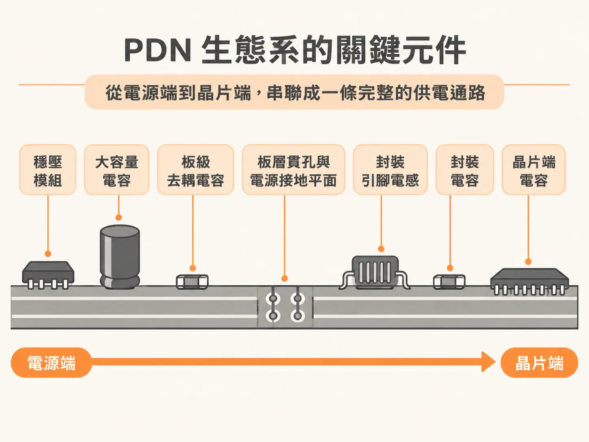
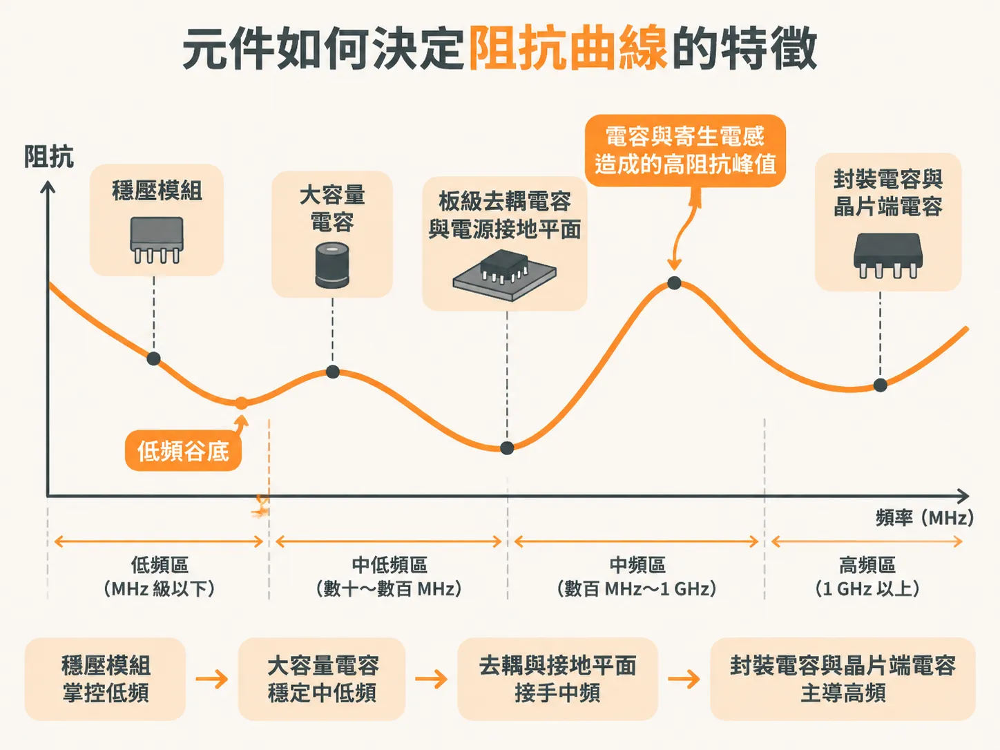

# 拆解 PDN 生態系：從 VRM 到晶片端的各元件與阻抗曲線對應

在高速數位系統中，主動元件瞬間切換電流時，如果電源供電路徑的阻抗過高，就會引發嚴重的電壓漣波與雜訊，導致系統運作不穩定。為了確保乾淨且穩定的供電，工程師必須通盤檢視電源分配網路（PDN, Power Delivery Network）的整體架構。

## 什麼是電源分配網路？

電源分配網路包含了從電源供應端一路延伸到晶片內部電路的所有互連結構。這條供電路徑涵蓋了穩壓模組（VRM, Voltage Regulator Module）、電路板內的電源與接地平面、纜線、連接器，以及所有掛在電源路徑上的電容器。

以常見的電腦主機板為例，板上通常配置了多組 VRM，透過各自的走線與平面，把電源與接地訊號精準傳送到各個主動元件的焊墊上。

## PDN 生態系的關鍵元件

如果將整個供電路徑畫成等效電路，從電源端往晶片端看，整個 PDN 生態系由以下關鍵元件緊密組成：

1. **穩壓模組（VRM）**：系統的原始直流能量來源，負責將輸入電壓調節為晶片所需的工作電壓。
2. **大容量電容（Bulk Capacitors）**：通常置於 VRM 輸出端附近，容量較大，負責在中低頻能量需求湧現時即時補充電荷。
3. **板級去耦電容（Decoupling Capacitors）**：散布在電路板上各處、靠近晶片的位置，用來濾除中高頻突波。
4. **電路板導通孔（Circuit Board Vias）與電源/接地平面（Power and Ground Planes）**：電路板內層的金屬平面本身具備平面電容，同時導通孔與走線也會引入寄生電感。
5. **封裝引腳電感（Package Lead Inductance）**：晶片封裝結構自帶的寄生電感，是高頻電源阻抗上升的主要原因之一。
6. **封裝電容（On-Package Capacitors）**：視設計需求直接安裝在晶片載板或封裝上的電容，能縮短去耦路徑，壓制封裝引腳帶來的電感影響。
7. **晶片端電容（On-Die Capacitance）**：積體電路矽晶片內部本身的寄生電容與刻意設計的去耦電容，是距離開關電路最近的儲能結構。

## 元件如何決定阻抗曲線的特徵

在評估 PDN 的好壞時，最關鍵的工具就是阻抗曲線（Impedance Profile）。當我們以百萬赫茲（MHz）為水平頻率軸來繪製阻抗曲線時，不同頻段的阻抗特徵分別由上述特定元件主導：

* **低頻區段（直流至數十 kHz）**：主要由 **VRM** 的回授迴路控制。在這個頻段，VRM 能夠即時反應並壓低阻抗；一旦超出 VRM 的頻寬上限，阻抗便開始由電感特性向上爬升。
* **中低頻區段（數百 kHz 至數 MHz）**：由 **大容量電容（Bulk Capacitors）** 接手。電容的容抗壓低了該頻段的阻抗，但在電容的等效串聯電感（ESL）作用下，會形成局部的反共振阻抗峰值。
* **中高頻區段（數 MHz 至數十 MHz）**：由板上的 **去耦電容（Decoupling Capacitors）** 以及電路板內的 **電源與接地平面** 共同主導，負責壓制晶片在該頻段切換時產生的雜訊。
* **高頻區段（數十 MHz 至數百 MHz 以上）**：此時電路板導通孔與 **封裝引腳電感** 會使板級去耦失去效用，阻抗急遽升高。這時必須仰賴封裝上的 **封裝電容** 與晶片內部的 **晶片端電容**，在最靠近邏輯閘的位置提供超高頻回流路徑，避免高頻阻抗突破系統容許的上限。

PDN 阻抗曲線上的每一個谷底與共振波峰，都對應著供電路徑上特定元件的電容值或寄生電感值。掌握整個 PDN 生態系中各元件與頻率特徵的對應關係，才能在設計階段對症下藥，選用合適的電容組合與配置策略。
