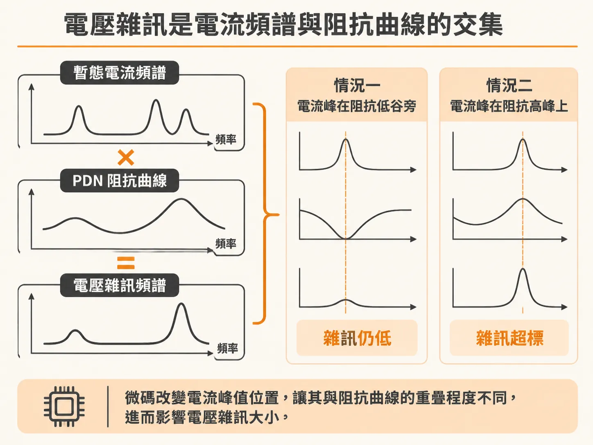
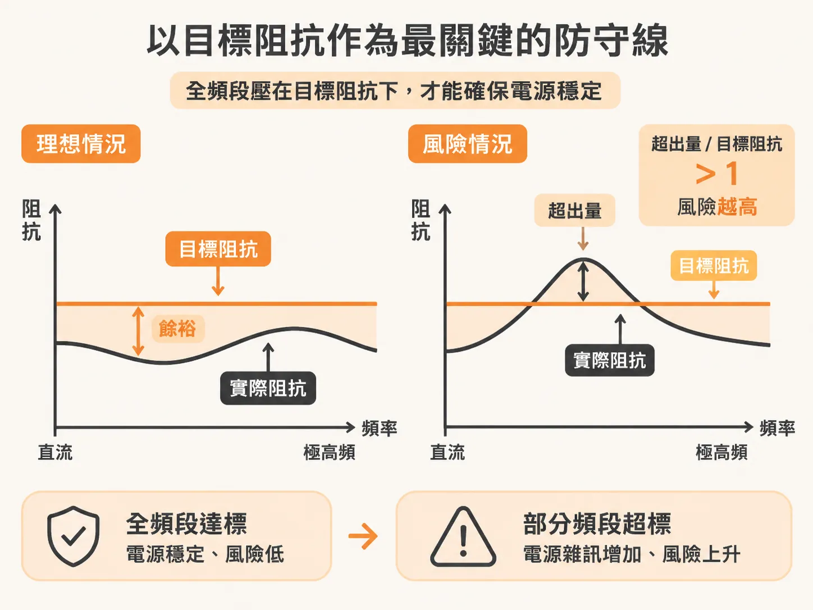
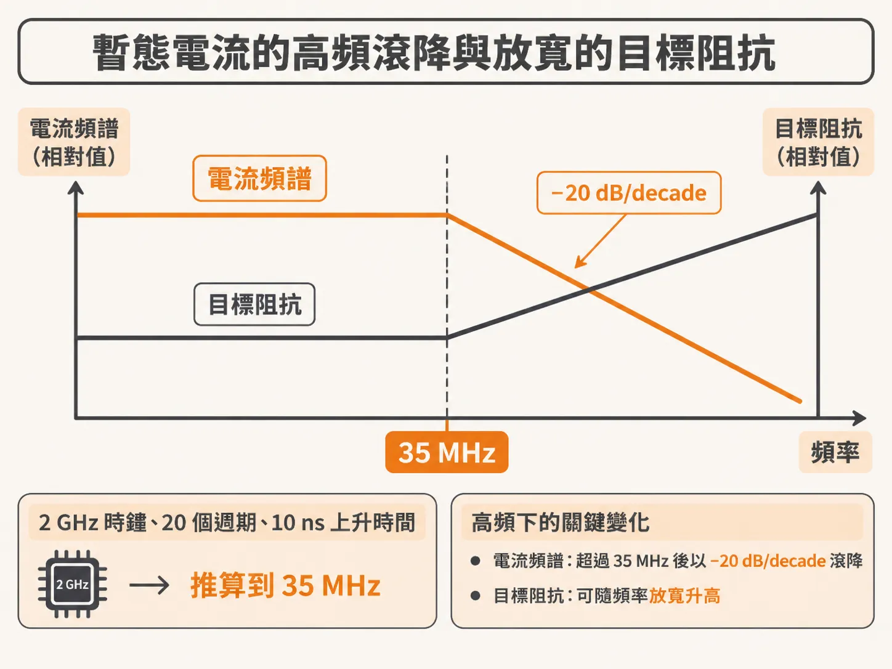

# 雕塑從 DC 到高頻的 PDN 阻抗地形

在高速數位系統中，晶片明明跑著相同的硬體，換了一段微碼（microcode）或演算法，電源軌上的雜訊就突然超標甚至當機。這類電源完整性（Power Integrity, PI）問題往往不是穩壓模組（VRM）壞了，而是晶片抽載的暫態電流頻譜，剛好撞上了電源分配網路（PDN）的阻抗峰值。

要確保系統穩定，PDN 設計的核心目標，就是從直流（DC）一路到電流最高頻率分量的整段頻寬內，將晶片端看到的阻抗曲線雕琢在安全界線之下。

## 電壓雜訊是電流頻譜與阻抗曲線的交集

從晶片核心（die pads）往外看，整套 PDN 包含封裝、板端電容、走線到電源模組，共同形成了一條隨頻率變化的阻抗曲線（impedance profile）。

當晶片執行特定微碼時，核心電源軌會抽取出特定形狀的暫態電流。在頻域上看，這是一組具有特定振幅與頻率分量的電流頻譜。將電流頻譜與該頻率下的 PDN 阻抗相乘，就會得到電壓雜訊頻譜；轉換回時域，就是我們在示波器上看到的暫態電源軌電壓雜訊。這個雜訊的大小直接取決於阻抗曲線，與 VRM 本身是否穩定沒有關係。

如果微碼稍微變動，驅動相同邏輯閘的頻率或步調出現些微偏移，電流頻譜的峰值就可能移動。若移動後的電流峰值剛好與 PDN 阻抗曲線的高峰重疊，產生的電源軌雜訊就會瞬間突破容許上限，導致產品失效。

這代表電源軌上的雜訊，受晶片端阻抗地形與暫態電流頻譜的影響是一樣大的。微碼的細節與邏輯閘的使用率（gate utilization），對最終產生的雜訊大小有著決定性的影響。只要雜訊能維持在規格限制以下，系統就不會發生因 PDN 引起的錯誤。

## 以目標阻抗作為最關鍵的防守線

既然微碼隨時會變，電流峰值可能落在各種位置，最穩健的設計方式就是替整套 PDN 定義出「目標阻抗」（target impedance）。

目標阻抗是評估 PDN 效能最核心的指標。如果在所有工作頻率下，晶片焊墊處看到的整個 PDN 生態阻抗都壓在目標阻抗之下，那麼即使在最嚴苛的暫態電流衝擊下，電源軌塌陷雜訊（rail collapse noise）也不會超過規格容許值，除非遇上極為罕見的異常疊加巨浪（rogue wave）。阻抗高出目標阻抗越多，系統出錯的風險就越高。

例如，將全頻段的目標阻抗設定為 50 mΩ，並透過工程設計讓 PDN 阻抗從 DC 到極高頻段都維持在 50 mΩ 以下。即使時鐘驅動的大負載方波電流湧入，電源軌上的漣波雜訊也能始終維持在 5% 的規格限制之內。

## 暫態電流的高頻滾降與放寬的目標阻抗

實務上，最嚴苛的暫態電流並不會在所有頻率都維持平坦。晶片內部的邏輯閘不可能瞬間全部打開，最大電流振幅在高頻端通常會開始衰減，這取決於晶片架構、管線（pipeline）級數以及微碼的運作模式。有效上升時間可能短至單一時鐘邊緣，也可能長達 100 個時鐘週期。

以時鐘頻率 2 GHz 的晶片為例：
- 時鐘週期為 0.5 ns。
- 若最嚴苛的微碼需要 20 個時鐘週期才能逐步喚醒最大數量的邏輯閘，暫態電流開啟的最短上升時間就是 0.5 ns × 20 = 10 ns。
- 電流振幅的高頻轉折頻率（knee frequency）大約落在 0.35 / 10 ns = 35 MHz。

超過 35 MHz 之後，最差暫態電流的頻譜分量會以 −20 dB/decade 的斜率快速滾降。既然高頻電流振幅變小，要維持相同的電源軌雜訊上限（例如 50 mV），容許的目標阻抗在 35 MHz 以上就可以隨頻率放寬升高。

這個高頻目標阻抗放寬的現象，能大幅減輕高頻濾波設計的難度。不過，若無法確切掌握暫態電流與最壞情況下的微碼細節，要精準估算這個轉折頻率往往相當困難。

## 雕琢整體 PDN 的阻抗曲線

PDN 工程的真正任務，是在 DC 到電源軌電流的最高頻率分量之間，雕塑出一條合格的阻抗分佈曲線。

整個 PDN 生態中的所有元件——從晶片內部電容、封裝層、板端去耦電容到 VRM——都會互相影響。雖然彼此交互作用複雜，但只要掌握各元件在不同頻段扮演的角色，就能將阻抗地形上的各個特徵波峰與波谷，對應到實體設計中的特定結構，進而逐段雕塑出符合安全邊界的平坦阻抗。
