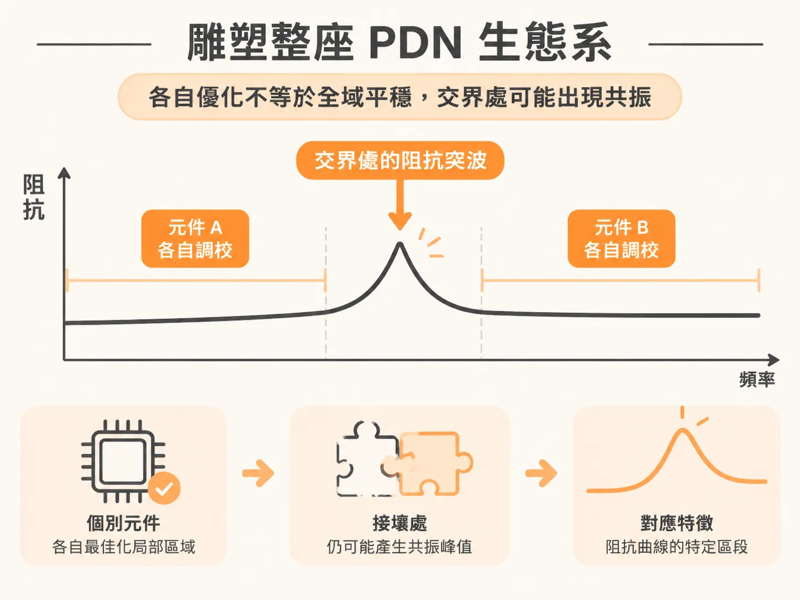
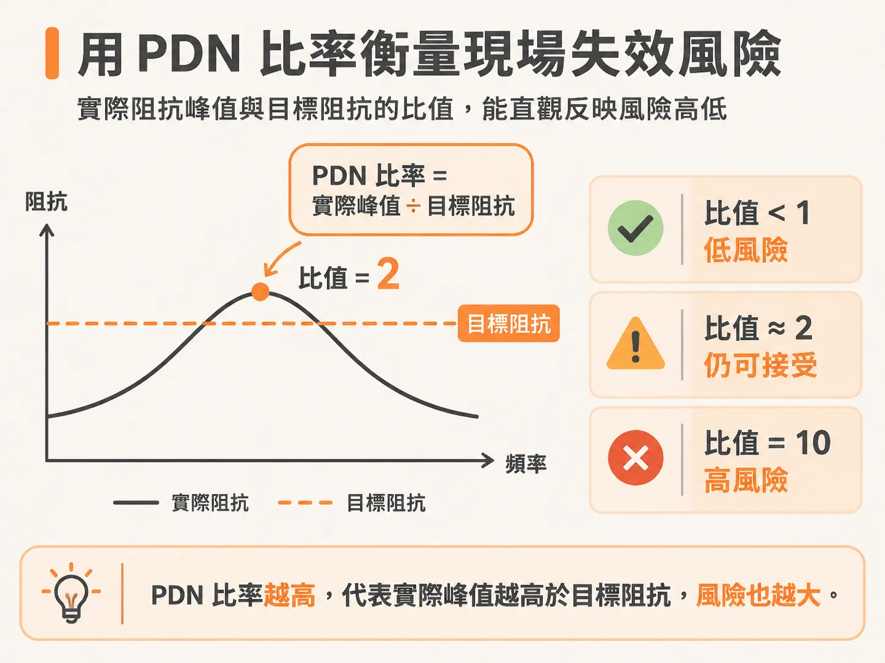
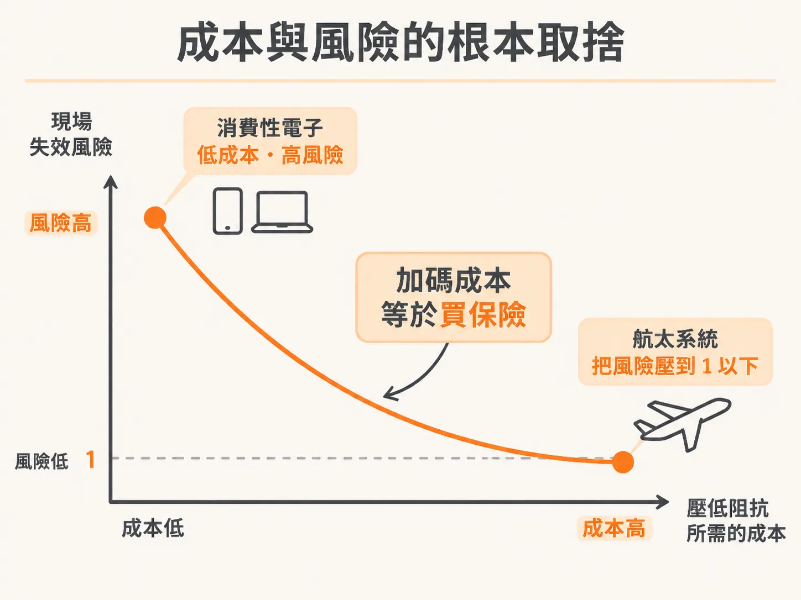

# 雕塑 PDN 阻抗曲線：為什麼工作量都在元件交界？

在高速數位系統中，電源分配網路（PDN）要解決的核心問題很單純：當晶片內部的電晶體高速切換、瞬間抽取大量電流時，電源軌上的電壓雜訊不能超過晶片允許的上限。

為了達成這項要求，電源完整性（PI）工程師最核心的工作，就是在晶片焊墊（chip pads）端，雕塑出一條從直流（DC）一路延伸到切換訊號最高頻率成分的可接受阻抗曲線（impedance profile）。阻抗曲線是衡量 PDN 品質與效能最重要的指標，而目標阻抗（target impedance）則是上限標準，確保最糟糕的電壓雜訊依然低於規格極限。

然而，要讓整條曲線壓在目標阻抗之下，工程師的大部分時間並不是花在單一元件上，而是耗費在元件之間的交界處。

## 雕塑整座 PDN 生態系

整個 PDN 是一個相互連動的生態系（PDN ecology）。從供電端到負載端，主要包含以下元件：

- 電壓調節模組（VRM）
- 大容量電容（Bulk capacitors）
- 去耦電容（Decoupling capacitors）
- 電路板的電源與接地平面（Power and ground planes）
- 電路板貫孔（Circuit board vias）
- 封裝引腳電感（Package lead inductance）
- 封裝內電容（On-package capacitors）
- 晶片內電容（On-die capacitance）

將這些元件的功能適度隔離，能讓我們在一定程度上獨立最佳化 PDN 的局部區域。阻抗曲線上的特定區段，往往可以對應到具體的設計特徵。

然而，真正棘手的問題發生在交界處。當一個元件的阻抗特性與相鄰元件的阻抗特性相遇時，極容易引發共振，產生意料之外的阻抗突波。如果不緊盯著元件之間的介面，個別元件最佳化得再好，交界處的相互作用依然會毀掉整條阻抗曲線。這也是為什麼 PDN 設計的大量心力，都必須投注在處理這些介面互動上。

## 用 PDN 比率衡量現場失效風險

雕塑阻抗曲線的工程流程大致可分為三步：

1. 根據晶片的功能運作與實際應用場景，建立目標阻抗的最佳估計值。
2. 做出具體的工程決策，盡可能讓阻抗曲線符合目標。
3. 在壓低阻抗所需的實現成本與現場失效（field failure）的風險之間取得平衡。

在評估電路無法依額定規格運行的風險時，一個關鍵指標是 **PDN 比率**（PDN ratio），也就是實際 PDN 阻抗峰值與目標阻抗的比值：

- **PDN 比率 $\le$ 2**：屬於低風險設計。
- **PDN 比率 $\ge$ 10**：屬於高風險設計，幾乎必然會帶來無法接受的現場失效風險。

即使多數微碼（microcode）在一般測試下能正常運作，一旦執行到某些特定微碼，剛好刺激了 PDN 的共振頻率，就可能引發嚴重的產品穩定度問題。

## 成本與風險的根本取捨

要降低 PDN 阻抗峰值、把 PDN 比率降下來，代價就是成本增加。額外付出的成本通常來自以下幾個方面：

- 必須放置更多被動元件。
- 組裝設計規則變得更嚴格，連帶影響產線良率。
- 電路板或封裝需要增加更多走線層。
- 晶片內部需要騰出更多面積來做晶片內電容。
- 必須採用更昂貴的基板或介電材料。

在 PDN 設計中，多花錢爭取設計餘量，本質上就是在「買保險」以降低風險。成本與風險之間的平衡，取決於產品所屬領域能承受多少風險：

- **消費性電子產品**：強烈受限於成本，選擇承受較高的風險比率以換取更低廉的成本，往往是合理的商業考量。
- **航太與航空系統**：對安全性要求極高，多花成本把風險比率壓到 1 以下，反而是最具成本效益的選擇。

電源完整性工程師的最終責任，就是在成本、風險、效能與專案時程之間，找出可接受的平衡點。越熟悉各個 PDN 元件的細節與交界處的互動行為，就越能迅速收束出兼具強健性與成本效益的設計方案。
