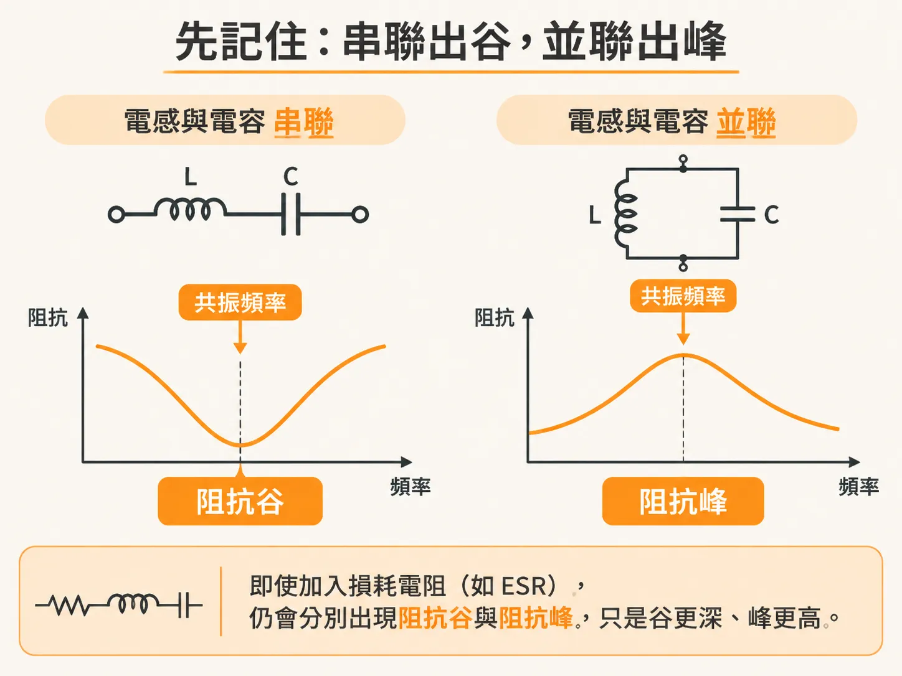
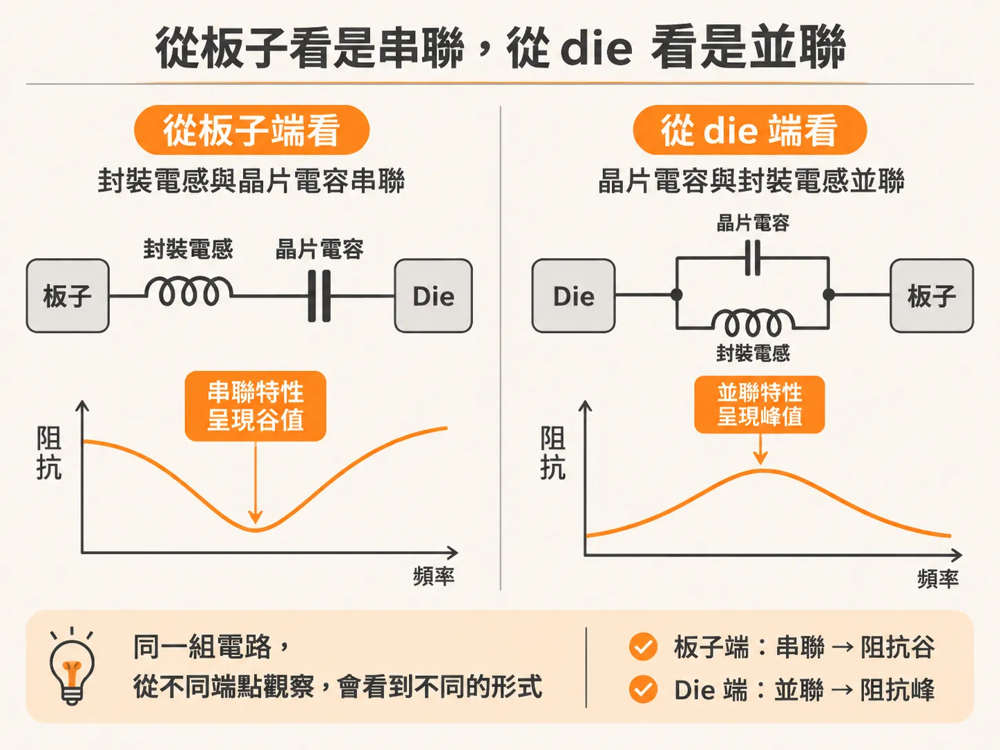
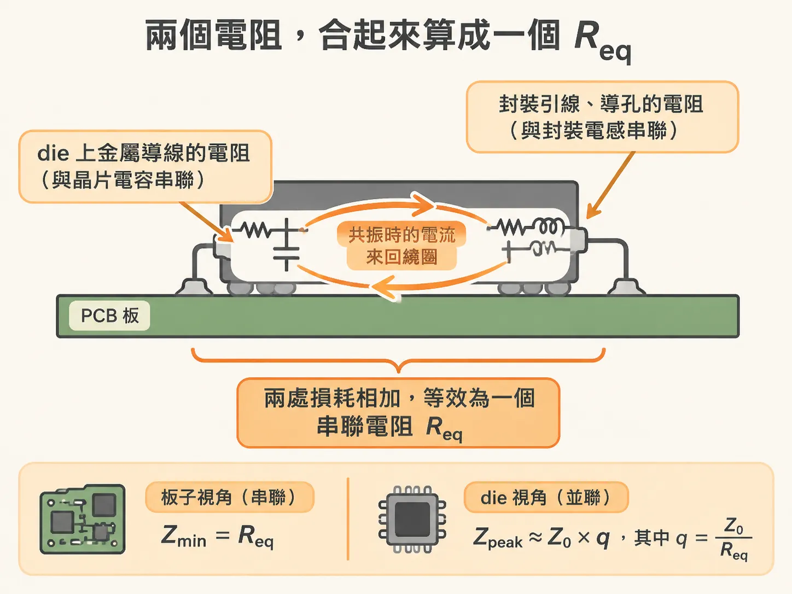

# 從板子看是谷，從 die 看是峰

你手上有一顆晶片的 PDN（電源分配網路）。用 VNA（向量網路分析儀）從電路板上量，阻抗曲線在共振點凹下去一個谷。隔壁做封裝模擬的同事，對同一顆晶片、同一組 L、C、R 從 die（晶片本身）端算，卻得到一個往上凸的峰。

你們沒有算錯，元件也沒有不一樣。差別只有一個：站的位置。串聯還是並聯，不是元件本身的性質，是「你從哪裡看」決定的。把兩種視角分清楚，迴路裡的兩個電阻就能合成一個等效電阻 R_eq。

## 先記兩條規則

規則只有兩條。電感 L 和電容 C 串聯，共振頻率處的阻抗是最低點，曲線凹成一個谷。L 和 C 並聯，共振頻率處的阻抗是最高點，曲線凸成一個峰。

損耗電阻可以放在旁邊，也可以串在迴路裡。就算 L 和 C 是並聯，電阻也常以 ESR（等效串聯電阻）的形式串在裡面。擺法不影響谷或峰的出現，影響的是谷的深度和峰的高度。



## 站哪裡看，決定串聯還是並聯

要判斷會量到谷還是峰，第一步不是盯著元件清單，而是先問一個問題：量測或模擬的埠接在哪裡。從那個位置往電路裡看，L 和 C 對你來說是串成一條路，還是並成兩條路。這個視角定了，阻抗曲線的形狀就定了。

## 同一個電路，兩種長相

套到 PDN 上看。die 上有電容（on-die capacitance，晶片自己的去耦電容），封裝有引線電感（package lead inductance），板子在下面。同一組結構，兩個方向看，長相完全不同。

從板子穿過封裝往晶片看，封裝引線電感串著晶片電容，一路串到底。這是一個串聯 RLC：阻抗在共振點凹到最低，之後隨頻率一路往上走。高頻端由封裝引線電感主導。

從 die 往外看，外面是一整塊低阻抗的板子，近似短路。晶片電容和封裝引線電感對 die 來說是並聯。這是一個並聯 RLC，共振點出現阻抗峰。高頻時阻抗往下掉，由晶片電容主導，最後受限於 die 上的金屬導線。低頻時，封裝引線電感把 die 接到低阻抗板子，等於把 die 短路。這時 die 看到的阻抗，最終受限於封裝引線電阻加上板上的路徑電阻。



還有一個實際的後果：從板子上，你只能看到 die 環境的低頻阻抗。die 的高頻特性被封裝引線電感擋住，也被晶片電容本身的低阻抗擋住，板子那端看不到。

## 兩個電阻，合成一個 R_eq

這個迴路裡有兩段電阻。一段是 die 上的金屬導線（on-die metallization），串在晶片電容的路徑上。另一段是封裝引線和導孔的電阻，串在封裝引線電感的路徑上。

從板子看，四個元件全部串成一條線。串聯電路不在乎順序，所以等效串聯電阻就是兩個電阻直接相加。

從 die 看就細一點。低頻時，晶片電容的阻抗高，die 看到的阻抗由封裝引線電阻主導。高頻時，晶片電容的阻抗低，改由 die 金屬導線電阻主導。但靠近共振時，電流在電感與電容之間繞圈，兩個電阻都在這個迴路上，損耗相加。所以在共振附近，這個電路就是一個並聯 RLC，等效電阻等於兩個電阻的和。

串聯谷、並聯峰，兩種視角共用同一套特性指標：共振頻率、特性阻抗 Z0、q-factor，還有谷深或峰高。套用之前，只要把 R 換成合成後的等效串聯迴路電阻：

<!-- derived -->
```
R_eq   = R_leads + R_metallization

f_res  = 1 / (2π × √(L × C))    兩種視角共用同一個共振頻率
Z0     = √(L / C)                特性阻抗

板子視角（串聯）：Z_min = R_eq
die 視角（並聯）：Z_peak ≈ Z0 × q，其中 q = Z0 / R_eq
```



## 一組數字，兩種曲線

拿一顆小 die 的典型數字來看：Cdie = 50 nF、Lpackage = 0.5 nH、Rleads = 0.01 Ω、Rmetallization = 0.005 Ω。合成後 R_eq = 0.015 Ω。這組數字的 q-factor 高，所以峰會很尖。

把同一組元件照兩種接法各自模擬，畫出來的阻抗曲線完全不同：一條有明顯的谷，一條有明顯的峰。谷的深度和峰的高度，都跟估計式對得上。元件一模一樣，換個視角，曲線就換了一張臉。

## 量測怎麼接，就量到什麼

對量 PDN 的人來說，這件事最重要。阻抗量測怎麼接，會直接決定量到的曲線長相，還有「你到底量到了什麼」。從板子上接 VNA，量到的是串聯視角，看到的是谷。die 的那個峰，要站到 die 端才看得到。下次你和別人對同一顆晶片的 PDN 曲線對不起來，先別懷疑數字，先問彼此：你站在哪裡看？
