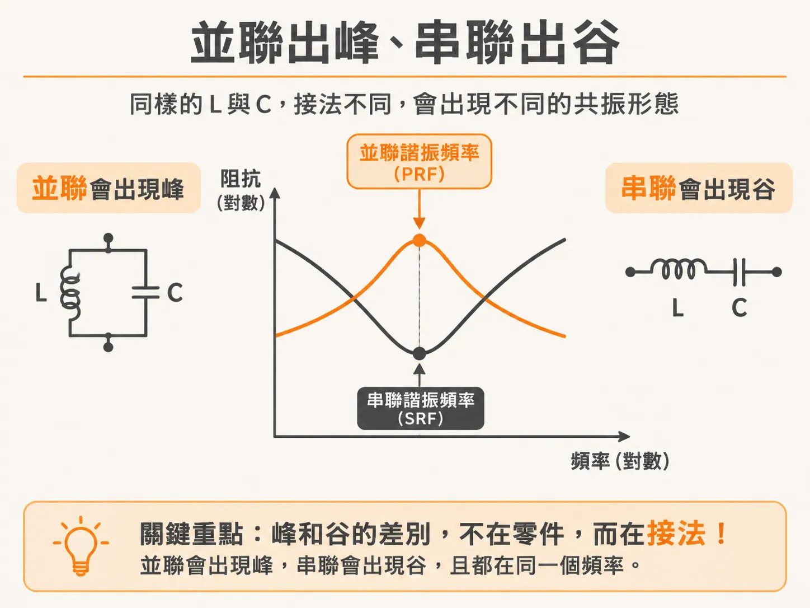
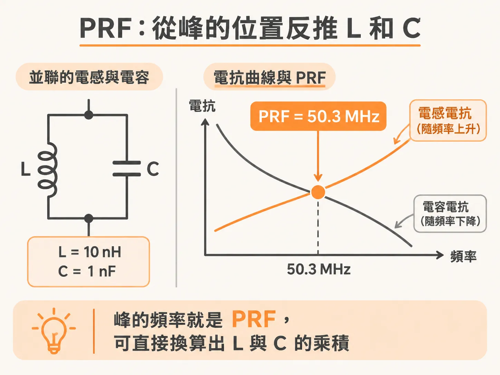
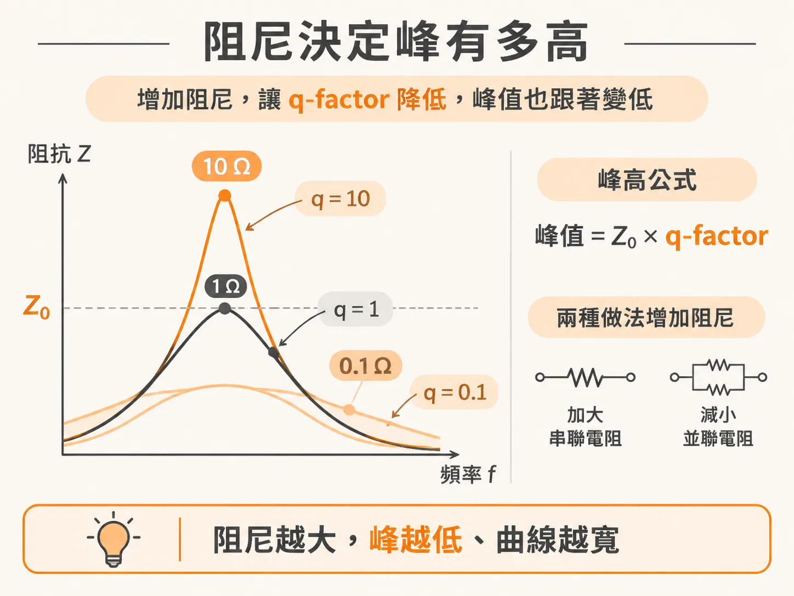

# 阻抗曲線上的峰，幾乎都是並聯 RLC 電路

模擬跑完，你在電源網路（PDN）的阻抗曲線上看到一個峰。先別急著加電容。這個峰本身帶著三個線索：形狀、位置、高度。三個都讀懂，就能反推峰背後是什麼電路。

## 峰的形狀會自己說話

RLC 指的是電阻（R）、電感（L）、電容（C）三種理想元素組成的電路。先把峰放大來看。

- 峰的左邊是低頻段，阻抗隨頻率上升。這是電感的行為。並聯在電路裡的電感，在 DC 附近像一條短路，頻率越高阻抗越大。
- 峰的右邊是高頻段，阻抗隨頻率下降。這是電容的行為。
- 峰頂是整條曲線的最高點，出現在電感與電容並聯之後阻抗最大的那個頻率。實際高度則被電阻壓住。

判讀結果：從你的量測點看進去，有一顆電感和一顆電容以並聯方式接在電路裡，另外有一個電阻在提供阻尼。

串聯的世界剛好相反。同樣的 L 和 C，改成串聯，曲線上出現的是谷，不是峰。谷底的位置叫串聯諧振頻率（SRF）。峰和谷的差別不在零件，在接法：L 和 C 相對於量測點，是並聯還是串聯。



## PRF：把峰的位置換算成 L 和 C

並聯諧振頻率（PRF，parallel resonant frequency）的定義很單純：電感的電抗等於電容的電抗的那個頻率。兩個電抗在這裡互相抵銷，並聯組合的阻抗衝到最大，曲線就冒出峰。

換算公式用方便的單位：L 用 nH，C 用 nF，PRF 用 MHz。

<!-- derived -->
```text
PRF (MHz) = 159 / sqrt(L × C)

例：L = 10 nH、C = 1 nF
PRF = 159 / sqrt(10 × 1)
    = 159 / 3.16
    ≈ 50.3 MHz
```

算出來的 50.3 MHz，正好就是峰頂出現的位置。

這條公式反過來用更有價值。曲線上看到一個峰，先記下頻率；如果已知其中一個值，例如封裝的迴路電感，就能反推另一個值。峰的位置不是雜訊，它是一道算術題的答案。



## 峰的高度由阻尼決定

如果電路裡只有理想的 L 和 C 並聯，峰頂會是無限高。實際曲線有個有限的高度，完全是電阻的功勞。阻尼把峰壓下來。

描述壓得多低的是 q-factor（品質因數）。峰高大約等於 Z0 乘上 q-factor。Z0 是這個 RLC 電路的特性阻抗，也就是諧振頻率下電感或電容的電抗值，由 L 和 C 決定。

拿一組數字來看：L = 10 nH、C = 10 nF 時，Z0 是 1 Ω。只改阻尼，讓 q-factor 分別是 10、1、0.1，峰高就分別是 10 Ω、1 Ω、0.1 Ω。

- q-factor 大：每個週期只損耗一點點能量，峰又高又尖，時域裡的振鈴拖很久。
- q-factor 小：能量每個週期被吃掉一大塊，峰變得又矮又寬，振鈴很快停。

想壓低峰，方向就是增加阻尼、把 q-factor 降下來。做法有兩個：加大串聯的電阻，或是減小並聯的電阻。



## 為什麼峰幾乎都是並聯 RLC

「幾乎都是」不是經驗之談，是拓撲的必然。峰或谷取決於你從哪裡量：L 和 C 相對於量測點是並聯，阻抗在諧振點就是最大值；是串聯，就是最小值。同一個 PDN 電路，從不同位置看出去，長相可以完全不同。但只要看到的是峰，就代表在那個視角下，L 與 C 是並聯的。

工程上的用法因此很直接：

1. 看到峰，反推有一組並聯的 L 和 C。
2. 峰的頻率，給你 L 與 C 的乘積（PRF 公式）。
3. 峰的高度，給你 Z0 與 q-factor 的乘積。

三個線索湊齊，你就知道該動哪個旋鈕。降低 L 或提高 C，可以把諧振點和 Z0 往下帶；增加阻尼，可以壓 q-factor。把這三件事想清楚，峰就從莫名其妙的突起，變成可以設計的對象。
