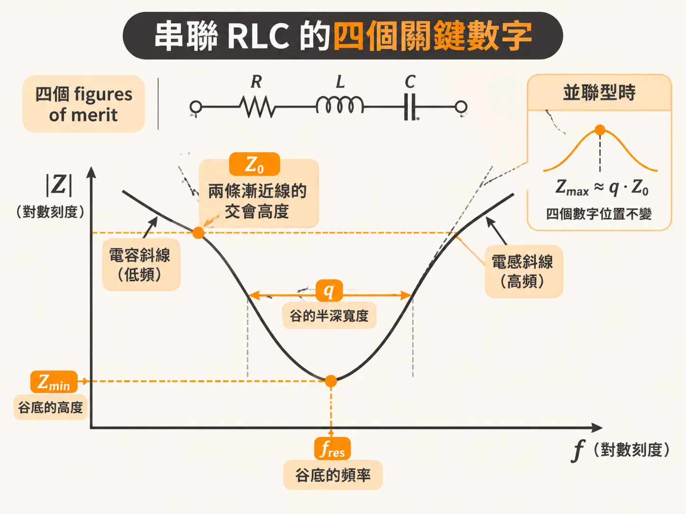
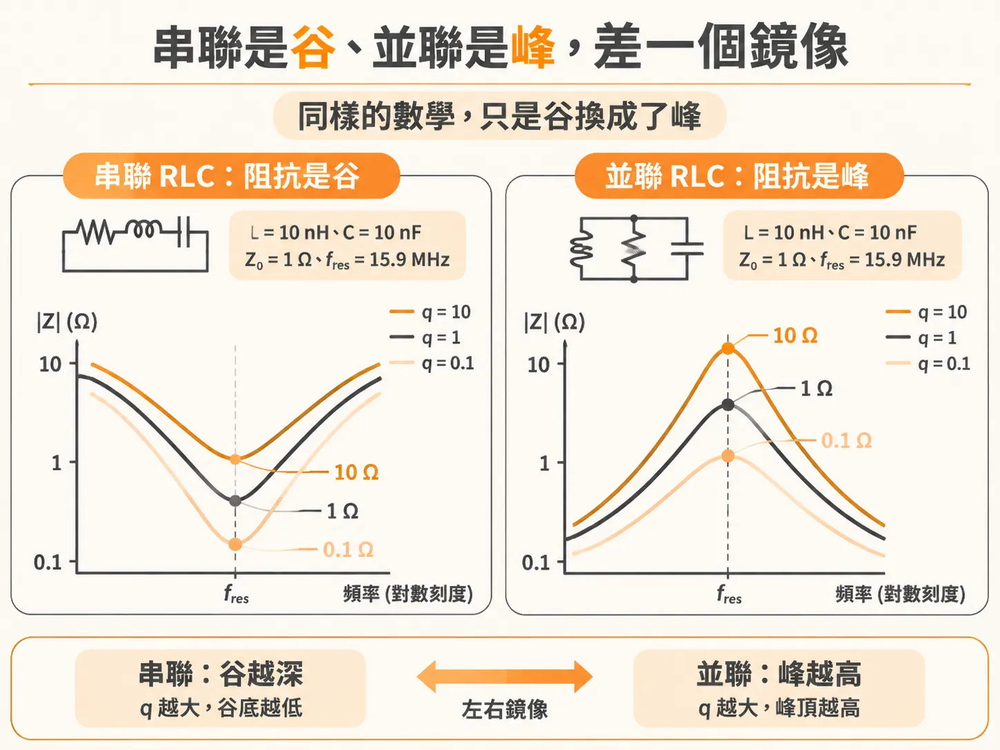
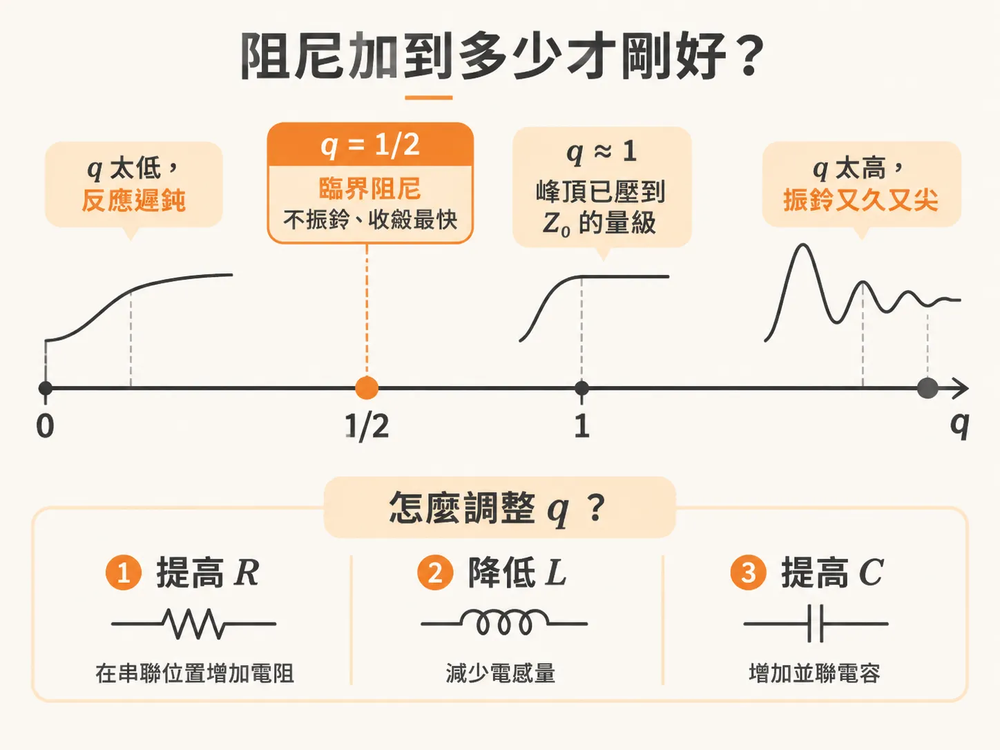
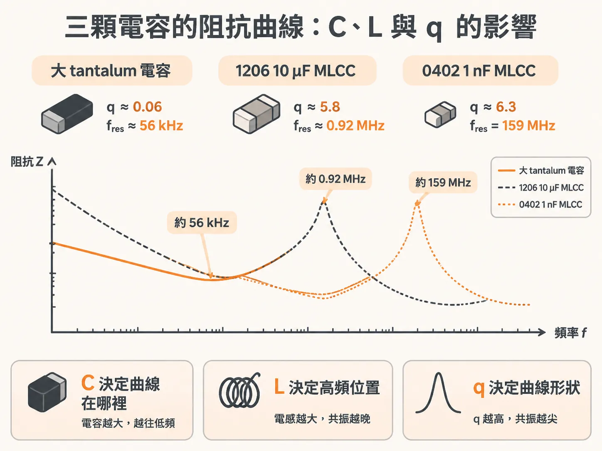

# 每個 RLC 電路都有四個重要的 figures of merit

模擬跑完，Z(f) 曲線上冒出一個峰。接著真正的問題就來了：這個峰到底要不要緊？阻尼要加多少才壓得住？

靠感覺改板，又花錢又花時間。穩當的做法是先把電路盤點清楚。任何 RLC 電路——不管是一顆電容的擬合模型，還是整個 PDN 在某個頻段的等效電路——都有四個關鍵的 figures of merit（評價指標）：共振頻率 fres、特性阻抗 Z0、q-factor，還有共振點上的最小或最大阻抗 Zmin／Zmax。分析 RLC 電路的第一步，就是把這四個數字算出來。

四個數字一出來，曲線大概什麼樣子就定了。

## 先把四個數字報出來

四個數字，各自對應曲線上一個量得出來的特徵。

**fres [MHz] = 159 ÷ √(L[nH] × C[nF])**

共振頻率就是電感電抗剛好等於電容電抗的那個頻率。串聯電路稱它 SRF，並聯電路稱它 PRF，定義其實是同一句話，公式也就只有一條。

**Z0 = √(L[nH] ÷ C[nF])**

Z0 是在共振頻率上，電感（或電容）單獨呈現的電抗大小。再釘一次：這個 Z0 跟傳輸線的特性阻抗毫無關係，純粹是名字撞到而已。

**q = Z0 ÷ R（串聯型）**

q-factor 衡量阻尼的相對強度，決定曲線中段有多尖。它還有一個直接從曲線上量的定義：拿 fres 除以谷或峰半深處的全寬，就是 q。

**串聯：Zmin = Z0 ÷ q；並聯：Zmax ≈ q × Z0**

串聯型的谷底就是那顆 R 本身；並聯型（R 和 L、C 並聯）的峰頂就是那顆並聯 R，用 q 寫就是 Zmax ≈ q × Z0。要是把 R 整個拿掉，谷底會一路掉到 0，峰頂會一路衝到無限大；是阻尼把共振拉回有限值。

曲線的兩端則輪不到 R 說話：低頻只由 C 決定，高頻只由 L 決定，q 只管中段。

## 同一組數學，兩種長相

拿同一組 L = 10 nH、C = 10 nF 來掃：Z0 = 1 Ω，fres = 15.9 MHz。q 分別設 10、1、0.1，兩種電路各畫一組。

串聯型：R = 0.1、1、10 Ω，對應 q = 10、1、0.1。q 越大，谷越深越尖，谷底分別落在 0.1、1、10 Ω。

並聯型：並聯 R = 10、1、0.1 Ω。方向跟串聯型剛好相反：並聯 R 越大越接近不存在，阻尼越弱，q 越高。q 越大，峰越高越尖，峰頂分別落在 10、1、0.1 Ω。

兩張曲線互為鏡像：同一組 L 和 C、同一條 fres，串聯把共振寫成谷，並聯把共振寫成峰，兩端的斜線都不受 q 影響。

q 的物理意思很樸素：共振時，每個振盪週期耗掉多少比例的儲能。q 高，每個週期只耗一點點，能量在電路裡盪很久，曲線就又尖又窄；q 低，能量很快耗光，曲線就寬而淺。換到時間域，串聯型振鈴的是電流，並聯型振鈴的是電壓。

## q 在時間域的意思

q = 1/2 是 critical damping（臨界阻尼）：不振鈴，收斂又最快，兩件事在這裡剛好同時成立。

q 比 1/2 大，振鈴變多；q 比 1/2 小，反應變遲鈍。阻尼加過頭，系統反而慢半拍。

## 阻尼要加到多少

回到開場那個峰。判斷需要的工具，到這裡已經齊了。

先算四個數字。四個裡面，Z0 和 q 最重要：峰高約等於 Z0 × q，谷深等於 Z0 ÷ q，峰值工程整套就撐在這兩條關係式上。q 遠大於 1，峰又高又尖，時間域振鈴也拖得久；把 q 壓到 1 附近，峰頂就從 q × Z0 掉到 Z0 的量級。q 從 10 壓到 1，峰高直接除以 10。

工程手段有三個：提高 R、降低 L、提高 C。Z0 在實務上好用的地方就在這裡：它直接喊出 q ≈ 1 需要的電阻量級，把 R 做到跟 Z0 同一個數量級就對了。

加阻尼的具體方向有兩個：提高串聯電阻，或降低並聯電阻。選哪一個，看阻尼電阻長在電路的哪個位置。

兩個參考點並排記：要壓峰值，往 q ≈ 1 看；怕振鈴，往 q = 1/2 看。反過來把 q 壓到遠低於 1/2，峰是沒了，反應也跟著遲鈍。阻尼不是免費的。

## 三顆真實電容的算例

同一套程序跑三遍。

第一顆，大 tantalum（鉭質電容）：C = 1000 μF = 10⁶ nF、L = 8 nH、R = 0.05 Ω。

**fres ≈ 0.056 MHz（56 kHz）；Z0 ≈ 2.8 mΩ；q ≈ 0.06；Zmin = 50 mΩ**

q 只有 0.06，曲線果然又寬又平，寬到幾乎看不出共振。

第二顆，1206 大 MLCC（多層陶瓷電容，X5R 介電材料）：C = 10 μF = 10,000 nF、L = 3 nH、R = 3 mΩ。

**fres ≈ 0.92 MHz；Z0 ≈ 17 mΩ；q ≈ 5.8**

串聯電阻低到 3 mΩ，q 衝到 5.8，共振又尖又窄。廠商公布的阻抗曲線用的是 L = 1 nH，比這顆電容實際裝上板子、接上 vias 之後做得到的還激進，所以 datasheet 上的 SRF 會比自己算出來的再高一點。

第三顆，0402 小 MLCC（X7R）：C = 1 nF、L = 1 nH、R = 0.16 Ω。

**fres = 159 MHz；Z0 = 1 Ω；q ≈ 6.3**

R 是第二顆的 50 倍以上：小電容的導體板少，並聯起來的電阻就高。但它的 Z0 也高得多，1 Ω 對 17 mΩ，q 算下來跟 1206 那顆差不多，照樣是尖共振。

三條曲線擺在一起，規則很清楚：C 和 L 決定曲線站在哪裡，q 決定曲線長什麼樣子。tantalum 的低 q 把共振抹平；兩顆 MLCC 的 q 都在 6 附近，各自的 fres 上都是尖谷。

## 看到峰，先算再說

面對任何 RLC 電路，先別急著換料。把 fres、Z0、q、Zmin／Zmax 四個數字算出來——從元件值代公式算得出來，從曲線上也讀得出來。算完才輪到設計判斷：峰要壓到多低、阻尼要加到多少，答案都掛在 q 上，而調 q 的手段就是 R、L、C。
