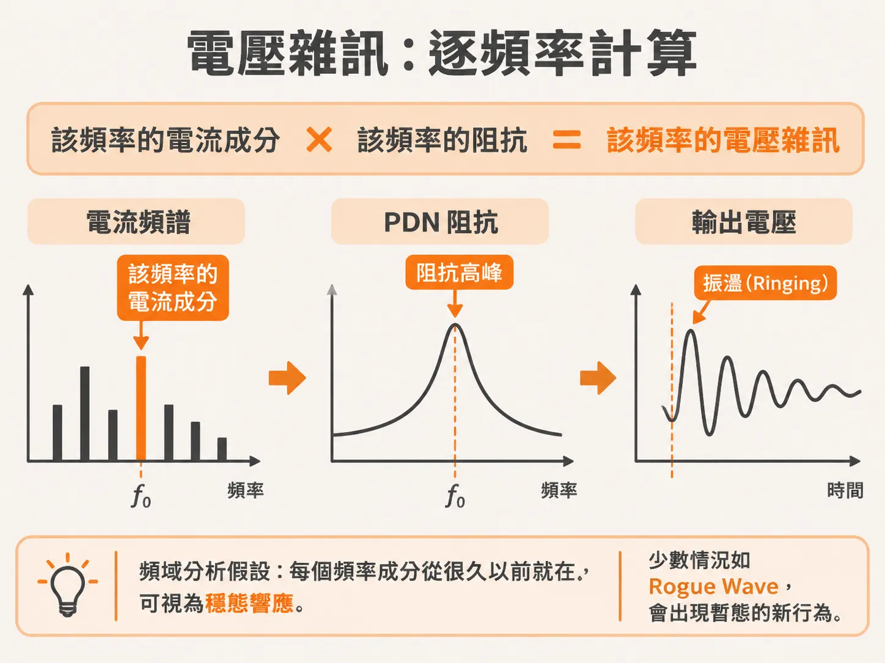
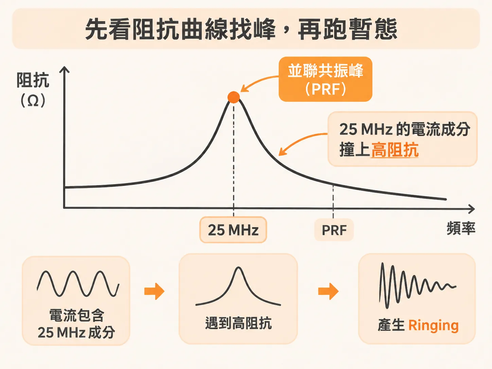
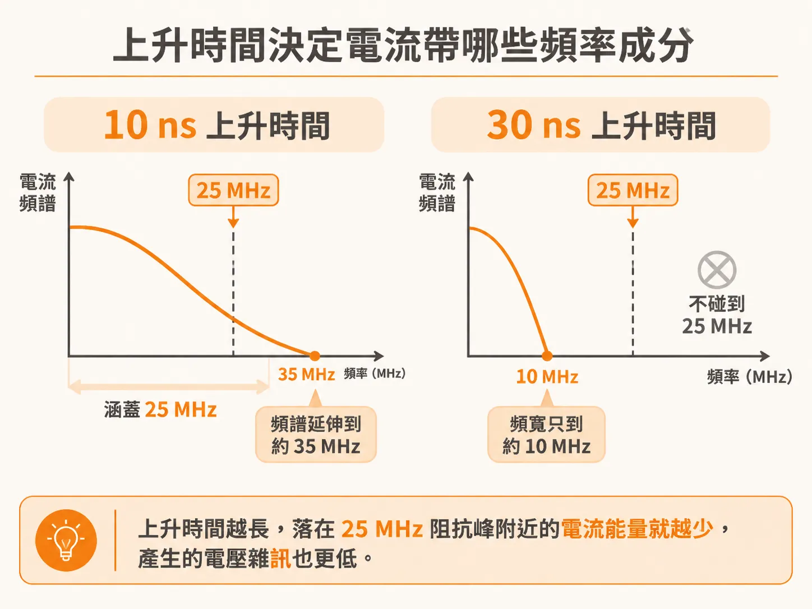
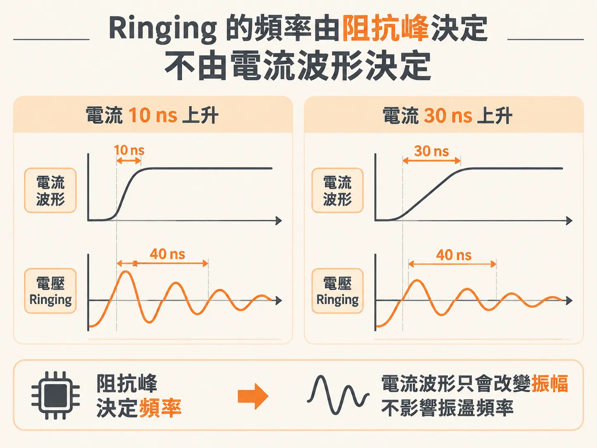

# Ringing 電壓雜訊是阻抗峰的跡象

示波器接到電壓軌上，除了 DC 之外還看到一層規律的振盪，週期差不多 40 ns。電流的波形明明是平滑的，電壓為什麼會振？有一個判斷法：量 ringing 的週期，換算成頻率，對照阻抗曲線，就能說出這個 ringing 是被哪一個峰激發的，以及振幅由誰決定。

## 電壓雜訊怎麼來的：每個頻率各自算

阻抗曲線是電壓雜訊的直接指標。電流的某個頻率成分流過這個阻抗，就會在該頻率產生電壓。電壓的大小，由電流在該頻率的振幅和阻抗在該頻率的高低共同決定。要預測雜訊，先問兩個問題：電流裡有哪些頻率成分？阻抗曲線在這些頻率上有多高？

頻域分析有一個前提：它假設每個頻率成分「從很久以前就在」，算的是穩態、不隨時間變的響應。這通常夠用。少數被稱為 rogue wave 的情況，暫態會顯現頻域看不到的新行為，要另外處理。

## 先看阻抗曲線，再跑暫態

一條複雜的阻抗曲線、一個任意的電流波形，要用公式解析算出暫態電壓很難；用 SPICE 這類電路模擬跑出來很容易。典型的暫態模型這樣接：左邊用一組 R 和 L 模擬 VRM 的阻抗，中間放兩個串聯 RLC 電路代表真實的去耦電容，再串一個電流表顯示暫態電流。

跑暫態之前，先看這個電路的阻抗曲線。範例電路的阻抗曲線在約 25 MHz 有一個並聯共振峰，這個頻率就是 PRF（parallel resonant frequency，並聯共振頻率）。電流裡頻率落在 PRF 附近的成分，流過電路時看到的阻抗特別大，產生的電壓也特別大。

## 上升時間決定電流帶哪些頻率

電流波形的頻寬（bandwidth，BW）告訴你它最高含有多少頻率的正弦波成分。頻寬跟 10–90 上升時間（rise time，RT）之間有一個好用的估計關係：

BW（GHz）≈ 0.35 ÷ RT（nsec）

代入數字。上升時間 10 nsec 的電流，頻寬是 0.35 ÷ 10 = 0.035 GHz，也就是 35 MHz。這個電流步階的頻率成分會到 35 MHz，再上去就沒有什麼能量了。

把這個電流丟進 PRF 在 25 MHz 的電路：35 MHz 的頻寬涵蓋了 25 MHz，預期會看到 25 MHz 的 ringing。

把上升時間拉長到 30 nsec，頻寬掉到大約 10 MHz。電流在 25 MHz 的成分振幅變小，產生的電壓雜訊也跟著降低。

## Ringing 的頻率是電路給的，不是波形給的

把 10 ns 和 30 ns 兩種上升時間的暫態模擬擺在一起，結果很一致：即使電流是平滑的高斯邊緣，電壓上還是出現很大的 ringing，而且振盪在 PRF。兩種情況的 ringing 週期都是 40 ns，正好對應 25 MHz。上升時間變了，ringing 的頻率沒有變。

這是最關鍵的分別：ringing 的頻率是電路固有的，由 PRF 決定，跟電流波形無關。會變的是振幅。

## 振幅與頻率各由誰決定

把兩件事拆開看：

- **頻率**：由電路決定。Ringing 振盪在阻抗峰所在的頻率，等於週期的倒數，跟輸入波形無關。
- **振幅**：由兩個因素相乘——電流波形在 ringing 頻率含有多少能量，以及那個阻抗峰有多高。上升時間越長，電流在 25 MHz 的能量越少，雜訊振幅越低。

所以在 PDN 上量到的 ringing 電壓雜訊，往往就是阻抗曲線裡有峰的跡象：電流的頻率成分加上 PRF 處的峰阻抗，兩個加起來決定了雜訊的振幅。這也是為什麼並聯共振在 PDN 設計裡這麼重要。

## 看到 ringing，你會怎麼判斷？

下次在電壓軌上看到 ringing，照這個順序走：

1. 量 ringing 的週期 T，算出頻率 f = 1/T。
2. 打開阻抗曲線，找 f 附近有沒有峰。有，這個 ringing 就是那個峰被激發的跡象。
3. 用 BW ≈ 0.35/RT 檢查電流：上升時間夠短，頻寬才蓋得到這個峰。要壓低 ringing，要嘛拉長上升時間、減少電流在該頻率的能量，要嘛把那個峰本身削低。
