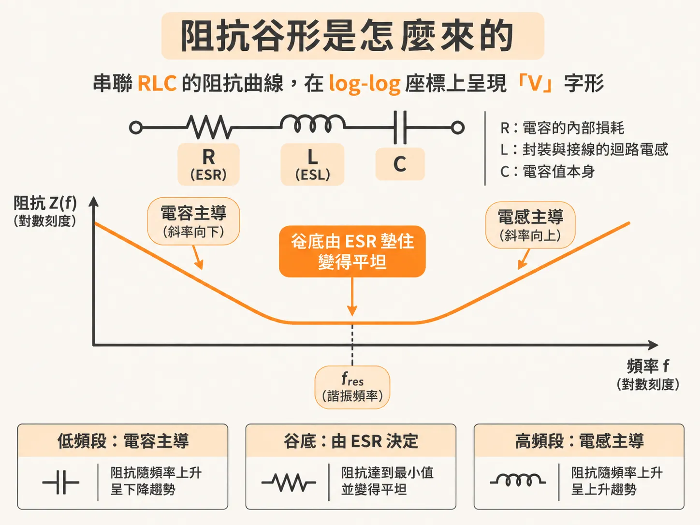
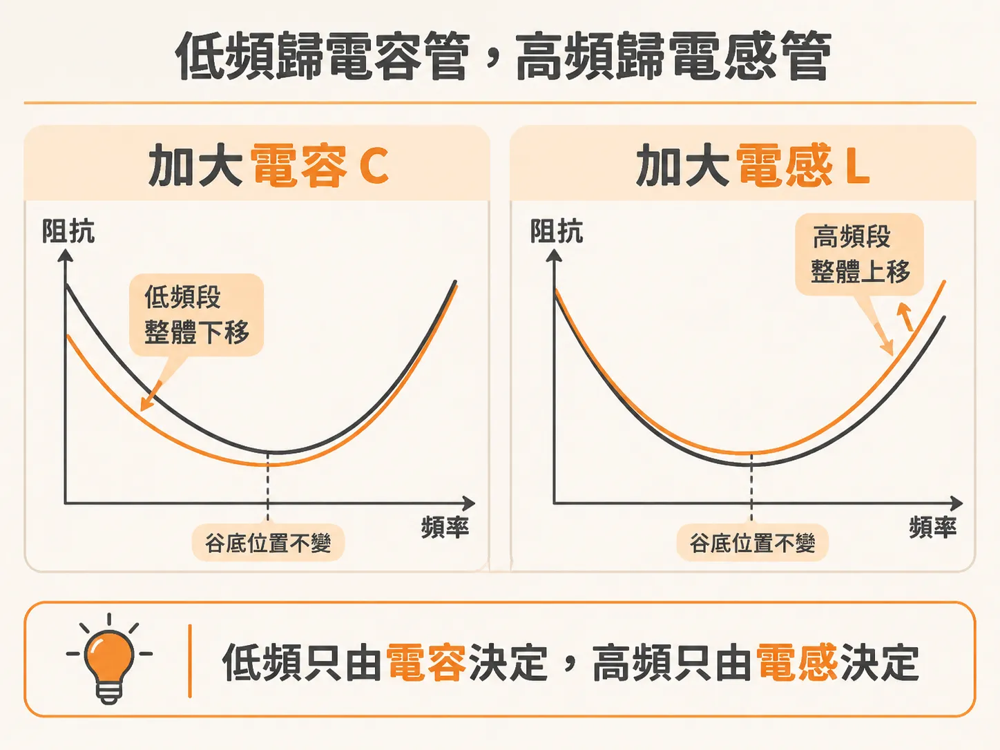
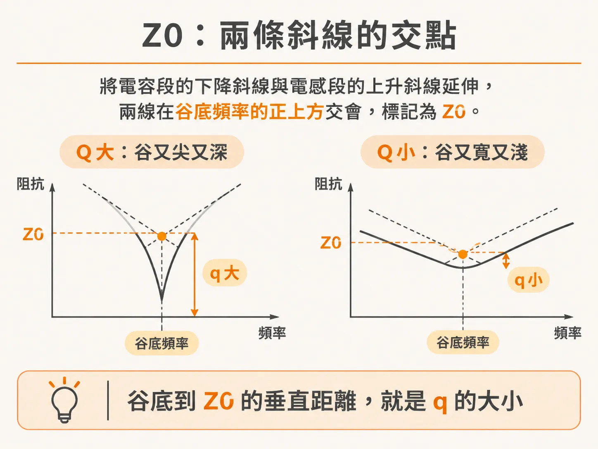
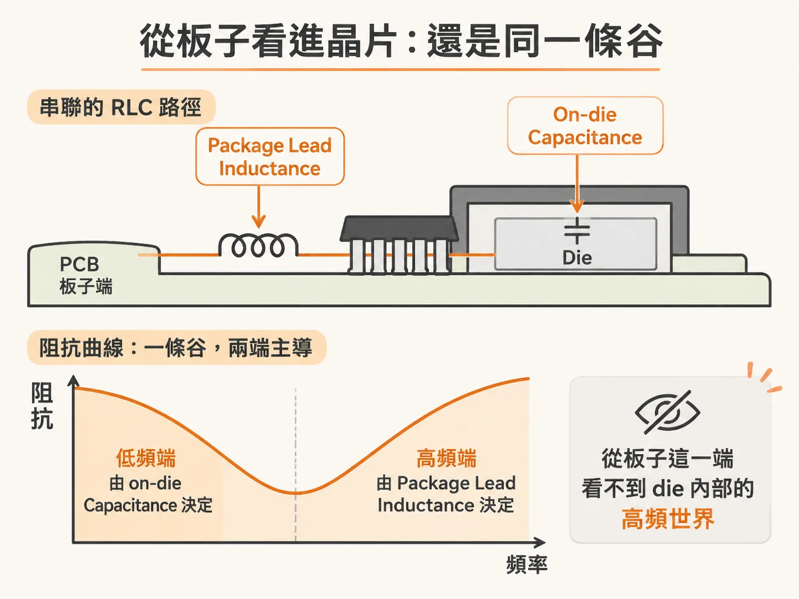

# 串聯 RLC 電路：低頻只由電容決定，高頻只由電感決定

你手上有一條電源軌的 Z(f) 曲線，中間凹下去一個谷。

先別急著把谷當成量測雜訊。在 PDN（電源分配網路）的世界裡，谷是一種簽名，而且是可以反推的簽名：讀出谷底落在哪個頻率，再讀出兩條斜線交會的高度，你就拿到了串聯 RLC 電路最重要的兩個數字——fres 和 Z0。這兩個數字，是讀懂 PDN 所有共振行為的入場券。

## 谷是怎麼來的

一顆真實的電容不是理想電容。

低頻時它的阻抗像電容，隨頻率下降；過了某個頻率卻反過來，像電感一樣隨頻率上升。中間那個最低點，就是谷。

要把這個行為講清楚，三個理想元件串成一串就夠了：R、L、C 串聯。R 是 ESR（等效串聯電阻），來自電容內部導體的損耗；L 是 ESL（等效串聯電感），來自封裝與 mounting 方式帶進來的迴路電感；C 才是電容值本身。串聯總阻抗，就是三個元件的阻抗直接相加。

串起來之後，曲線分成三段：

低頻段由 C 主導，阻抗以每十倍頻率 −20 dB 的斜率下降，相位趨近 −90 度。高頻段由 L 主導，以每十倍頻率 +20 dB 的斜率上升，相位趨近 +90 度。谷底附近是平的，相位趨近 0 度，這是電阻的行為。

在 log-log 圖上，看到斜率就能推相位：下降趨近 −90 度，上升趨近 +90 度，平坦趨近 0 度。這是任何真實系統的必然，背後的數學叫 Kramers-Kronig 關係。

## 低頻只由電容決定，高頻只由電感決定

三段行為裡，最值得記住的是這句：

**串聯 RLC 的低頻阻抗只由電容決定，高頻阻抗只由電感決定。**

不是「主要由」，是「只由」。

把 C 從 1 nF 掃到 100 nF，只有低頻端整段下移，高頻端動都不動。把 L 從 1 nH 掃到 100 nH，只有高頻端整段上移，低頻端動都不動。R 只管谷底：R 變大，谷變淺，但兩端的斜線幾乎不受影響。

所以拿到一條量到的曲線，兩端各給你一個數字：低頻那條 −20 dB/decade 的斜線讀出 C，高頻那條 +20 dB/decade 的斜線讀出 L。

## 谷底在哪：fres

電感的阻抗隨頻率上升，電容的阻抗隨頻率下降，總有一個頻率，兩者的電抗大小相等。在那個頻率上，兩個電抗互相抵消，串聯總阻抗只剩 R。阻抗最低點就在這裡，這個頻率叫自共振頻率（SRF），記作 fres。

用 nH 和 nF 代入，公式很簡單：

**fres [MHz] = 159 ÷ √(L[nH] × C[nF])**

例如 L = 1 nH、C = 1 nF，fres 就是 159 MHz。公式算出來的頻率，正好落在谷底，和曲線完全對上。

## Z0：兩條斜線的交點

把低頻的電容斜線往右延伸，把高頻的電感斜線往左延伸，兩條線會交在一點：橫軸是 fres，縱軸就是這個電路的 Z0。

Z0 的公式更短：

**Z0 = √(L ÷ C)**

它就是共振頻率上，電感或電容單獨呈現的電抗大小。用上面的例子驗證：L = 1 nH、C = 1 nF，Z0 = 1 Ω。在 159 MHz 上，1 nH 的電感恰好是 1 Ω，1 nF 的電容也是 1 Ω，兩條斜線就是在這裡交叉。

要釘死一個術語：這個 Z0 跟傳輸線的特性阻抗毫無關係。它只是描述這個 RLC 電路的一個阻抗值，名字撞到而已，別混為一談。

## 谷有多深：q-factor

Z0 還有一個用途：它決定谷的形狀。

串聯 RLC 的 q-factor（品質因數）就是 Z0 除以 R：

**q = Z0 ÷ R**

q-factor 衡量的是阻尼的相對強度，也就是共振時每個週期耗掉多少比例的能量。耗得越少，q 越高，振盪拖得越久，曲線上的谷就又尖又窄又深；耗得越多，谷就又寬又淺。q = 1/2 是 critical damping，不振鈴、收斂最快。

還有一個直接從曲線上讀 q 的方法：q = fres ÷ 谷在半深處的寬度。谷越窄，q 越高。

谷底本身也有乾淨的關係：串聯 RLC 的最小阻抗就是 R，而且 Zmin = Z0 ÷ q。

Z0 在實務上好用的地方就在這裡：它直接告訴你，R 要做到跟 Z0 同一個量級，q 才會接近 1。

## 從谷反推：一顆真實電容的算例

把整套流程走一遍。一顆 0603 MLCC 裝在板子上量阻抗：

低頻段到 3 MHz 為止，它就像一顆 182 nF 的理想電容；過了共振之後，高頻斜線讀出 1.3 nH；谷底深度是 18 mΩ。

用公式反推：

**fres = 159 ÷ √(1.3 × 182) ≈ 10 MHz**
**Z0 = √(1.3 ÷ 182) ≈ 85 mΩ**

兩個數字都跟曲線對上。谷底的 18 mΩ 就是 ESR，q = 85 ÷ 18 ≈ 4.7。q 比 1 大不少，所以這條谷是尖的、窄的。

一條曲線，四個數字：fres、Z0、R、q，全部從谷裡讀出來。之後遇到任何 RLC 電路，先算這四個 figures of merit，再談設計。

## 從板子看進晶片：同一條谷

這條谷在 PDN 上最常出現的位置，是從板子端看進晶片的時候。

從 board 端穿過 package lead inductance 往 die 看，package lead inductance 和 on-die capacitance 是串聯的——又一組 series RLC。低頻端由 on-die capacitance 決定，高頻端由 package lead inductance 決定。

拿一顆小 die 的典型數字：Cdie = 50 nF、Lpackage = 0.5 nH、等效串聯電阻 15 mΩ。

**fres = 159 ÷ √(0.5 × 50) ≈ 32 MHz**
**Z0 = √(0.5 ÷ 50) = 0.1 Ω**

這條谷在 32 MHz 附近見底，Z0 是 100 mΩ，谷底 15 mΩ，q ≈ 6.7，是又尖又深的谷。

這裡有一個實務上很重要的副作用：從板子看，die 環境的高頻部分被 package lead inductance 擋住了。板子只能看到 die 的低頻阻抗；die 本地的高頻行為，被 package lead inductance 的高阻抗和 on-die capacitance 的低阻抗一起遮掉。谷的高頻斜線告訴你 package lead inductance 是多少，但 die 裡面更高頻的世界，從板子上看不到。

同一組 L 和 C，從 die 端往外看是峰，從板子端往內看是谷——同一組數學，兩種長相。拆谷的方法就這四步：兩端斜線讀出 C 和 L，兩線交點讀出 fres 和 Z0，谷底讀出 R，Z0 除以 R 得到 q。下次看到谷，先別急著換元件，先把這四個數字讀出來。
