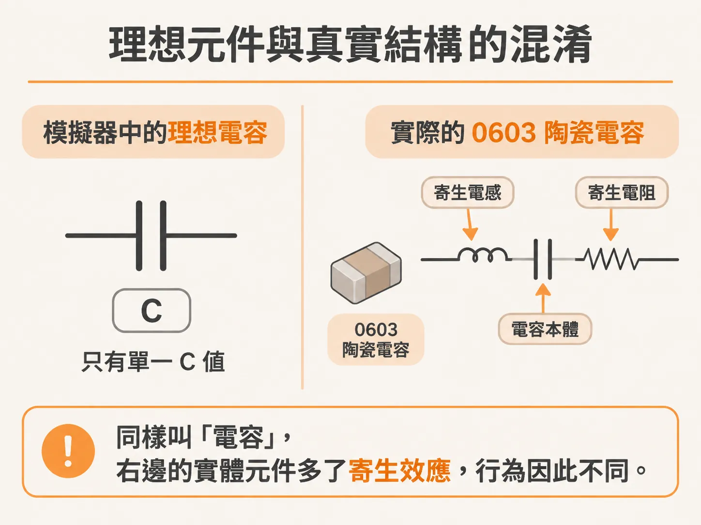
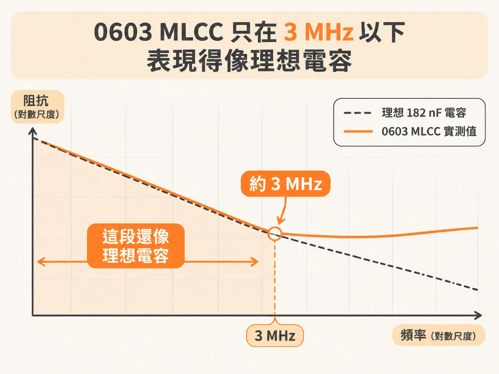

# 理想元件與真實電容的差別：為什麼 0603 MLCC 只在 3 MHz 以下像電容？

在設計高速數位電路時，我們常在模擬軟體裡拉出一顆電容，期待它能幫忙濾波或穩定電源。我們可以使用像 QUCS 的阻抗分析儀電路，模擬出由各種理想電路元件組合而成的阻抗特性。然而，模擬出來的結果往往和實際在電路板上量到的阻抗有相當大的落差。

要避開這個陷阱，關鍵在於分清楚「理想電路元件（ideal circuit elements）」與「真實電路元件（real circuit components）」。

## 理想元件與真實結構的混淆

理想電路元件具有精確、明確定義的數學特性，專門用在電路模擬裡。真實電路元件則是有具體形狀、大小與材質的實體結構，能透過儀器量測出阻抗，而且必然包含各種寄生效應（parasitic effects）。

很可惜的是，不管是電路圖上的符號還是焊接在板子上的零件，我們都統稱為「電容」。雖然名稱相同，兩者的行為與特性卻可能天差地遠。即使大家習慣叫它電容，在某些頻段下，這顆真實電容所量測到的阻抗，甚至完全不像一顆理想電容。

真實電路元件的運作，本質上是基於它的實體結構設計、材料特性以及馬克士威方程式（Maxwell's Equations）。它的行為通常可以看成是「理想元件加上寄生效應」；而我們在模擬中使用的理想電路元件，只是用來近似這個非理想實體結構的抽象化模型。

## 真實電容的量測與 S 參數模擬

如果想在電路模擬中納入真實元件的量測阻抗，有些特殊情況會採用行為模型，例如將阻抗以 S 參數（S-parameters）來描述。

不過，要把 S 參數這類行為模型與傳統的電阻、電感、電容（RLC）以及傳輸線（T）元件放在同一個電路中模擬，需要特別的模擬工具支援。更重要的是，如果你沒有完全掌握當初的量測設定細節，或是不知道那組 S 參數到底是如何產生的，直接套用行為模型往往伴隨著不小的風險。

要取得真實電容的阻抗，可以使用網路分析儀（VNA）搭配雙埠（two-port）量測技術。例如，將一顆 0603 封裝的積層陶瓷電容（MLCC，樣品由 X2Y attenuators 提供）焊接在四層測試板上，接著以雙埠向量網路分析儀進行量測，就能取得它完整的阻抗頻率曲線。

## 0603 MLCC 只在 3 MHz 以下表現得像理想電容

將這顆 0603 MLCC 的量測阻抗與模擬的理想電容阻抗疊合比較，會發現一個關鍵現象：

在低頻時，這顆真實電容的量測阻抗與一顆 182 nF 的理想電容高度吻合。兩者的曲線在大約 3 MHz 以下幾乎完全重疊。

但在大約 3 MHz 以上，真實電容因為內部結構與封裝的寄生電感等效應，阻抗不再隨著頻率上升而持續下降，反而開始偏離理想曲線。換句話說，這顆被標記為電容的 0603 MLCC，實際上只有在大約 3 MHz 以下的頻段，行為才真正符合我們對理想電容的預期。超過這個頻率，就不能再把它當作單純的理想電容來看待。
