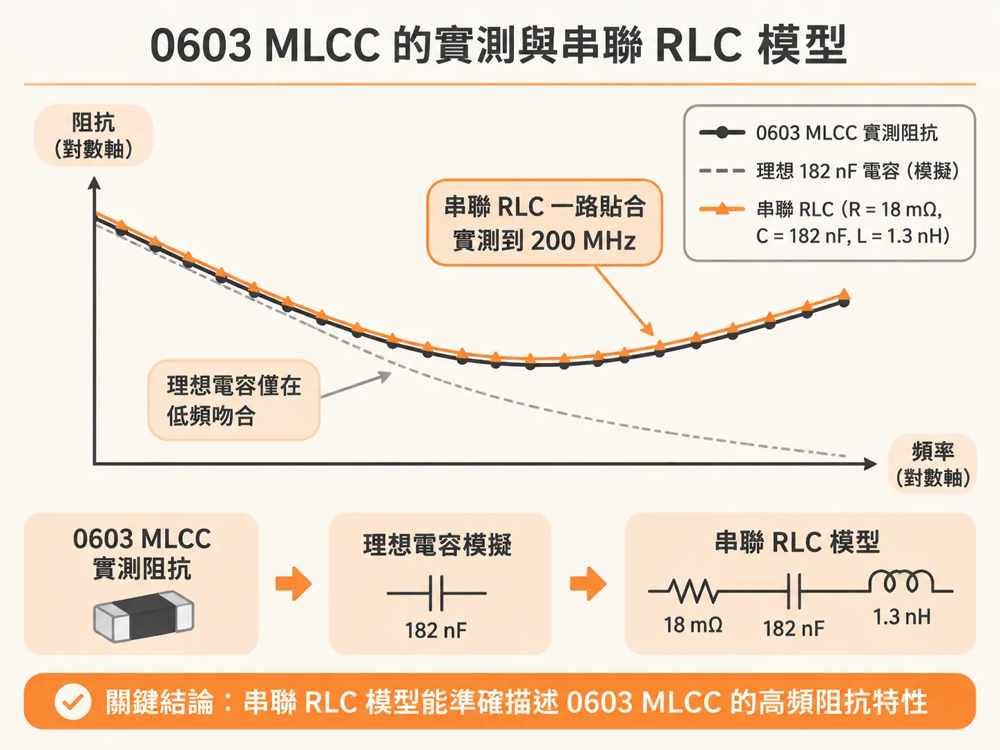
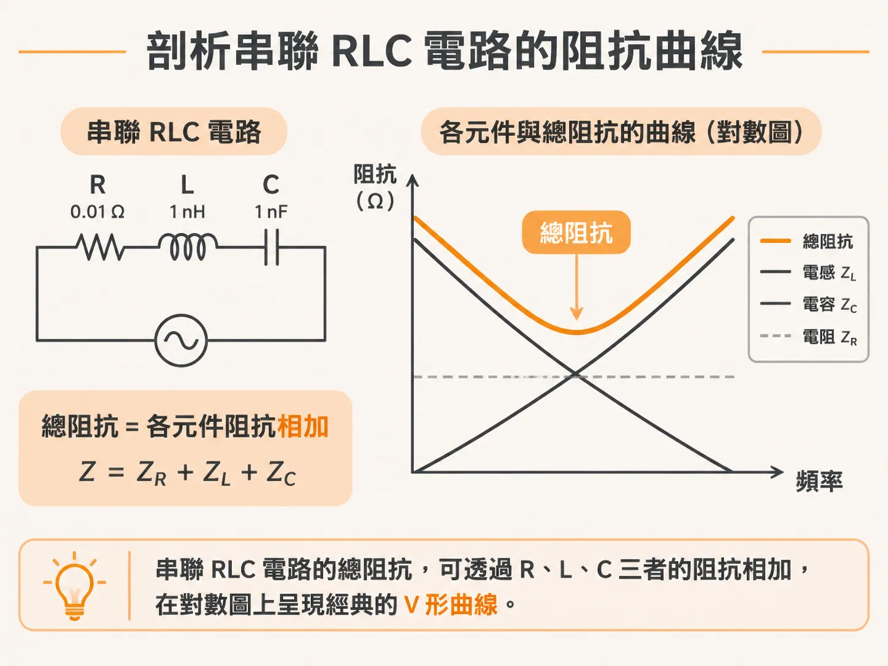
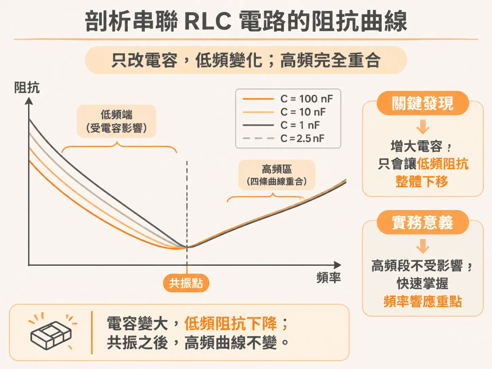

# 用串聯 RLC 模型精準掌握 0603 MLCC 的實測阻抗

在規劃高速數位產品的電源分配網路（PDN）時，工程師經常會放上大量積層陶瓷電容（MLCC）來抑制電源雜訊。但在高頻環境下，一顆標稱 182 nF 的電容，表現往往和純電容相差甚遠。若在模擬時只把它當成一顆理想電容，頻率只要拉高，阻抗預估就會完全失真。

要準確描述真實電容在更高頻寬下的阻抗行為，串聯 RLC 電路是最經典且強大的模型。

## 0603 MLCC 的實測與串聯 RLC 模型

以一顆封裝為 0603 的 MLCC 實測阻抗為例，如果只用理想的 182 nF 電容去模擬，會發現兩者只有在低頻段吻合；一旦頻率往上升，實測阻抗不再隨頻率下降，反而開始反彈上升。

但只要改用一個理想的串聯 RLC 電路來模擬，情況就完全改觀。將電路參數設定為：

- 電阻 $R = 18\text{ m}\Omega$
- 電容 $C = 182\text{ nF}$
- 電感 $L = 1.3\text{ nH}$

模擬出來的阻抗大小（magnitude）與相位（phase），就能與 0603 MLCC 的實測曲線高度吻合。這項吻合度一路延伸到量測儀器的頻寬上限 200 MHz。事實上，這個模型的適用頻寬很可能高於 200 MHz，只是現有的量測數據無法再往上看。

值得注意的是，雖然整體電路的阻抗會隨頻率劇烈變動，但模型裡所使用的 $R$、$L$、$C$ 理想元件數值，本身都是不隨頻率改變的常數。這說明了一件事：我們不需要複雜的黑盒子，只要憑藉工程洞察力與實務經驗，挑選合適的電路拓撲並設定參數，就能用少數幾個常數理想元件，精準逼近實體元件內部複雜的非理想寄生效應。

## 為什麼量測是驗證模型的關鍵？

能夠用相對簡單的理想元件組合，在如此高的頻寬下精確還原真實結構的阻抗，是一件非常驚人的事。然而，通常要確認一個模型到底夠不夠準、到底能吻合到多高的頻寬，唯一的途徑就是透過實際量測。

在 PDN 的領域中，絕大多數相關結構都可以簡化成兩種基本的 RLC 電路及其衍生組合：
1. $R$、$L$、$C$ 元件的串聯組合
2. $R$、$L$、$C$ 元件的並聯組合

這裡所謂的「串聯」或「並聯」，是指從量測儀器或模擬訊號源的視角看進去時，$L$ 與 $C$ 這兩個電抗元件是如何連接的；至於電阻 $R$，則可以選擇與其中一個電抗元件串聯或並聯。徹底摸清這兩種電路的特性，是透徹理解 PDN 效能的基石。

## 剖析串聯 RLC 電路的阻抗曲線

串聯 RLC 電路之所以如此關鍵，正是因為它是詮釋實體電容行為的最佳模型。在計算上，串聯 RLC 電路的總阻抗十分單純，只要透過基礎代數將各元件的阻抗直接相加即可。

我們也可以在 SPICE 中架設阻抗分析儀電路來進行模擬。假設設定一組元件參數為 $R = 0.01\ \Omega$、$L = 1\text{ nH}$ 以及 $C = 1\text{ nF}$，觀察其阻抗大小與相位隨頻率變化的曲線，會發現串聯 RLC 電路具有三個涇渭分明的特徵頻段：

1. **電容性區域（低頻）**：在頻率最低的頻段，電路的總阻抗幾乎完全由理想電容的阻抗主導。阻抗隨頻率上升而下降，阻抗相位則落在 $-90$ 度，這與理想電容完全一致，也符合因果系統的克拉莫-克羅尼希關係（Kramers-Kronig relationship）。
2. **電阻性區域（共振點）**：當電容抗與電感抗互相抵消時，阻抗達到最低點，整體電路純粹呈現電阻性，阻抗大小等於 $R$。
3. **電感性區域（高頻）**：超過共振頻率後，寄生電感開始支配整體行為，阻抗隨頻率上升而線性增加。

若將電感固定在 $L = 1\text{ nH}$，把電容量 $C$ 分成四個階段從 $1\text{ nF}$ 逐步提高到 $100\text{ nF}$，會發現曲線的改變僅僅集中在低頻端：電容量變大，只會讓低頻區的阻抗整體往下移，而超過共振點之後的高頻電感性區間，曲線則完全重疊，絲毫不受電容大小影響。掌握了這項特性，面對不同規格的 MLCC 時，就能快速抓住其頻率響應的主導因素。

