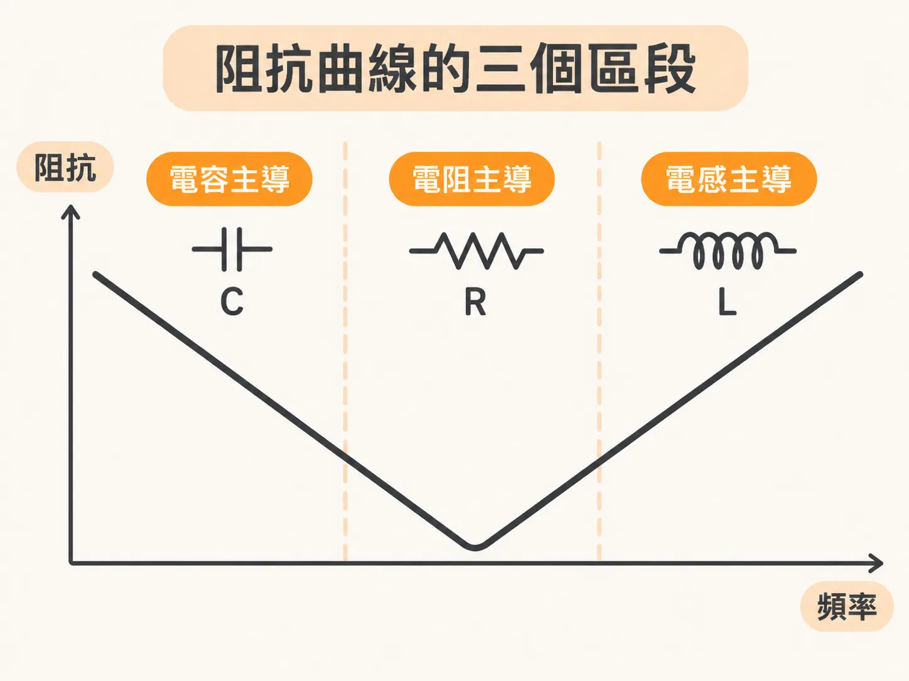
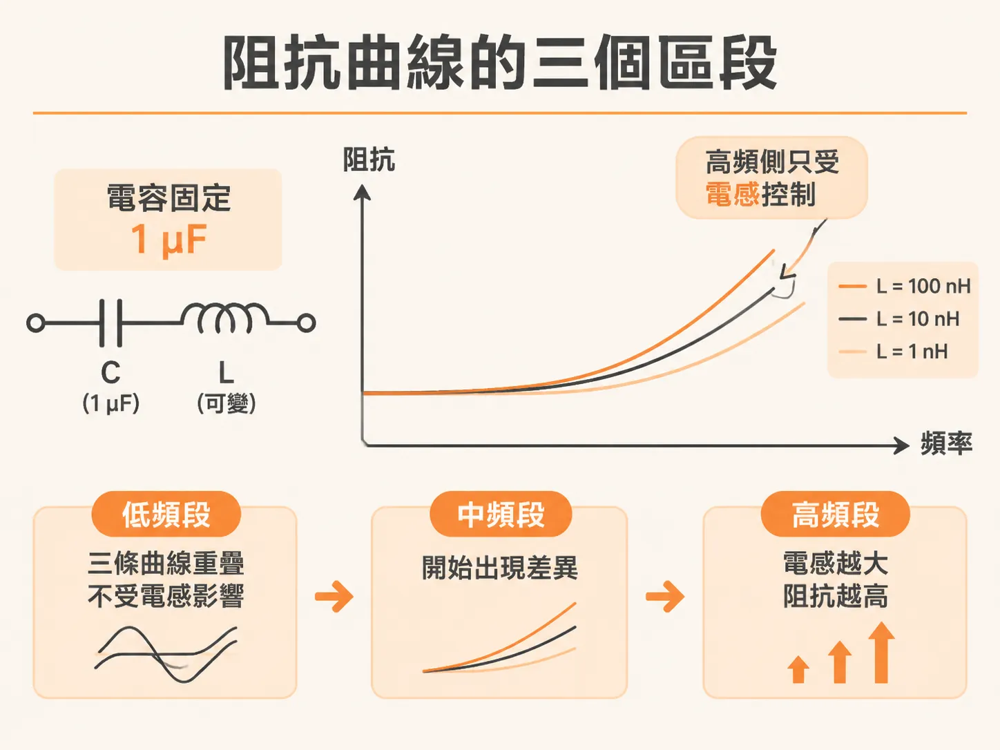
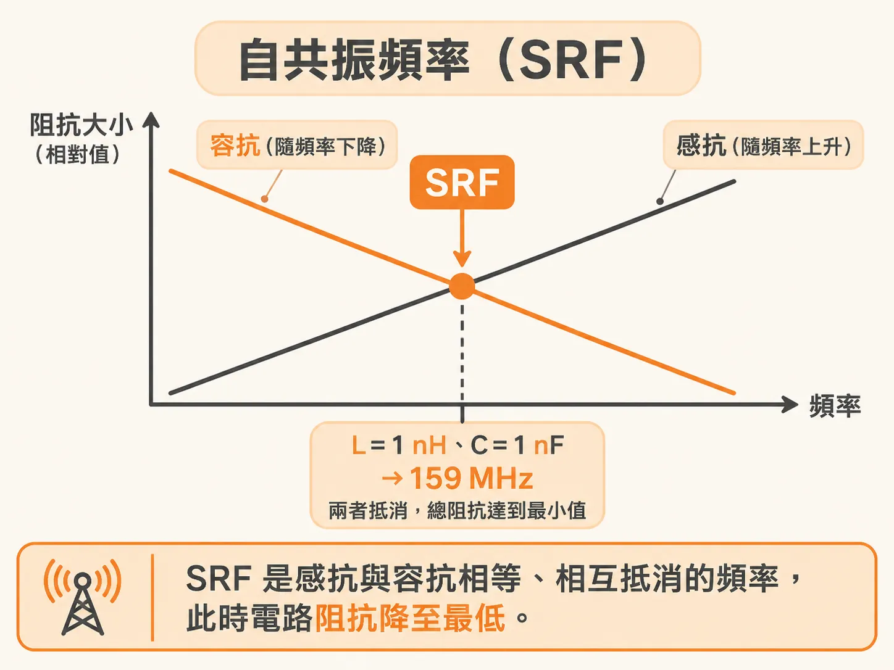

# 解讀串聯 RLC 阻抗曲線與計算自共振頻率

在分析電源完整性（PDN）或挑選去耦電容時，串聯 RLC 電路的阻抗頻率響應往往呈現一個深谷形狀。要掌握這條曲線，關鍵在於把它拆解為電容、電阻與電感主導的三個區段。

## 阻抗曲線的三個區段

串聯 RLC 電路的阻抗曲線在不同頻段由不同元件主導：

- **低頻區段**：阻抗完全由電容決定，呈現隨頻率上升而阻抗下降的容抗特性。
- **共振點**：當感抗與容抗大小相等時，兩者串聯抵消為零，此時整體電路阻抗降到最低，完全由理想電阻元件決定。
- **高頻區段**：阻抗完全由理想電感的感抗主導，電路的相位為 +90 度，與理想電感完全一致。

因為高頻端只受電感控制，若想改變串聯 RLC 電路在高頻端的阻抗，唯一的辦法就是改變電感值。例如將電容值固定為 1 µF，把電感值 $L$ 由 1 nH 逐步增加到 100 nH，整條曲線上只有高頻側的阻抗會往上抬升，低頻側則完全不受影響。

## 自共振頻率（SRF）的計算

感抗與容抗大小交會、相互抵消的頻率，稱為自共振頻率或串聯共振頻率（Self or Series Resonance Frequency, SRF），這也是整個電路阻抗達到極小值的頻率點。

若以角頻率 $\omega$（單位為 rad/s）表示：

$$\omega = \frac{1}{\sqrt{LC}}$$

轉換為一般頻率（單位為 Hz）時，公式為：

$$\text{SRF} = \frac{1}{2\pi \sqrt{LC}}$$

其中電感 $L$ 的單位為亨利（H），電容 $C$ 的單位為法拉（F）。

在實際工程計算上，更方便的單位組合是將電感以 nH、電容以 nF 輸入，算出來的自共振頻率單位即為 MHz：

$$\text{SRF (MHz)} = \frac{1000}{2\pi \sqrt{L\text{ (nH)} \times C\text{ (nF)}}}$$

舉例來說，若電路中的電感 $L = 1\text{ nH}$、電容 $C = 1\text{ nF}$，代入公式後即可算出 SRF 為 159 MHz。這個 159 MHz 就是電路出現最小阻抗的確切頻率。

## 共振頻率下的「特性阻抗」

在共振頻率下，電路整體阻抗雖然只剩下電阻值，但個別電容或電感本身的抗值大小依然存在，數值為 $\sqrt{L/C}$。

這個數值常被稱為該 RLC 電路的「特性阻抗」（characteristic impedance）。需要特別注意的是，它與傳輸線的特性阻抗完全不同，純粹代表該 RLC 電路在共振頻率時，電感與電容各自具備的阻抗大小。

總結來說，串聯 RLC 電路低頻只看電容、高頻只看電感、谷底最低點只看電阻。只要掌握電感與電容的數值，就能迅速推算出阻抗最低的自共振頻率。
