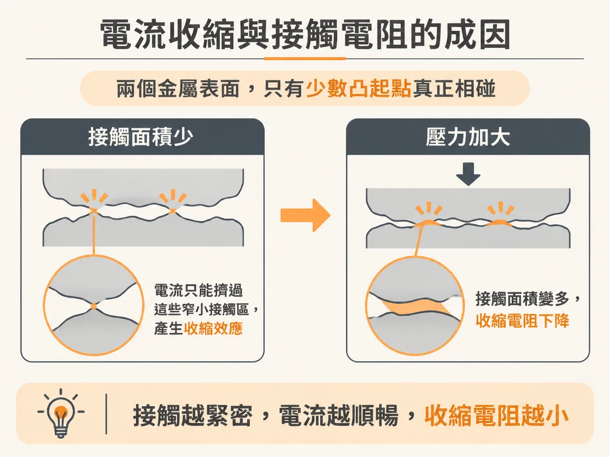
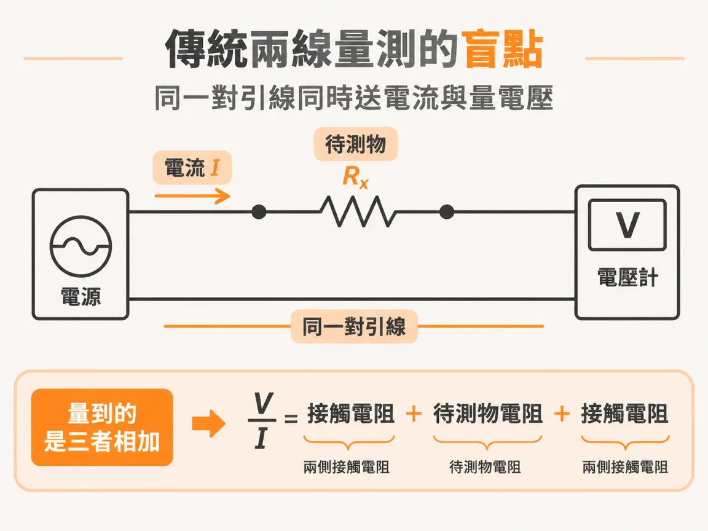
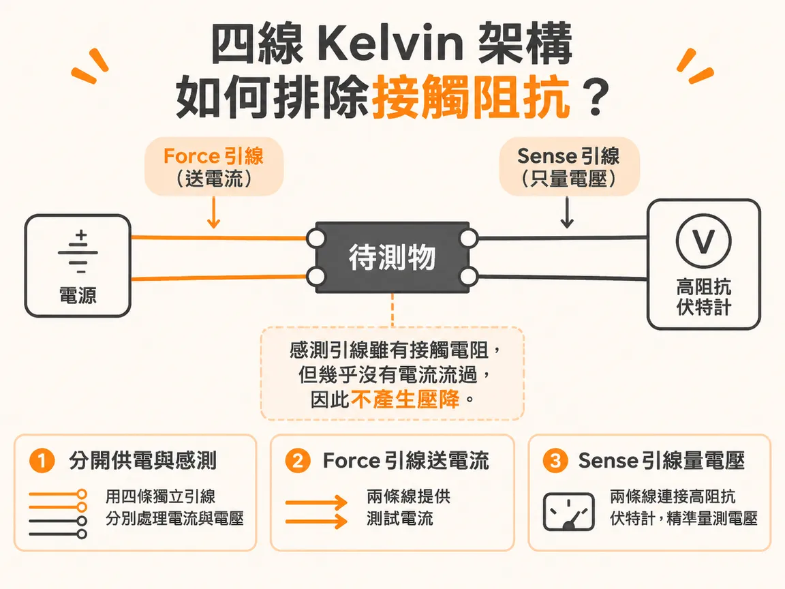

# 為什麼量小電阻不能只用兩條線：接觸電阻與四線 Kelvin 量測法

在電路板設計或電源完整性分析中，如果試著用傳統三用電表測量小於 1 Ω 的導體結構或電源平面阻抗，量出來的數值往往比理論值大上好幾倍。這個誤差並不是儀器刻度不夠細，而是測量探針接觸金屬表面時，介面本身產生了不可忽視的接觸電阻（contact resistance）。

### 電流收縮與接觸電阻的成因

當兩個金屬表面乾燥接觸時，無論肉眼看起來多麼平整，微觀視角下都只有少數凸起點真正互相碰觸。

即使表面完全沒有氧化層或介金屬化合物，電流通過這些微小接觸點時，路徑會被迫緊縮在極小的區域內。這種現象稱為收縮效應，由此產生的阻抗稱為收縮電阻（constricting resistance）或擴散電阻（spreading resistance）。

接觸面承受的壓力越大，實際碰觸的微觀面積就越多，收縮電阻隨之降低。以乾淨的金對金表面為例，施加 100 克重（100 g-force）的下壓力時，接觸電阻大約落在 20 mΩ 左右。

一旦金屬表面形成氧化層，接觸電阻就會急遽增加到 100 mΩ 以上。如果是焊料（solder）、鋁或銅這類在空氣中極易氧化的金屬，介面接觸電阻甚至可能達到 2 Ω 以上。當待測物（DUT）本身的電阻小於 1 Ω 時，接觸電阻就成了主導整體量測結果的最大誤差來源。

### 傳統兩線量測的盲點

傳統的兩線量測（two-wire measurement）使用同一對引線連接待測物：

1. 電流源透過兩條引線將電流 $I$ 灌入待測物。
2. 電表測量這兩條引線兩端的總電壓降 $V$。
3. 儀器以 $V / I$ 計算待測物的阻抗。

探針與待測物接觸點上的接觸電阻，會直接與待測物本身的電阻串聯在同一個迴路上。儀器量到的總電壓降，同時包含了待測物與兩個接觸點的壓降。兩線量測真正算出來的數值，是待測物電阻加上兩側引線接觸電阻的總和。

### 開爾文勳爵與四線量測的誕生

為了解決接觸電阻對導體量測的干擾，物理學家威廉·湯姆森（William Thomson）提出了一種全新的接線架構。

湯姆森曾任蘇格蘭格拉斯哥大學（University of Glasgow）的自然哲學教授，學術生涯超過五十年。他早期的代表成就之一是分析第一條跨大西洋海底電纜，從中開創了傳輸線（transmission line）概念，並推導出電報方程（Telegrapher's Equations）。因為修復跨洋電纜的貢獻，他被英國女王冊封為爵士，後來獲封進入英國上議院，成為第一位獲此殊榮的科學家。他選擇以流經格拉斯哥大學旁的開爾文河為名，受封為開爾文勳爵（Lord Kelvin）。現今衡量絕對零度的開爾文溫標（Kelvin scale），同樣是以他命名。

開爾文勳爵在電學領域的研究中，發明了一種能繞過接觸電阻、精準測量金屬導體本質低電阻的方法，也就是通稱的四線量測或開爾文量測（Kelvin measurement）。

### 四線 Kelvin 架構如何排除接觸阻抗

開爾文量測的核心觀念，是將「供電」與「感測」徹底拆開，改用四條獨立的引線分別連接待測物：

- **激勵電流引線（Force leads）**：維持原本的功能，專門用來把電流灌入待測物。電流流經這組引線時，依然會穿過它們各自的接觸電阻。
- **感測電壓引線（Sense leads）**：獨立拉出另外兩條引線，直接接觸待測物的兩端，只負責測量待測物本體上的電壓降。

電壓感測引線在接觸待測物時，同樣存在接觸電阻。但是，用來測量電壓的電表（voltmeter）具備極高的輸入阻抗，流經電壓感測引線的電流趨近於零。

根據歐姆定律，幾乎沒有電流流經感測引線，感測點上的接觸電阻也就不會產生可觀的電壓降。電表量到的電壓，純粹是待測物本體的端電壓，完全不受接觸介面的收縮電阻或氧化物阻抗影響。

這種將電流路徑與電壓路徑分離的做法，本質上就是把待測物的阻抗與量測治具（fixture）的接觸阻抗完全脫鉤。這套直流上的四線概念，在搬到射頻與微波領域的雙埠向量網路分析儀上時，便成為量測高頻低阻抗的核心機制。
