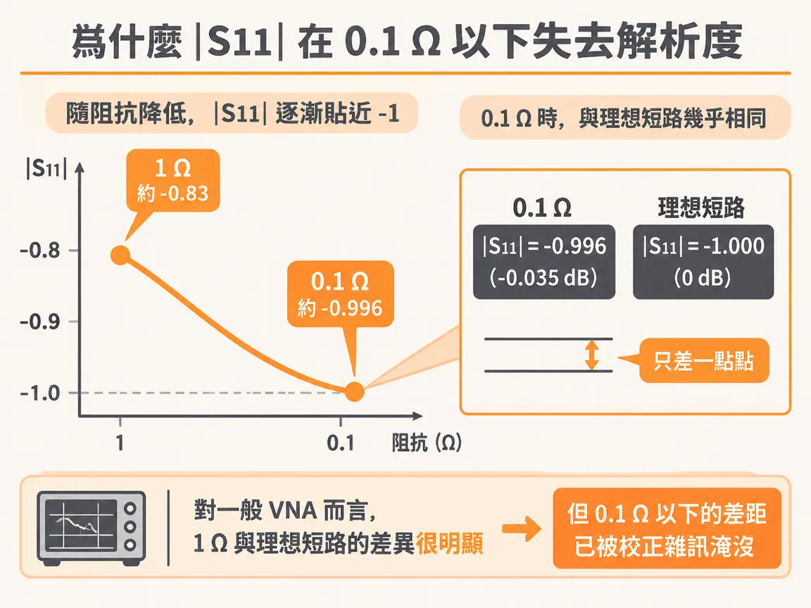
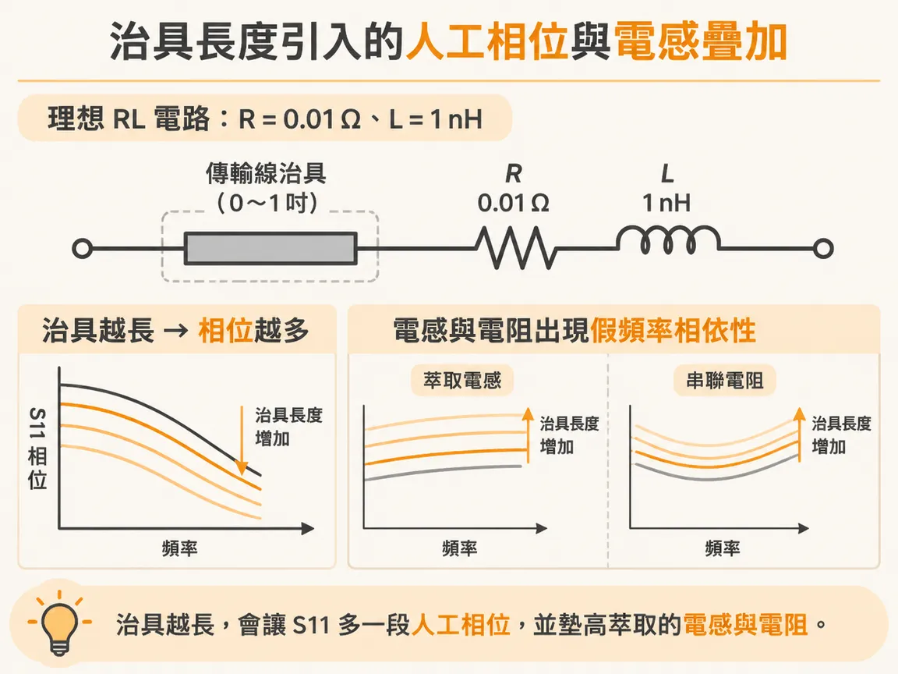
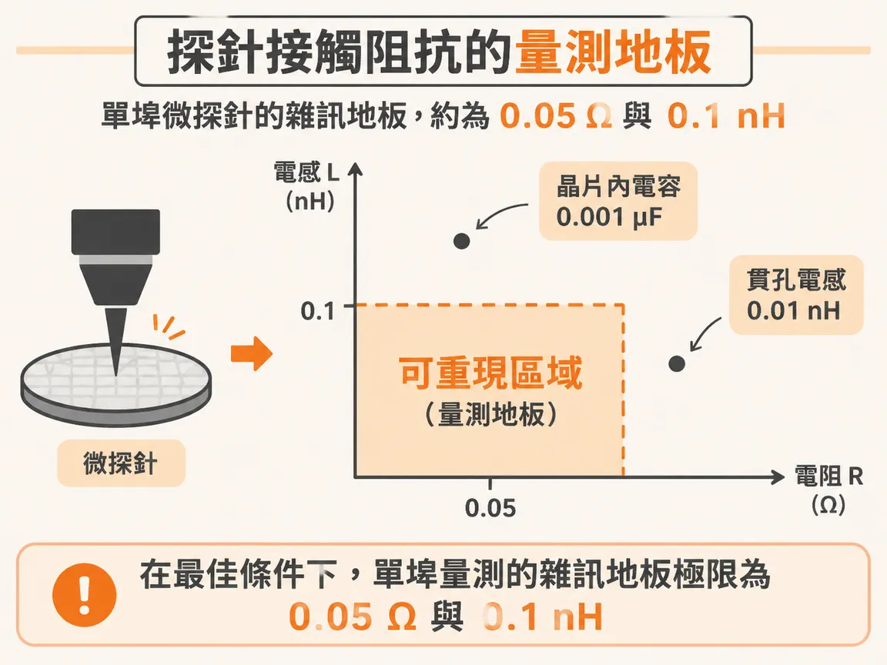

# 單埠 VNA 量測低阻抗的物理極限：訊雜比、治具相位與探針接觸地板

在評估電源分配網路（PDN）的阻抗時，若直接用向量網路分析儀（VNA）量測單埠反射參數（S11）來換算待測物（DUT）的輸入阻抗，當待測阻抗降到次歐姆等級時，會迅速遇到物理與儀器極限，導致讀數嚴重失真。

這類量測失效主要來自三個根本原因：反射訊號的訊雜比不足、量測治具引入的相位誤差，以及探針與焊墊之間的接觸阻抗。

### 為什麼 |S11| 在 0.1 Ω 以下失去解析度

使用單埠 VNA 量測極低阻抗的第一個難題，在於反射訊號的訊雜比（SNR）。

當 DUT 的阻抗為 1 Ω 時，S11 的幅度大約比完全反射的 -1 大 4% 左右。這個差異對一般 VNA 來說相當充裕，儀器能穩定區分 1 Ω 與理想短路的差異。

但如果 DUT 的阻抗降到 0.1 Ω，反射係數 S11 會變成約 -0.996。換算成對數刻度，這只有 -0.035 dB 的衰減。在這種情況下，要將 -0.996 的反射訊號與短路標準件的 -1 正確分辨，量測系統會對極微小的雜訊異常敏感。-0.035 dB 的變化量，通常已經落在儀器校正程序的重現性雜訊極限內。

在 0.1 Ω 時，電阻量測勉強還能維持一致性；但一旦待測阻抗低於 0.1 Ω，S11 的量測解析度便徹底崩潰，無法再萃取出可靠的數值。

### 治具長度引入的人工相位與電感疊加

第二個問題來自連接 DUT 的治具（fixture）。即使使用一條毫無損耗的完美傳輸線，將校正後的 VNA 連接端延伸至 DUT，傳輸線本身的相位延遲依然會在量測中製造假影，扭曲阻抗萃取結果。

若以理想的 RL 串聯電路（R = 0.01 Ω、L = 1 nH）進行模擬，並在前方串聯不同長度（0 到 1 吋，以 0.25 吋遞增）的理想傳輸線治具，就能清楚看見這種影響。隨著治具長度增加，S11 會被疊加一段人工相位，這段相位接著向下干擾阻抗的相位計算。

結果是，萃取出的等效電感不僅隨著治具長度增加而墊高，還在高頻端呈現出虛假的頻率相依性；原本固定的串聯電阻也同樣開始隨頻率變化。

單埠 VNA 量測所看見的，永遠是治具與 DUT 的總和。萃取電感變高，是因為治具傳輸線本身帶有串聯電感。這意味著單埠量測無法將 DUT 的本質電感從整體量測中準確剝離。即使治具長度不到一吋，其引入的電感就足以淹沒微亨利等級的待測物。雖然在治具特性極度精確已知的前提下可以嘗試進行去嵌入（de-embedding），但治具佔比越大，去嵌入的數學運算就越脆弱且困難。

### 探針接觸阻抗將量測地板壓在 0.05 Ω 與 0.1 nH

為了徹底消除治具長度的干擾，常見的做法是改用微探針（microprobe），並將 VNA 的校正基準面直接拉到探針尖端。這種做法確實去除了傳輸線長度帶來的假影，卻隨之引來第三個問題：接觸阻抗。

微探針接觸焊墊屬於乾式接觸（dry contact）。接觸電阻取決於表面金屬材質：即使是最佳狀況的金對金接觸，接觸電阻也有約 0.05 Ω；若是面對表面氧化的錫或銅焊墊，接觸電阻甚至可達 2 Ω。

此外，雖然探針本體特性能在校正時被扣除，但探針尖端只要產生微小的形變，或下針位置出現偏移（例如探針刮擦焊墊），就會改變殘留迴路電感。微小迴路的典型電感大約是每 mil 長度 20 pH。如果探針在焊墊上下壓滑移僅僅 5 mils，探針尖端的殘留迴路電感就會產生：

5 mils × 20 pH/mil = 100 pH（即 0.1 nH）

這個漂移量會直接疊加在校正值之上，無法藉由預先校正消除。

探針接觸特性的重現性，決定了單埠 VNA 阻抗量測的物理底線。在最佳的微探針條件下，單埠量測的雜訊地板極限約為 0.05 Ω 與 0.1 nH。

這項限制在超過 100 MHz 的頻率下格外嚴苛，它將電容量測範圍限制在 0.01 µF 以下，並將電感量測下限封死在 0.1 nH 以上。在 PDN 元件特性量測中，晶片內電容可能僅有 0.001 µF，貫孔（via）電感往往只有 0.01 nH，單埠量測在此完全失去實用價值。

如果是在沒有實體治具與探針的純電路模擬環境中，S11 仍可用於萃取極低阻抗；但在實驗室實測時，面對次歐姆級別的 PDN 阻抗，單埠 S11 終究受困於訊雜比、治具相位與接觸阻抗這三重假影。要突破這個限制，必須先從探針與導體介面的接觸阻抗機制看起，理解為何傳統量測會被這層介面困住。
