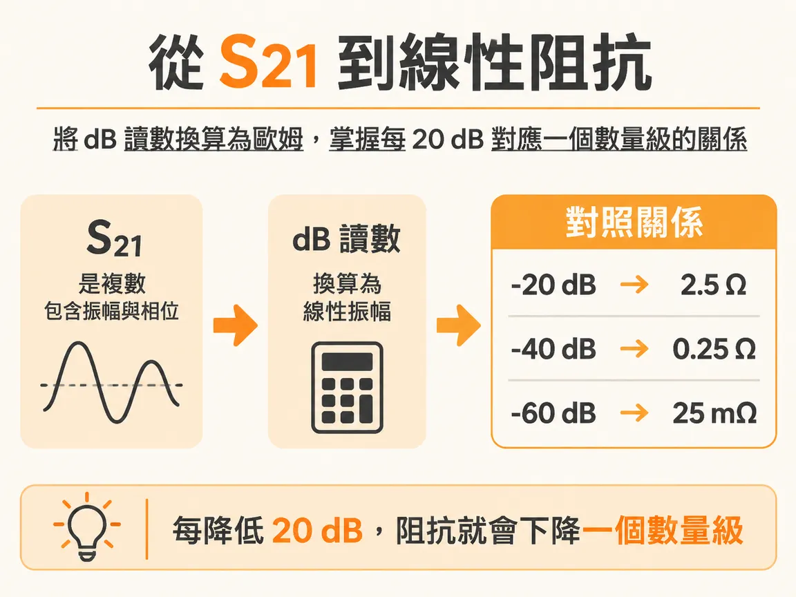
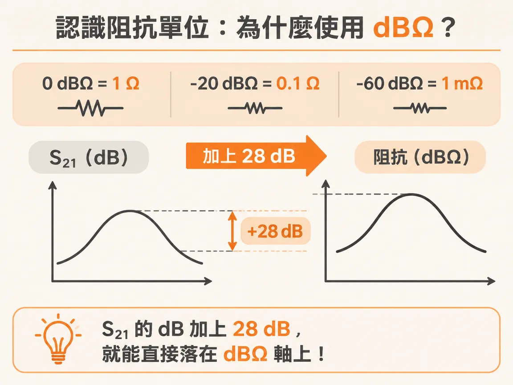
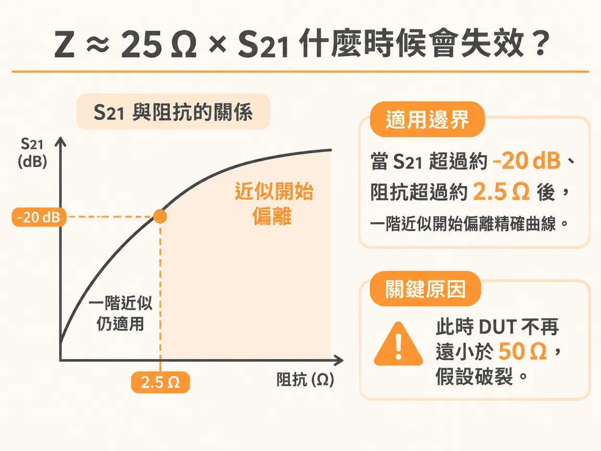
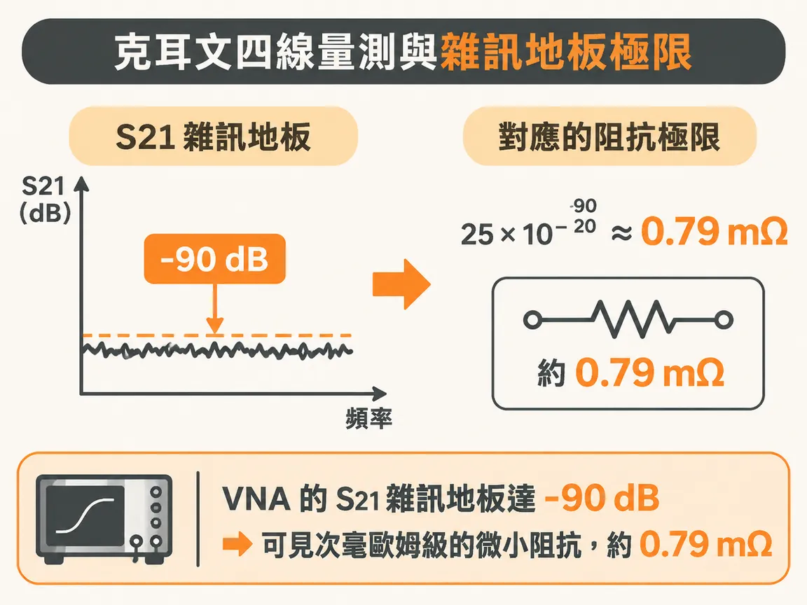

# 將 S21 換算為阻抗與 dBΩ：一階近似極限與雜訊地板解析

在評估高速數位系統的電源分配網路（PDN）時，工程師經常使用雙埠向量網路分析儀（VNA）量測傳輸係數 $S_{21}$，藉此推算出極低的毫歐姆級阻抗。VNA 畫面上呈現的往往是取對數後的分貝（dB）讀數，且量測背後依賴的簡化公式並非在所有情況下都成立。

清楚掌握 $S_{21}$ 與阻抗之間的換算邏輯、一階近似的適用邊界，以及儀器的雜訊地板極限，是避免量測失真的關鍵。

## 從 S21 到線性阻抗

$S_{21}$ 本身是一個包含振幅與相位的複數，而不是 dB。當儀表以 dB 顯示 $S_{21}$ 時，如果要換算成以歐姆（$\Omega$）為單位的阻抗，必須先將 dB 值轉回線性振幅大小，再進行比例縮放。

在待測物（DUT）阻抗非常低的假設下，阻抗與 $S_{21}$ 的一階近似關係為：

阻抗 $Z = 25 \times 10^{(S_{21}[\text{dB}] / 20)}$

透過幾個具體數值可以看出兩者的對應關係：
- 當 $S_{21}$ 為 $-20\text{ dB}$ 時，阻抗 $Z = 25 \times 10^{(-20/20)} = 2.5\ \Omega$。
- 當 $S_{21}$ 為 $-40\text{ dB}$ 時，阻抗為 $0.25\ \Omega$。
- 當 $S_{21}$ 為 $-60\text{ dB}$ 時，阻抗為 $25\text{ m}\Omega$。

要量測到毫歐姆（$\text{m}\Omega$）等級的阻抗，通常需要運用到 VNA 的完整動態範圍。

## 認識阻抗單位：為什麼使用 dBΩ？

工程上也常將阻抗本身以 dB 表示。dB 本質上是兩個功率比值的對數，但在阻抗轉換時，常會引發兩個疑問：「參考值是什麼？」以及「阻抗該視為電壓還是功率？」

由於阻抗正比於 S 參數，而 S 參數在定義上是振幅而非功率，因此阻抗在 dB 尺度下的表現如同振幅。這意味著在將 dB 阻抗換算回歐姆時，採用的係數是 20 而非 10：

$Z[\text{dB}] = 20 \times \log(Z[\Omega] / 1\ \Omega)$

在慣例上，當我們以 dB 描述阻抗時，基準值取為 $1\ \Omega$。這就像是以 $1\text{ mW}$ 為基準稱為 $\text{dBm}$、以 $1\ \mu\text{W}$ 為基準稱為 $\text{dBu}$ 一樣，以 $1\ \Omega$ 為基準的單位理想上應寫作 $\text{dB}\Omega$。雖然業界大多簡稱為「阻抗多少 dB」，但理解為 $\text{dB}\Omega$ 能有效避免混淆：
- $0\text{ dB}\Omega$ 代表 $1\ \Omega$
- $-20\text{ dB}\Omega$ 代表 $0.1\ \Omega$
- $-60\text{ dB}\Omega$ 代表 $1\text{ m}\Omega$

在一階近似成立的前提下，$S_{21}$（dB）與阻抗（$\text{dB}\Omega$）之間存在一個簡單的加法關係：

$Z[\text{dB}\Omega] \approx 28\text{ dB} + S_{21}[\text{dB}]$

其中的 $28\text{ dB}$ 來自於 $20 \times \log(25\ \Omega)$。舉例來說：
- 若量得 $S_{21}$ 為 $-40\text{ dB}$，阻抗即為 $28 + (-40) = -12\text{ dB}\Omega$；換算回線性值為 $10^{(-12/20)} = 0.25\ \Omega$。
- 若量得 $S_{21}$ 為 $-60\text{ dB}$，阻抗即為 $28 + (-60) = -32\text{ dB}\Omega$；換算回線性值為 $10^{(-32/20)} = 0.025\ \Omega$（即 $25\text{ m}\Omega$）。

## Z ≈ 25 Ω × S21 什麼時候會失效？

$Z \approx 25\ \Omega \times S_{21}$ 只是簡化的一階近似。它的推導前提是：待測物的阻抗遠小於系統傳輸線特徵阻抗（即遠小於 $50\ \Omega$）。

因此，當量測到的 $S_{21}$ 大於約 $-20\text{ dB}$ 時，對應的阻抗已超過 $2.5\ \Omega$，這項「遠小於 $50\ \Omega$」的假設被破壞，該近似公式便不再適用。

如果透過嚴謹的電路代數推導（相當於 VNA 透過零長度傳輸線連接至 DUT 的模型），可以得到適用於任意阻抗大小的精確關係式。當 DUT 阻抗非常小時，精確式自然會簡化為 $Z_{\text{DUT}} = 25\ \Omega \times S_{21}$。

需要注意的是，雖然精確數學公式適用於所有阻抗，但 $S_{21}$ 量測在 DUT 阻抗極大時會出現數值計算問題（numerical problems），這與單埠 $S_{11}$ 在阻抗極小時會失去精度的現象類似。例如在低頻量測小電容、或在高頻量測大電感時，就會遭遇這種數值極限。在 PDN 量測的情境中，關注的焦點幾乎都是遠小於 $25\ \Omega$ 的超低阻抗。

此外，$S_{21}$ 與阻抗在實際電路中皆為複數，兩者都隨頻率變化，在完整推導中皆由複數運算處理。

## 克耳文四線量測與雜訊地板極限

雙埠克耳文（two-port Kelvin）四線量測技術，是實現量測小於 $1\text{ m}\Omega$、頻率突破 $1\text{ GHz}$ 的關鍵基礎。

任何標準的雙埠 VNA 都可以透過這套原理來量測超低阻抗。為了壓低雜訊、看清微小的信號，可以搭配以下量測設定：
- 提高訊號發射功率（higher power）
- 開啟多次平均功能（averaging）
- 設定較窄的中頻通帶濾波器（narrow pass band filter）

在這些最佳化配置下，VNA 的 $S_{21}$ 雜訊地板常規上可壓低至 $-90\text{ dB}$。將 $-90\text{ dB}$ 代入換算，所對應的阻抗極限約為 $25 \times 10^{(-90/20)} \approx 0.79\text{ m}\Omega$，讓次毫歐姆級的微小阻抗清晰可見。

在進行這類量測時，除了掌握換算關係與雜訊極限外，也必須特別謹慎處理 DUT 兩端的連接方式，以避免引入常見的夾具與探針量測誤差。
