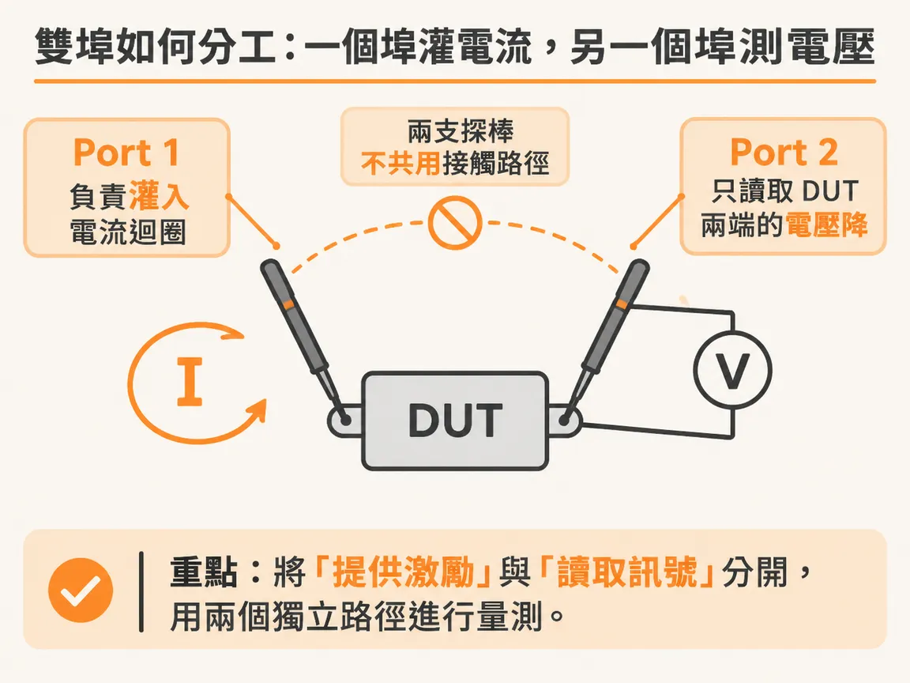
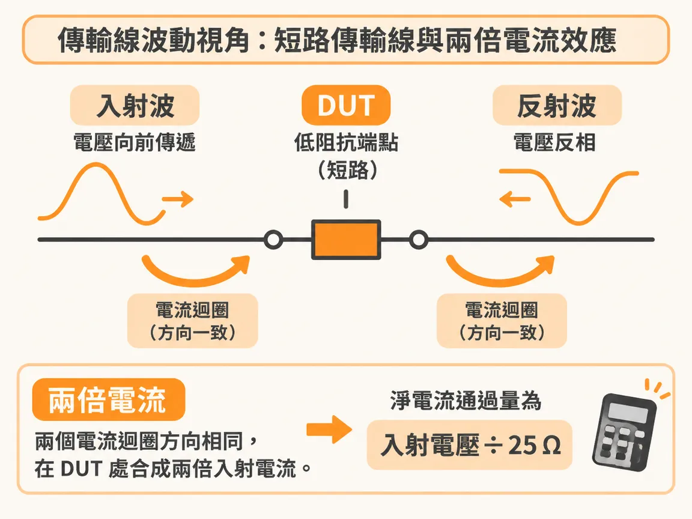
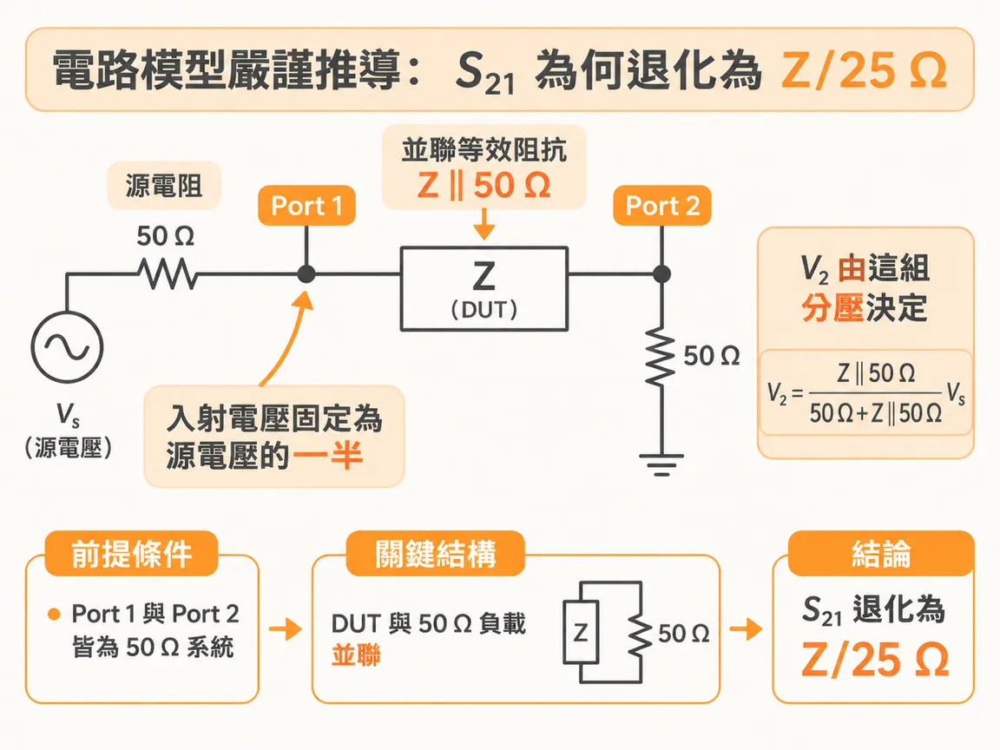

# 雙埠低阻抗量測原理：從電流分工到 S21 退化為 Z/25 Ω 的推導

在評估高速數位系統的電源分配網路（PDN）時，工程師經常需要量測毫歐姆（$\text{m}\Omega$）等級的超低阻抗。若直接使用向量網路分析儀（VNA）的單埠（One-port）來測量，雖然接頭只有一個，實際上仍有訊號與返回兩條導線連接到待測物（DUT）。這種接法會將探棒接點與測試治具的接觸阻抗一併算入，只要接觸面稍有雜質或壓力不均，量測結果就會失真，通常只能準確量到 $0.1\ \Omega$ 以上的阻抗。

為了解決這個瓶頸，PDN 量測改用雙埠（Two-port）架構，也就是四線式的開爾文感測概念。透過將電流激勵與電壓感測分開，能將接觸阻抗的影響降到最低。

## 雙埠如何分工：一個埠灌電流，另一個埠測電壓

雙埠量測的核心是將「提供激勵」與「讀取訊號」拆到兩個獨立路徑上：

* **Port 1 負責驅動電流**：Port 1 送出訊號，在 DUT 上建立驅動電流迴圈，進而在 DUT 兩端產生微小的跨壓。
* **Port 2 負責感測電壓**：Port 2 作為接收端，只負責測量 DUT 兩端因電流流過而產生的電壓降。

這項量測能克服接觸阻抗的關鍵，在於兩組探棒必須以**各自獨立的接點**連接至 DUT 同一組端子上。兩支探棒絕不能共用接觸路徑；一旦共用路徑，接觸阻抗上的壓降就會混入 Port 2 的量測電壓中。

## 傳輸線波動視角：短路傳輸線與兩倍電流效應

從傳輸線的波動角度來看，Port 1 往 DUT 方向看去，看到的是 DUT 阻抗與 Port 2 的 $50\ \Omega$ 系統特徵阻抗並聯。在 PDN 應用中，DUT 的阻抗通常遠小於 $50\ \Omega$，因此並聯阻抗主要由極低的 DUT 決定。

當 Port 1 的入射訊號撞上如此微小的阻抗時，會發生以下連鎖反應：

1. **極低阻抗造成強烈反射**：介面上的反射係數 $\Gamma$ 非常接近 $-1$。
2. **電流迴圈同相疊加**：正向傳播的入射電壓波 $V_{\text{incident}}$ 在 $50\ \Omega$ 纜線中攜帶順時針方向的電流迴圈，電流振幅為 $V_{\text{incident}} / 50\ \Omega$。當訊號遇到接近短路的 DUT 時，反射波 $V_{\text{reflected}}$ 的電壓反相 180 度，但反射波朝反方向傳播，兩者負負得正，使反射訊號的電流迴圈依然維持順時針方向，大小同樣約為 $V_{\text{reflected}} / 50\ \Omega$。
3. **DUT 上的淨電流倍增**：DUT 上的總電流是入射與反射電流迴圈的總和。因為兩個順時針電流迴圈同向疊加，DUT 處的總電壓幾乎歸零，而流經 DUT 的淨電流則倍增為入射電流的兩倍：

$$I_{\text{net}} \approx 2 \times \frac{V_{\text{incident}}}{50\ \Omega} = \frac{V_{\text{incident}}}{25\ \Omega}$$

這正是傳輸線末端短路時的典型物理現象。

這股倍增後的淨電流流過微小的 DUT 阻抗 $Z$，在 DUT 兩端建立一個微弱的電壓：

$$V_{\text{DUT}} = Z \times I_{\text{net}} = Z \times \frac{V_{\text{incident}}}{25\ \Omega}$$

這個在 DUT 端產生的微小電壓會射入右側的傳輸線，一路傳播至 Port 2，被 Port 2 的接收器測得為 $V_2$（即 $V_2 = V_{\text{DUT}}$）。

根據散射參數定義，$S_{21}$ 為輸出埠測得電壓與輸入埠入射電壓的比值（$S_{21} = V_2 / V_{\text{incident}}$）：

$$S_{21} = \frac{V_2}{V_{\text{incident}}} \approx \frac{Z}{25\ \Omega}$$

反推待測物阻抗，只需將量測到的 $S_{21}$ 乘上 $25\ \Omega$：

$$Z \approx 25\ \Omega \times S_{21}$$

在待測物阻抗極低的情境下，DUT 的阻抗大小與 $S_{21}$ 線性成正比，且阻抗的相位直接等於 $S_{21}$ 的相位。需要注意的是，$S_{21}$ 原始定義為複數；如果儀器顯示為分貝（dB），計算阻抗前必須先換算為線性振幅再乘以 $25\ \Omega$。

## 電路模型嚴謹推導：$S_{21}$ 為何退化為 $Z/25\ \Omega$

除了直觀的傳輸線波動疊加，也可以用集中元件電路模型（Lumped circuit model）配合 VNA 內部架構來推導完整的轉換關係。

假設 Port 1 與 Port 2 皆為 $50\ \Omega$ 系統，DUT 以並聯形式跨接在兩埠之間。Port 2 內部呈現為一個接地的 $50\ \Omega$ 負載，因此與阻抗 $Z$ 形成並聯電路，並聯等效阻抗為 $Z \parallel 50\ \Omega$。

### 1. 節點電壓 $V_2$ 與訊號源電壓的關係

若 Port 1 內部訊號源開路電壓為 $V_{\text{source}}$、內部訊號源電阻為 $50\ \Omega$，則節點處（即 Port 2 量到的電壓 $V_2$）由分壓定理決定：

$$V_2 = V_{\text{source}} \times \frac{Z \parallel 50\ \Omega}{50\ \Omega + (Z \parallel 50\ \Omega)}$$

### 2. 入射電壓 $V_{\text{incident}}$ 的本質

在 VNA 電路分析中，從 Port 1 射向 DUT 的入射電壓波**完全獨立於 DUT 的阻抗大小**。它只取決於內建訊號源電壓 $V_{\text{source}}$ 以及訊號源電阻與內部 $50\ \Omega$ 傳輸線特徵阻抗的分壓。因為兩者皆為 $50\ \Omega$，分壓比固定為一半：

$$V_{\text{incident}} = \frac{V_{\text{source}}}{2} \implies V_{\text{source}} = 2 V_{\text{incident}}$$

### 3. 推導 $S_{21}$ 完整方程式

將 $V_{\text{source}} = 2 V_{\text{incident}}$ 代回 $V_2$ 的分壓算式中：

$$V_2 = 2 V_{\text{incident}} \times \frac{Z \parallel 50\ \Omega}{50\ \Omega + (Z \parallel 50\ \Omega)}$$

兩邊同除以 $V_{\text{incident}}$，即可求得雙埠並聯量測下的精確 $S_{21}$ 公式：

$$S_{21} = \frac{V_2}{V_{\text{incident}}} = \frac{2 (Z \parallel 50\ \Omega)}{50\ \Omega + (Z \parallel 50\ \Omega)}$$

可以用幾個極端阻抗值來驗證此式的合理性：
* 當 $Z = 0\ \Omega$（完全短路）時，$Z \parallel 50\ \Omega = 0$，得到 $S_{21} = 0$。
* 當 $Z = 25\ \Omega$ 時，$Z \parallel 50\ \Omega = 50/3\ \Omega$，分母為 $200/3\ \Omega$，計算出 $S_{21} = 0.5$。
* 當 $Z \to \infty$（開路）時，$Z \parallel 50\ \Omega = 50\ \Omega$，計算出 $S_{21} = 2 \times 50 / (50 + 50) = 1$。

### 4. 低阻抗條件下的簡化

當待測物阻抗遠小於傳輸線特徵阻抗（$Z \ll 50\ \Omega$）時：
* 分子中的並聯阻抗：$Z \parallel 50\ \Omega = \frac{Z \times 50}{Z + 50} \approx Z$
* 分母中的並聯阻抗：$50\ \Omega + (Z \parallel 50\ \Omega) \approx 50\ \Omega + Z \approx 50\ \Omega$

將這兩個近似條件帶入精確公式：

$$S_{21} \approx \frac{2 Z}{50\ \Omega} = \frac{Z}{25\ \Omega}$$

這項推導說明了在低阻抗假設下，$S_{21}$ 之所以會退化為 $Z/25\ \Omega$，是因為入射波與反射波在極低阻抗端點形成了兩倍的短路電流迴圈，而該電流受限於兩側各 $50\ \Omega$ 系統特徵阻抗的並聯效果（$25\ \Omega$）。推導出這層線性關係後，實務上如何將儀表上的 dB 讀數與 dBΩ 互相換算，以及這個近似何時會失效，就是下一步要處理的課題。
