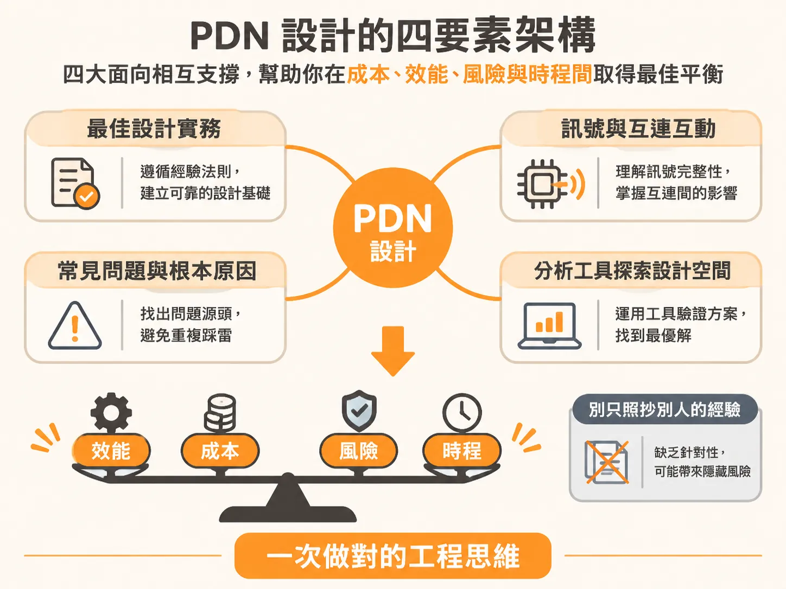
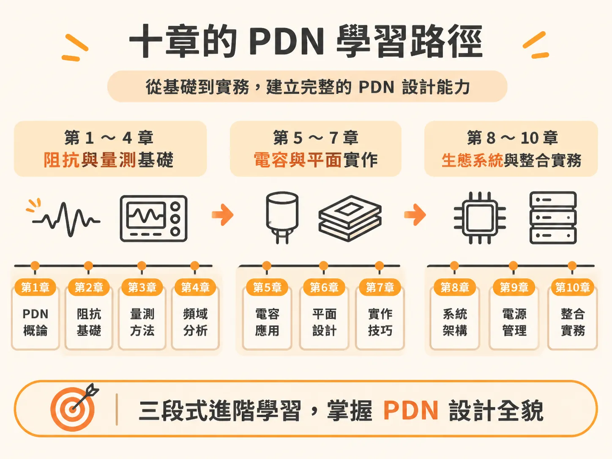
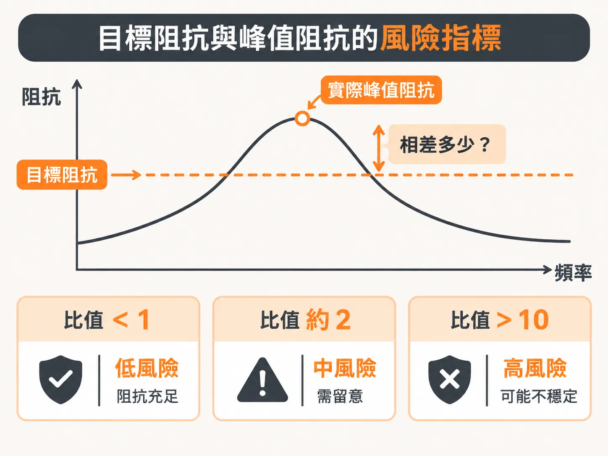

# 穩健 PDN 設計的四要素方法與十章全景

既然 PDN 雜訊的大小取決於阻抗輪廓與電流頻譜的疊合，下一個問題就是：設計階段該怎麼把這件事做對？

PDN 如果設計不良，往往會在最糟糕的時間點導致產品故障。這類故障通常極難重現，有時只發生在特定微碼（microcode）組合執行特定運算時。產品末端的測試無法把品質「測」出來，穩健的 PDN 必須在一開始就被「設計」進去。

每個專案的 PDN 都有其獨特性。有些設計只要在電路板上放一顆低阻抗的電壓調節模組（VRM）就能穩定運作。有些設計必須在極為精準的位置搭配特定電容組合，甚至得限制特定微碼才能避免出錯。每項產品的晶片功能、效能要求、微碼邏輯，以及成本、效能、風險和時程上的限制都不同。

在工程實務和電源完整性（Power Integrity, PI）的討論裡，最常見的答案是「看情況（it depends）」。要回答這類問題，唯一的辦法是把問題本質定義清楚，帶入真實數字，再往下拆解根本原因與各項解決方案。

### 邁向一次做對的四要素設計方法

為了提高「第一次就做對」的機率，並在可接受的成本、風險與時程內達成效能目標，高效的 PDN 設計流程仰賴四個核心要素：

1. **從既有的最佳設計實務出發**：借重業界已驗證的經驗法則與成熟流程。
2. **掌握訊號與互連結構互動的本質原理**：理解電磁場物理行為，根本基礎在於馬克士威方程式（Maxwell's Equations）。
3. **識別常見問題及其根本原因**：不盲目滅火，找出問題核心，避開已知設計地雷。
4. **善用分析工具探索設計空間**：透過模擬與計算評估各種取捨，為特定產品細節找出成本、效能、風險與時程之間的最佳平衡點。

這套方法想達成的，是讓工程設計不用再依樣畫葫蘆，改以物理原理和量化分析做出合理的權衡。

### PDN 核心技術架構與設計流程

整本書依據實務訓練手冊的邏輯編排，成功設計 PDN 所需的策略、戰術與技能包含以下面向：

* **工程化電源分配網路（Engineering the Power Delivery Network）**  
  PDN 的重點就在追求低阻抗。「阻抗輪廓（impedance profile）」是衡量 PDN 效能的主要特徵。真正的設計目標是「目標阻抗（target impedance）」：在可控的成本、風險與時程下，把阻抗輪廓壓在目標阻抗之下。
* **PDN 設計的阻抗核心原理（Essential Principles of Impedance for PDN Design）**  
  阻抗是評估系統穩健度的基礎工具。串聯與並聯 RLC 電路的物理特性，撐起了阻抗輪廓的骨幹。免費的 SPICE 模擬軟體可以當成阻抗分析儀，用來建立並模擬元件組合的阻抗輪廓。
* **量測低阻抗（Measuring Low Impedance）**  
  一般的 PDN 目標阻抗範圍落在 1 $\Omega$ 到低於 1 $\text{m}\Omega$ 之間。精準量測個別元件乃至於整體 PDN 生態系統，需要專門的超低阻抗量測技術。
* **電感與 PDN 設計（Inductance and PDN Design）**  
  實體設計會直接影響電感大小，可以從結構特徵估算迴路電感（loop inductance）。在互連結構中實現低迴路電感是壓低阻抗峰值的關鍵；若電感無法消除，必須量化其數值以評估衝擊。
* **積層陶瓷電容（MLCC）的實務整合（Practical Multi-Layer Ceramic Chip Capacitor Integration）**  
  MLCC 是塑造阻抗輪廓、壓制峰值的主要元件。電容單獨與並聯時具有不同行為。壓制組合電容峰值阻抗有 5 種通用策略，降低安裝電感（mounting inductance）是必要的一步。
* **平面與電容的特性（Properties of Planes and Capacitors）**  
  電源與接地平面在互連裡佔著重要位置，也會和電容產生動態互動。平面最重要的特性是擴展電感（spreading inductance）。平面腔體諧振（cavity resonances）對晶粒內部電路實際感受到的電源品質沒有影響。
* **訊號變更返回路徑時的訊號完整性問題（Taming Signal Integrity Problems When Signals Change Return Planes）**  
  PDN 互連同時承載另一項任務：為訊號返回電流提供低阻抗路徑。當訊號穿透平面時，切換雜訊（地彈 ground bounce 的一種形式）會在平面上引發雜訊。這屬於訊號完整性（SI）的範疇，根本原因與核心 $V_{\text{dd}}$ 軌上的電源完整性雜訊不同，兩者的解法完全不同，必須嚴格區分。
* **PDN 生態系統（The PDN Ecology）**  
  PDN 最大的瓶頸，是晶片內部晶粒電容（on-die capacitance）與封裝引線電感（package lead inductance）互動所產生的阻抗峰值。要把所有基礎原理整合起來，在電路板端想出對策，才能克服這個峰值帶來的限制。
* **暫態電流與 PDN 電壓雜訊（Transient Currents and PDN Voltage Noise）**  
  CMOS 電路抽取的電流頻譜會與 PDN 阻抗輪廓交互作用。三種重要的暫態電流波形分別是時脈邊緣脈衝（clock-edge impulse）、階躍暫態電流（step transient current）與重複方波電流（repetitive square wave）。阻抗輪廓、暫態電流與誘發的雜訊電壓三者緊密相扣，掌握其中任意兩者即可推算第三者。
* **整合實務 PDN 設計方法（Putting It All Together: A Practical Approach to PDN Design）**  
  把設計原理與流程整合起來，就能一步步建立 PDN 的各項具體特徵。試算表分析法可以大幅加快初版設計。多種設計情境與實測數據都顯示，從實測推導出的 PDN 參數和系統實際表現相當吻合。

### 核心底線與關鍵指標

掌握 PDN 設計時，有十項不容忽視的基本原則：

1. **PDN 的範圍**：包含從晶粒（die）焊墊到 VRM 之間的所有互連結構，以及沿途的所有元件。
2. **PDN 的功能**：提供主晶片乾淨且低雜訊的電壓與接地參考、為高速訊號提供低阻抗返回路徑，並協助抑制電磁相容性（EMC）問題。
3. **5% 雜訊規格的由來**：典型 PDN 的 5% 容許度規格，是基於將整個系統雜訊預算平均分配（各佔三分之一）給三大雜訊源：反射雜訊、串擾（cross talk）與 PDN 雜訊。
4. **電壓雜訊的生成**：暫態電源電流流經 PDN 阻抗時會產生電壓雜訊，雜訊總量取決於阻抗輪廓與暫態電流頻譜的疊合結果。
5. **對時序抖動（Jitter）的影響**：PDN 雜訊會直接轉成抖動，典型敏感度大約是每 1 毫伏特（mV）雜訊換來 1 皮秒（psec）抖動，實際數字則看晶片架構與製程節點。
6. **阻抗輪廓的地位**：在晶片焊墊處看到的阻抗輪廓（涵蓋直流到切換訊號的最高頻率成分），是衡量 PDN 品質與效能最重要的單一指標。
7. **目標阻抗的定義**：在最差暫態條件下，仍能將電壓雜訊壓在規格容許範圍內的最大阻抗限值。
8. **PDN 比率（PDN Ratio）與風險**：實際 PDN 阻抗峰值與目標阻抗的比值稱為 PDN 比率，是衡量設計風險的重要指標；PDN 比率大於 10 代表極高風險的設計。
9. **雕塑阻抗輪廓的方法**：不能只看單一元件，必須同時最佳化個別元件特性及其相互作用，將整個 PDN 生態系統納入考量來壓抑峰值。
10. **設計使命**：只要工程專案得在效能、雜訊與成本之間取得穩定平衡，這套設計體系就能派上用場。
