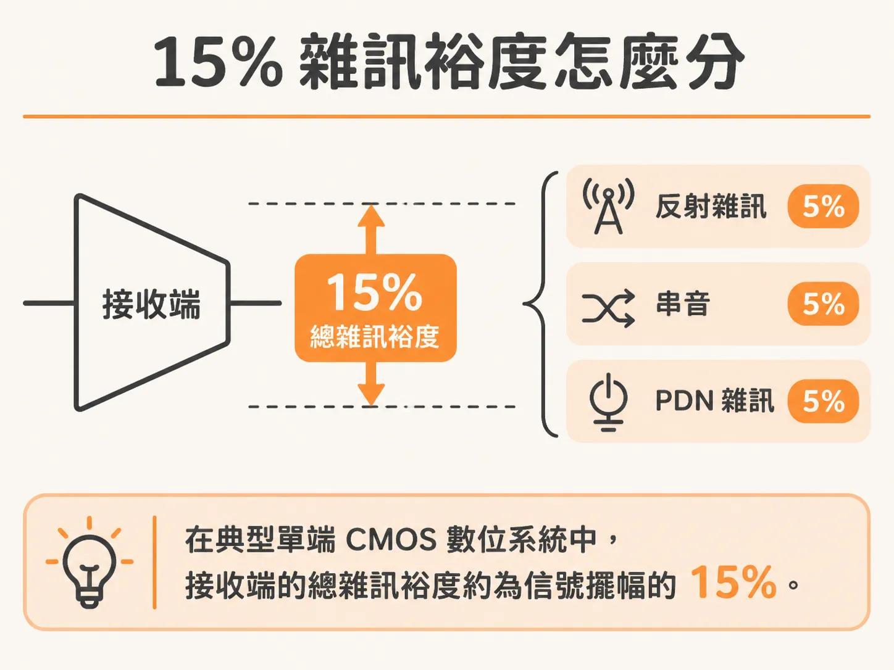
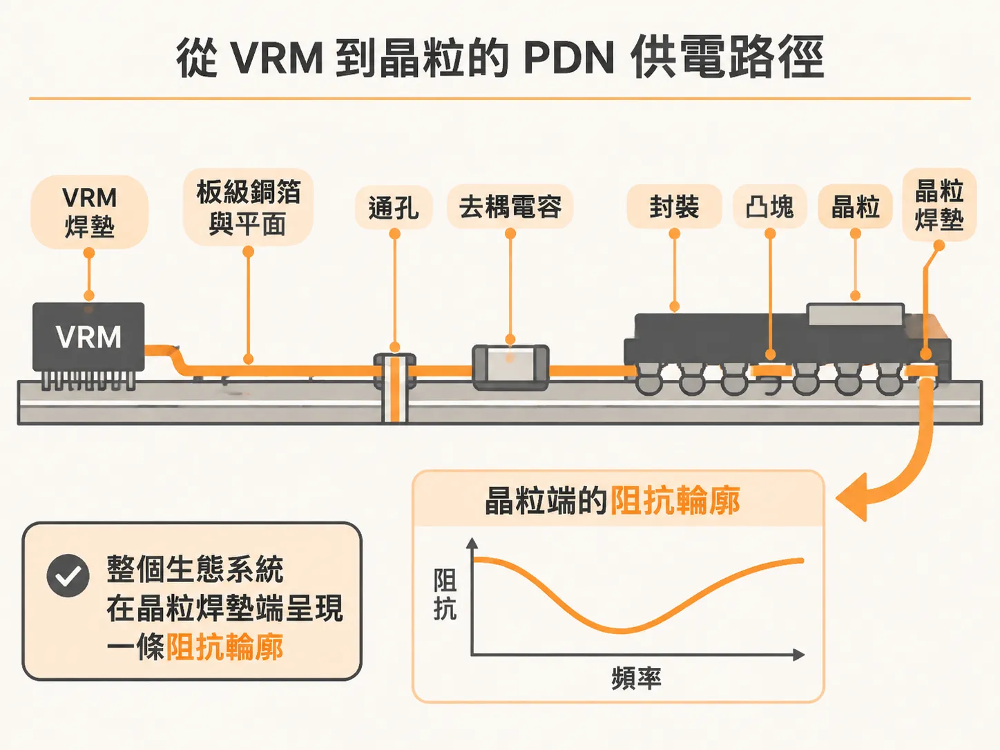
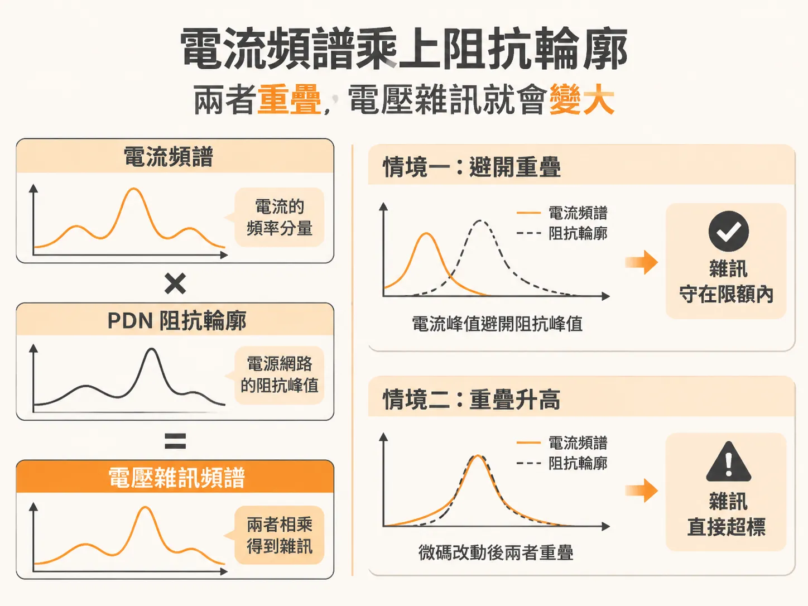

# 從 15% 雜訊裕度到阻抗頻譜：PDN 電壓雜訊的估算與成因

既然 PDN 雜訊會同時壓扁眼高、推散邊緣，下一個問題就是：它究竟該被壓到多小？

系統要不出錯，電源分配網路（PDN）上的電壓雜訊就得控制在一定範圍內。

實務上最常見的規範是「電源雜訊要在 ±5% 以內」。

這個 5% 不是隨便訂的，源頭是接收端的整體雜訊裕度。

## 5% PDN 雜訊限額的由來

在典型的單端 CMOS 數位系統中，接收端（receiver）所能容忍的總雜訊裕度（total noise margin），大約是信號擺幅（signal swing）的 15%。

沒有其他特殊條件時，這 15% 的雜訊預算通常就平均分給三個來源：

1. **反射雜訊（Reflection noise）**：分配 5%
2. **串音（Crosstalk）**：分配 5%
3. **PDN 雜訊（PDN noise）**：分配 5%

這就是業界普遍將 PDN 電壓雜訊上限訂為 ±5% 的原因。

但並非所有電路都適用 5% 的標準。

類比數位轉換器（ADC）或鎖相迴路（PLL）對電壓雜訊極為敏感，PDN 雜訊通常必須壓在 1% 以下。

這條限制不只看低頻，從直流（DC）一路到信號頻寬的高頻上限都算在內。

在現代系統中，這個頻寬往往高達 5 GHz 到 10 GHz。

## 雜訊的根本來源：VRM 與 PDN 生態系統

要解決信號完整度，先得找出雜訊從哪裡來。

在低頻段，PDN 的電壓雜訊主要來自電壓調節模組（VRM）。

PDN 設計就從這裡開始：挑一顆在目標負載電流下輸出雜訊夠低的 VRM。

就算挑到很穩的 VRM，晶粒（die）焊墊上的電壓雜訊還是消不掉。

晶片內部大量邏輯閘快速切換時，會抽載劇烈變化的暫態電流。

當暫態電流流經整個 PDN 的阻抗，就會在晶粒端產生壓降與電壓彈跳。

從 VRM 焊墊一路延伸到晶粒焊墊之間的所有互連結構——包含電路板走線、通孔、去耦電容、封裝基板與打線或凸塊——全部串在一起，就是所謂的「PDN 生態系統」（PDN ecology）。

把整條生態系統看成一個整體，它在晶粒焊墊端呈現的就是一條隨頻率變化的阻抗輪廓（impedance profile）。

## 阻抗輪廓乘上電流頻譜

只要暫態電流流經這條阻抗輪廓，就會在晶片焊墊上引發電壓雜訊。

這件事跟 VRM 本身穩不穩，沒有直接關係。

晶片執行特定微碼（microcode）時，核心電源軌會抽載對應的暫態電流。

將暫態電流轉換到頻域，會得到一組電流頻譜。

把電流頻譜和該電源軌的 PDN 阻抗輪廓放在同一條頻率軸上，各頻率的振幅乘上阻抗，就是電壓雜訊頻譜。

把雜訊頻譜轉回時域，就是實際量測到的暫態電壓雜訊。

因此，暫態電流產生的實際電壓雜訊大小，關鍵在於「電流頻譜分量」與「阻抗峰值」是否重疊：

- **正常運作情境**：暫態電流的各個頻譜峰值剛好避開 PDN 阻抗高峰。兩者相乘後的電壓雜訊低於 5% 上限，系統便能正常運作。
- **異常失效情境**：在同一塊板子與同一個 PDN 阻抗輪廓下，微碼演算法僅有些微調整，使邏輯閘切換頻率略有改變，電流頻譜的峰值位置就會移動。一旦電流峰值剛好與 PDN 阻抗的共振峰重疊，兩者相乘就會引發巨大的電壓雜訊，衝破容許上限，導致運算出錯甚至當機。

所以 PDN 雜訊兩頭都受影響：晶片外圍生態系統的阻抗輪廓，還有晶片內部抽載電流的頻譜特性。

微碼怎麼跑、邏輯閘用量多少，直接決定最後的 PDN 雜訊。
