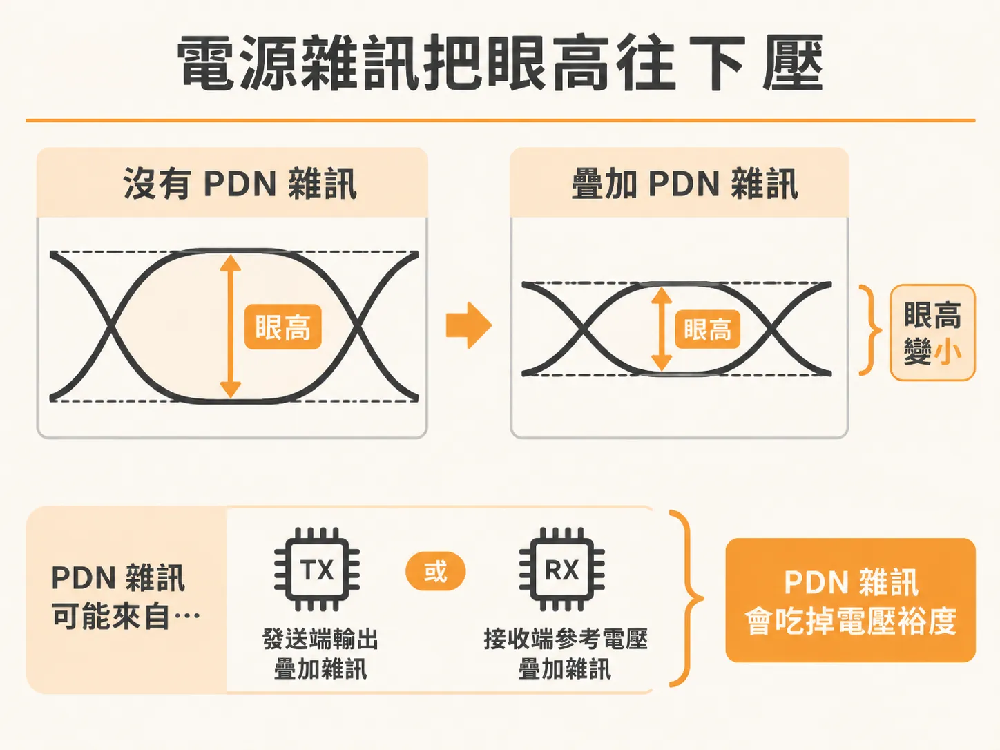
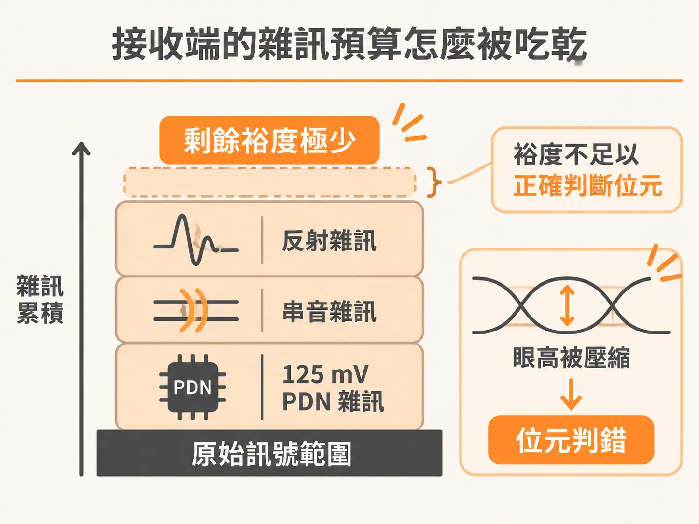
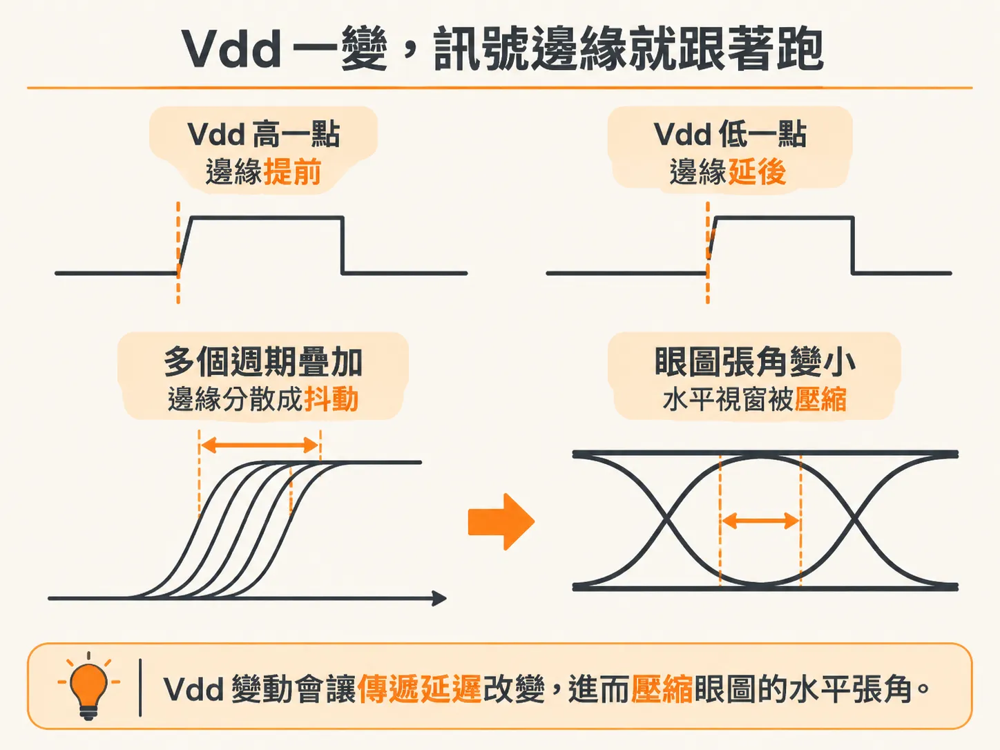
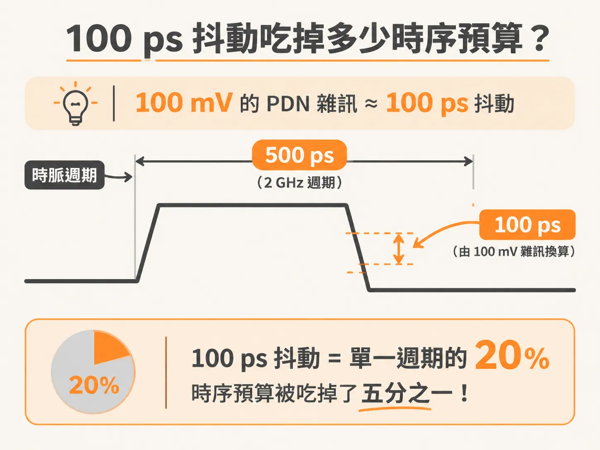

# 電源雜訊如何吃掉眼圖裕度：從 125 mV 垂直壓縮到 1 ps/mV 邊緣抖動

前一節把 PDN 的職責收在「把傳輸途中的雜訊壓在系統容許的標準內」。一旦這條防線失守，訊號眼圖就會在高頻數位系統中迅速閉合。

除錯眼圖時，如果只盯著高速傳輸線的阻抗與衰減，很容易漏掉晶片內部的電源雜訊。這種雜訊會同時從垂直（電壓）與水平（時序）兩個方向侵蝕系統裕度，讓誤碼率（BER）往上跑，甚至造成核心電路的建立時間（setup time）與保持時間（hold-time）違規。

電源雜訊在晶片內部造成的破壞，可以分成兩個方向。

## 垂直方向：電壓雜訊疊加與眼高閉合

當切換邏輯閘運作時，PDN 產生的雜訊會灌進傳輸鏈路。視電路架構而定，它可能直接疊加在發送端（TX）輸出的訊號上，也可能落在接收端（RX）的參考電壓上。不管是哪一種，PDN 雜訊都會吃掉原本留給其他雜訊的電壓裕度。

在 300 MHz 時脈的微處理器晶片實測中，量測了核心電源與接地軌（Vdd 與 Vss）在晶片上三個不同位置、兩組電源軌的雜訊，測到的電壓雜訊超過 125 mV。在很多實際電路裡，這 125 mV 就直接疊加在接收端看到的訊號振幅上。

單看 125 mV 本身，可能還不足以造成位元誤判，但它會壓扁眼圖垂直方向的開口（眼高）。跟系統原本就有的反射、串音等雜訊加在一起，整體雜訊裕度就會見底，位元也就跟著判錯。

## 水平方向：CMOS 延遲變化如何將雜訊推成抖動

比起垂直方向的振幅壓縮，電源雜訊對時序的破壞更難處理。

訊號通過一連串邏輯閘時，從輸入轉態到輸出轉態的這段時間，稱為傳遞延遲（propagation delay）。在 CMOS 技術裡，邏輯閘的延遲時間完全取決於通道兩端的瞬時電壓差：

- 當 Vdd 與 Vss 之間的跨壓升高，通道電場跟著增強，邏輯閘充放電加快，傳遞延遲就縮短，時脈或訊號邊緣被往前拉（pull in）。
- 當跨壓降低，通道電場減弱，傳遞延遲拉長，時脈或訊號邊緣就被往後推（push out）。

晶片核心內部 Vdd 到 Vss 的瞬時電壓雜訊，就這樣變成輸出訊號的時序起伏，也就是水平方向的抖動（Jitter）。

抖動會讓訊號跨越參考準位的時間點在水平方向散開，進一步擠壓眼圖的水平開口。晶片核心電路很容易因此出現建立時間與保持時間違規，最後導致功能失效。

## 1 ps/mV 的代價：100 mV 雜訊吃空 2 GHz 系統時序

電源雜訊轉化成抖動的幅度，實務上可以換算。

在高階 FPGA 測試晶片的實測中，時脈分配網路跟其他內部邏輯閘共用同一組 Vdd 電源軌。當這群邏輯閘以虛擬隨機位元序列（PRBS）高速切換時，會瞬間向 PDN 抽取大電流，在晶片內部引發劇烈的暫態電壓雜訊。

這個電壓雜訊落在時脈分配網路的邏輯閘上，直接造成輸出時脈的週期起伏。實測的週期抖動（period jitter）顯示，晶片上的電壓雜訊跟時脈抖動高度正相關。

這項實測得出一個 PDN 雜訊引發抖動的靈敏度參考：

- 每 1 mV 的電壓雜訊，大約會產生 1 ps 的抖動。

1 ps/mV 是適用在多數元件的經驗值。若晶片內存在 100 mV 的峰對峰值（peak-to-peak）PDN 雜訊，就會換算成 100 ps 的峰對峰抖動。

以 2 GHz 時脈的系統為例，一個週期只有 500 ps。光是 100 mV 電源雜訊帶來的 100 ps 抖動，就吃掉 20% 的週期時間。時序裕度本來就吃緊的設計，電源引起的抖動就足以把整份時序預算用完。

不管是 I/O 傳輸還是核心電路，電源完整性都不是「電壓穩不穩」四個字就能帶過。它會在垂直方向壓扁眼高、在水平方向推散邊緣，最後讓系統在誤碼與時序違規中崩潰。
