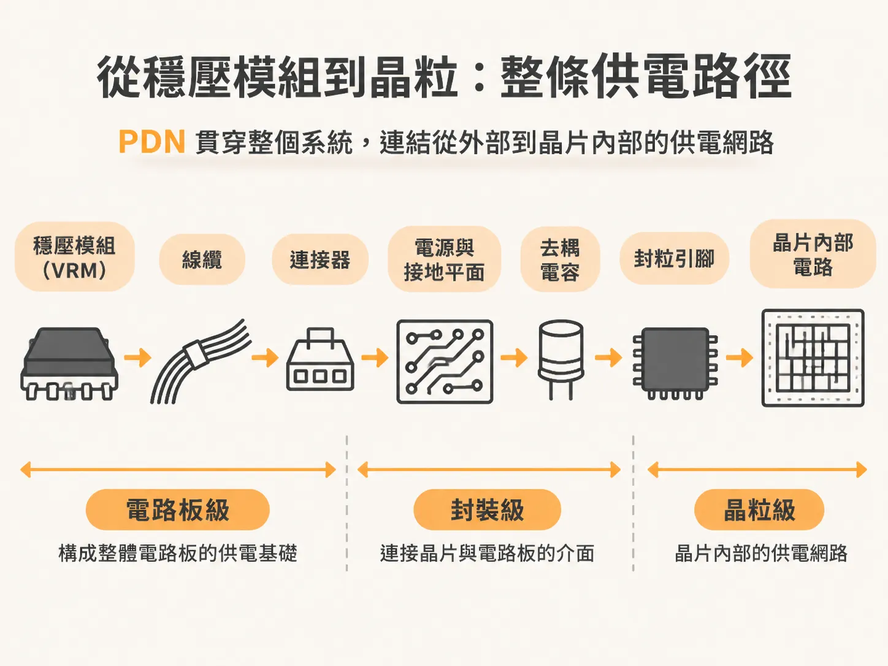
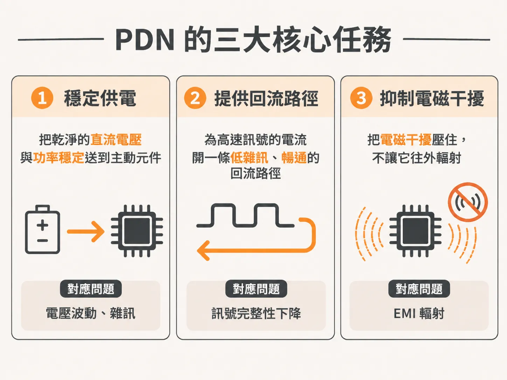

# 認識電源分配網路的範圍與三大核心職責

在高速數位電路設計裡，晶片能不能穩定運作，多半取決於電源進到晶片內部之前走了哪些路徑。規格上的供電電壓高不高，反倒沒那麼關鍵。

這條從電源供應端接到負載端的通道，就是電源分配網路（Power Delivery Network，簡稱 PDN）。

### PDN 涵蓋的實體範圍

PDN 指的是供電路徑上，從穩壓模組（VRM）一路延伸到晶片晶粒（die）內部電路的所有互連結構。

以常見的電腦主機板為例，板上通常會有好幾組 VRM，負責把電源與接地拉到各個主動元件的焊盤。

在這段實體傳輸路徑中，PDN 涵蓋的元件與結構包含：

- 電路板內的電源平面與接地平面
- 連接各模組的線纜與連接器
- 所有掛在電源路徑上的電容器
- 從 VRM 焊盤、封裝引腳，接到晶片 die 上導線的整段金屬互連

### PDN 的三大核心任務

在電路系統中，PDN 並非單純扮演「送電導線」的角色，它同時擔起三項關鍵任務：

1. **輸送低雜訊的直流電壓與功率**：把穩定的電力送進正在運算的主動元件。
2. **為所有訊號提供低雜訊的回流路徑**：高頻訊號傳輸必須具備對應的返回路徑（return path），PDN 的接地平面與電源平面就是引導這些回流電流的重要通道。
3. **抑制電磁干擾（EMI）**：在不製造額外輻射發射的前提下，把整體的電磁干擾壓下來。

雖然 PDN 必須兼顧訊號回流與 EMI 控制，但在電源完整性工程中，最核心的目標還是第一項任務：讓傳送到每個主動元件的直流電壓與功率維持穩定，並把傳輸途中的電源雜訊壓在系統容許的標準內。
