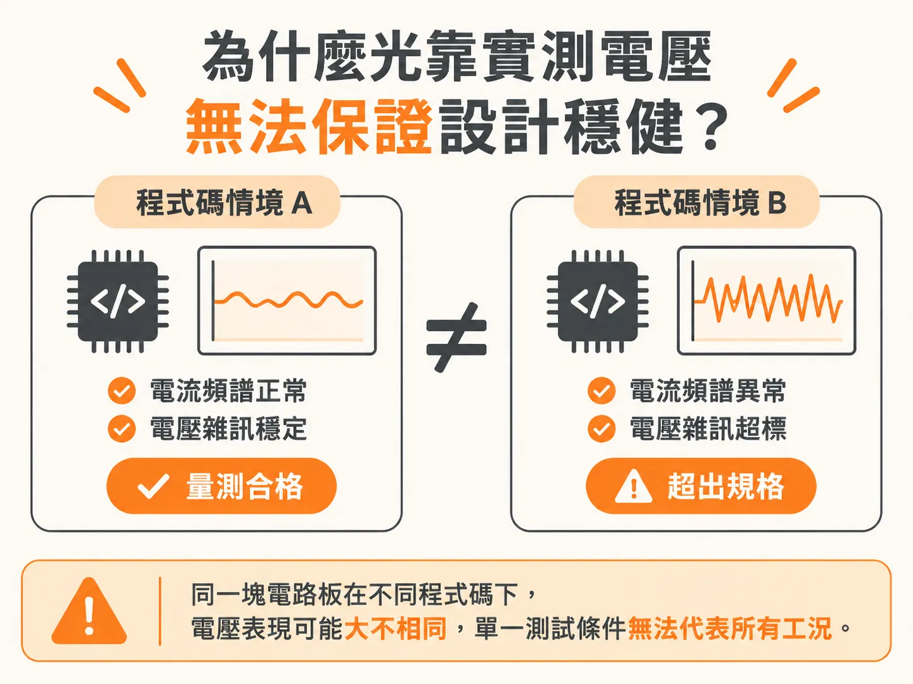
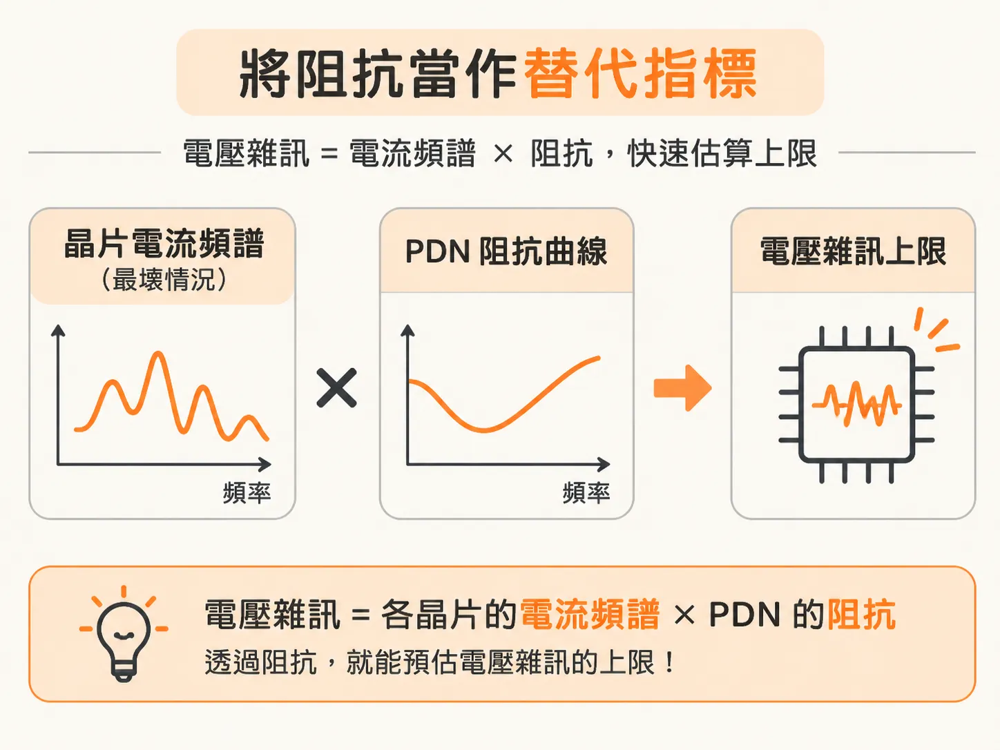
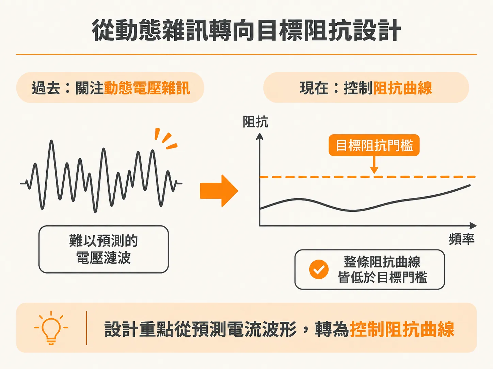

# 為什麼阻抗曲線是 PDN 設計穩健性的替代指標

在設計高速數位系統的電源分配網路（PDN）時，最終的驗收標準其實很單純：只要晶片端接收到的電壓維持在規格範圍內即可，也就是平均工作電壓加上允許的交流漣波（AC ripple）。

然而，要保證電壓維持在合格範圍內並不容易。這項結果不僅取決於 PDN 本身的設計，更取決於系統中各個晶片的運作行為，包括晶片當下執行的功能，以及抽載電流在不同頻率下的分佈（即電流頻譜）。

### 為什麼光靠實測電壓無法保證設計穩健？

在實際測試時，往往會面臨一個難題：在電路板上某個位置量到的電壓，可能在跑特定一段程式碼時完全合格；但這完全無法保證晶片在執行其他微碼（microcode）時，電壓依然落在安全範圍內。

更棘手的是，晶片焊墊（pads）端實際承受的電壓雜訊，通常比我們在電路板上量到的還要嚴重。因為終端使用者未來可能執行的微碼與運算情境千變萬化，我們不可能在測試環境中窮舉並重現所有可能出現的電流波形。如果只能被動地針對單一測試條件量測電壓，就無法確認 PDN 設計是否真正穩健。

### 將阻抗當作替代指標

為了解決電流無法窮舉的問題，可以回歸電路的一階近似原理：系統中的電壓雜訊，本質上就是各晶片所抽取的電流頻譜，流經互連網路（PDN）的阻抗時所產生的壓降。

這意味著：
1. 即使無法預測所有操作情境，我們仍能透過邏輯閘使用率（gate utilization）推估或模擬出晶片在最壞情況下的抽載電流。
2. 同時，PDN 自身的阻抗可以透過計算、模擬或儀器量測精準掌握。

兩者結合，就能在真實且最壞的情境下，估算出預期的電壓雜訊上限。

因此，當你無法得知晶粒（die）供電電流的具體頻譜時，PDN 的阻抗曲線（impedance profile）就成為評估 PDN 設計是否合格的替代指標（surrogate measure）。即使無法窮舉實際工作負載，只要將 PDN 的阻抗控制在安全門檻內，系統就能承受極端的電流變化。

### 從動態雜訊轉向目標阻抗設計

當阻抗曲線被確立為評估穩健性的替代指標後，PDN 設計的複雜度便大幅簡化——原本難以捉摸的動態電壓漣波問題，轉化為具體的「目標阻抗」（target impedance）設計。

這使得阻抗成為 PDN 效能中最重要的設計指標。掌握阻抗的物理細節，並釐清被動元件挑選與電路板實體佈局如何改變阻抗曲線，是打造穩健且符合成本效益之電源系統的核心關鍵。
