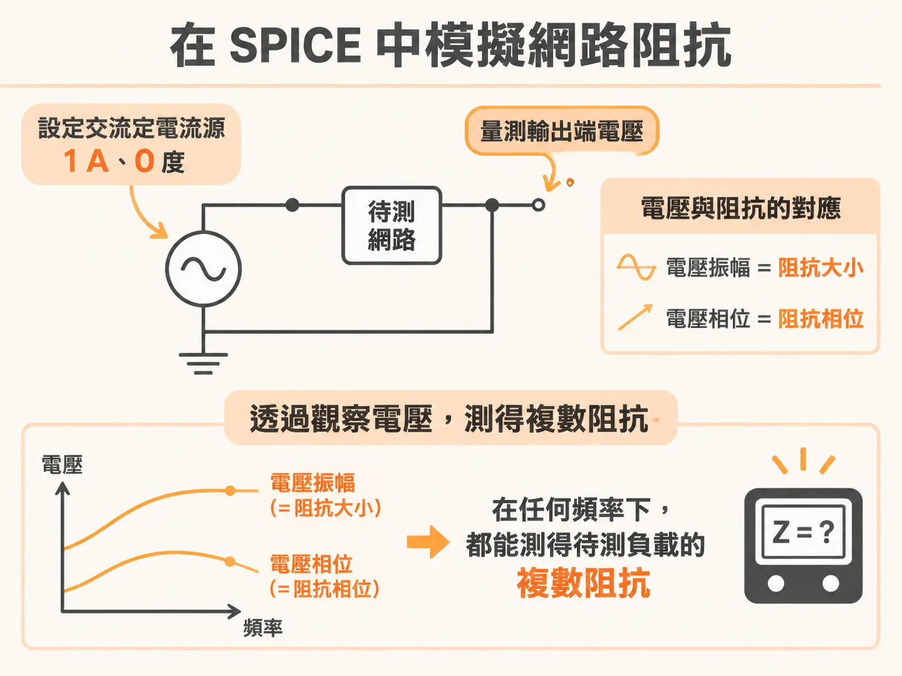
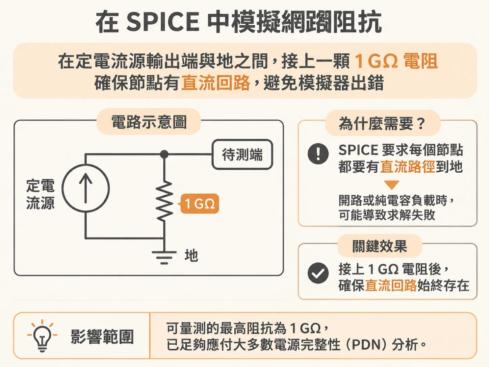

# 用 1 A 交流源與 1 GΩ 電阻在 SPICE 中模擬網路阻抗

如果電路裡只有單一元件，用筆和紙在頻域中計算阻抗還算簡單；但電路每多一個元件，手算的工作量就會呈指數增加。

幸運的是，只要電路是由理想、線性且非時變（linear, time-invariant）的元件組成，我們就可以利用 SPICE 或類似的電路模擬器來計算整個網路的阻抗。這類工具普遍免費、操作直覺，在主流作業系統上都能運行，並且提供圖形化介面與波形顯示，是非常實用的分析工具。

其中，QUCS（Quite Universal Circuit Simulator）是一套免費、開源且強大的電路模擬器，很適合直接當成阻抗計算機或阻抗分析儀使用。而在高階工程應用中，常見的工具則是 Keysight Technologies（前身為 Agilent Technologies）所推出的 ADS（Advanced System Design）。無論使用輕巧的 QUCS 還是高階的 ADS，計算出來的阻抗結果完全一致。

要在 SPICE 中建立阻抗分析儀，關鍵在於善用「定電流交流源」（constant current AC source）。

在 SPICE 裡，定電流源是理想元件，不論後方接上什麼負載，它都會輸出固定大小的電流；為了維持電流恆定，它會自動輸出推動該電流所需的任何電壓。切換到 AC 模擬模式時，定電流源會輸出振幅固定、不隨負載改變的正弦波電流。在頻域分析中，所有波形都可以視為正弦波，只要掌握頻率、振幅與相位，就能完整描述訊號。

交流定電流源輸出的正弦波電壓，與流經負載的電流有著明確的數學關係：

電壓等於電流乘以阻抗。其中各頻率下的電壓 $V(\omega)$、電流 $I(\omega)$ 與負載阻抗 $Z(\omega)$ 都是複數，各自包含振幅與相位。這意味著，當電路接上交流電流源時，模擬器所計算出來的複數電壓，在數值上就直接對應到該負載的複數阻抗：電壓振幅等於阻抗大小，電壓相位則等於阻抗相位。

這項關係帶來了一個非常方便的技巧：只要把交流定電流源的振幅設為 1 A、相位設為 0 度，那麼模擬節點得到的電壓振幅（單位為伏特），在數值上就會剛好等於負載阻抗（單位為歐姆），電壓相位也完全等於阻抗相位。透過觀察定電流源輸出端的電壓振幅與相位隨頻率變化的曲線，我們就能在任何頻率下測得待測負載的複數阻抗。

實際在模擬器中繪製電路時，還需要在定電流源並聯一顆 1 GΩ 的電阻接地。這顆電阻的用途是防止模擬器出錯當掉。許多 SPICE 模擬器在演算法上都要求每個電路節點必須具備一條通往地線的直流路徑（DC path to ground）；如果待測端開路或是接上純電容負載，節點就會失去對地直流路徑而導致矩陣無法求解。接上一顆 1 GΩ 電阻便能確保直流路徑永遠存在。雖然這會將可量測的最高阻抗限制在 1 GΩ，但對絕大多數電源完整性（PDN）的分析情境來說，這個範圍已經綽綽有餘。

