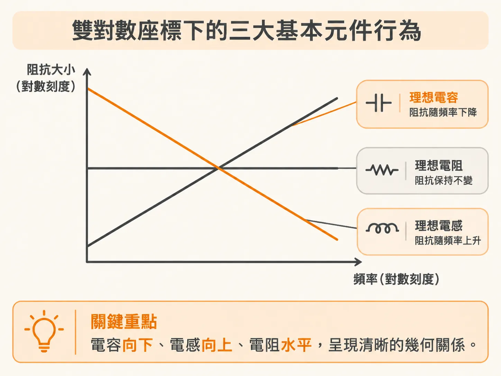
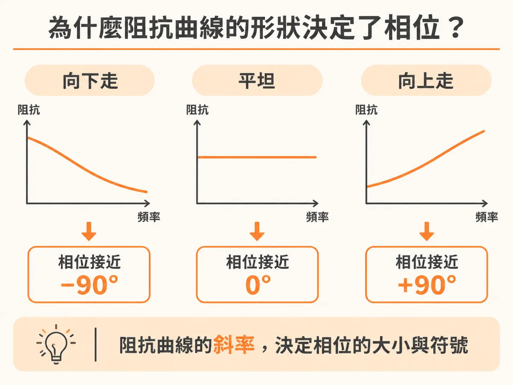
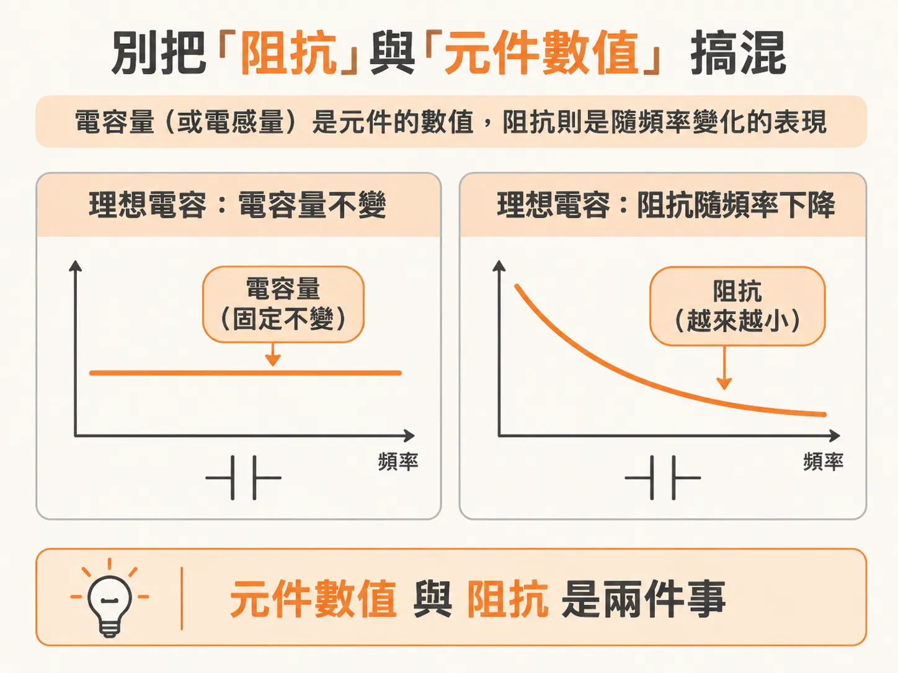

# 從對數阻抗圖的斜率看懂電路行為與相位

在分析電源分配網路（PDN）或高頻電路時，工程師最常看的圖表就是阻抗對頻率的走勢圖。初看這類圖表時，曲線上下起伏，如果沒有同時對照相位，很容易讓人不知道當前頻率下的電路到底偏向電容還是電感。

其實，只要將頻率與阻抗大小畫在雙對數座標（log-log scale）上，光憑曲線的斜率，就能立刻看出電路處於「容性（capacitive）」還是「感性（inductive）」，甚至不用看相位圖，就能準確反推出相位。

## 雙對數座標下的三大基本元件行為

在雙對數座標中，理想電容、理想電感與理想電阻的阻抗大小（magnitude）會呈現非常規律的幾何特徵：

- **理想電容**：頻率每增加 10 倍（每十倍頻，per decade），阻抗大小就下降 20 dB（即 -20 dB/decade）。其阻抗相位始終維持在固定的 -90 度。
- **理想電感**：頻率每增加 10 倍，阻抗大小就上升 20 dB（即 +20 dB/decade）。其阻抗相位始終維持在固定的 +90 度。
- **理想電阻**：阻抗大小不隨頻率改變，呈現一條水平線（0 dB/decade）。其阻抗相位始終維持在 0 度。

雙對數座標之所以是最實用的呈現方式，正是因為這種每十倍頻變化 20 dB 的斜率特徵，能讓我們一眼辨識出電路在特定頻段下的行為模式。

## 為什麼阻抗曲線的形狀決定了相位？

阻抗曲線的形狀與相位之間之所以有如此緊密的關聯，背後的根本物理機制是「克拉莫—克羅尼希關係式」（Kramers-Kronig relationship）。

在真實物理世界中，任何系統都必須遵守因果律（causality）——也就是「反應必定發生在刺激之後」。在頻域中，一個複數函數若要能正確描述時域裡的因果物理效應，它的實部與虛部之間就必須存在特定的數學約束。簡而言之，知道了阻抗的實部，就等於確定了它的虛部；兩者相互綁定，無法各自獨立改變。

在阻抗圖上，這項因果限制帶來了一個非常實用的結論：**阻抗大小曲線的走勢形狀，直接決定了阻抗的相位**。只要知道阻抗曲線的形狀，就能推導出相位：

1. 當阻抗大小隨頻率以 -20 dB/decade 的斜率下降時（如電容特性），相位必然接近 -90 度。
2. 當阻抗大小隨頻率以 +20 dB/decade 的斜率上升時（如電感特性），相位必然接近 +90 度。
3. 當阻抗曲線隨頻率保持平坦時，相位必然接近 0 度。

這就是真實、具因果性的物理系統的本質。正因為只要觀察雙對數座標上的斜率就能推知相位，工程實務中往往不需要在圖表上把相位曲線同時畫出來，而是將焦點集中在阻抗大小的變化上。

## 別把「阻抗」與「元件數值」搞混

解讀這些圖表時，有一個觀念必須特別釐清：千萬不要把理想電容的「電容量」或理想電感的「電感量」，與它們的「阻抗」混為一談。

根據理想電路元件的定義：

- 理想電容的電容值（C）不隨頻率改變，它是常數。
- 理想電感的電感值（L）不隨頻率改變，它是常數。
- 理想電阻的電阻值（R）同樣不隨頻率改變，也是常數。

隨頻率變動的是電感與電容的「阻抗大小」，而不是元件本身的電感量或電容量。

在實際工程應用中，所有版本的 SPICE 與常見電路模擬軟體，都能依循這些原理自動計算並繪製出電路在各頻率下的阻抗特性。只要掌握了對數斜率與相位的對應關係，即便面對複雜電路的模擬波形，也能迅速判斷出不同頻段分別是由電容還是電感主導。
