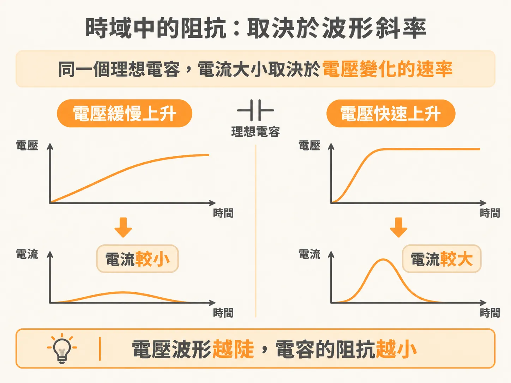
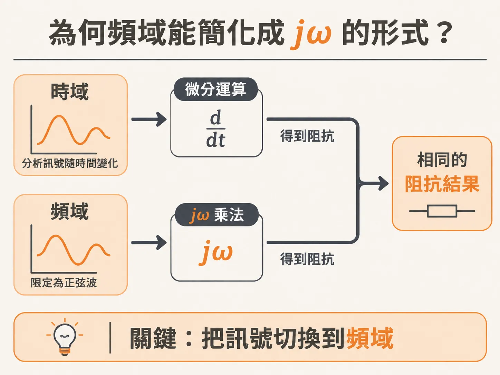
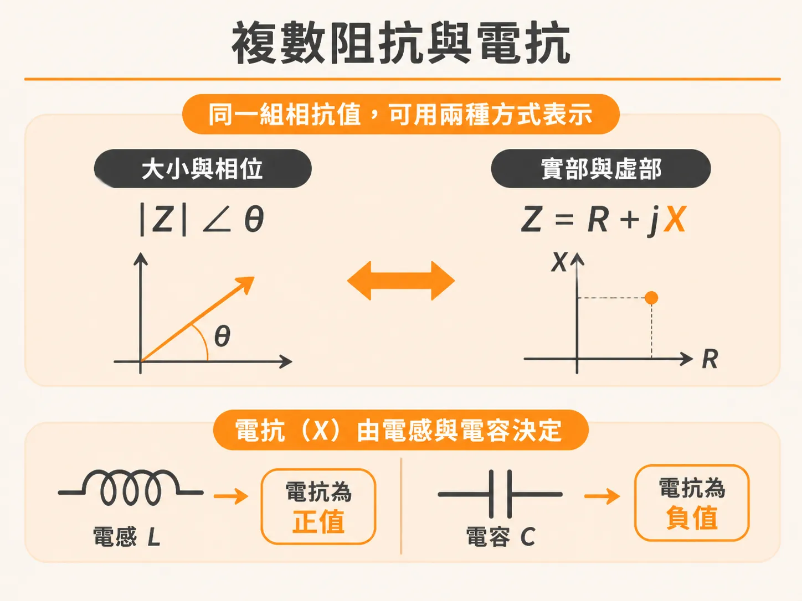
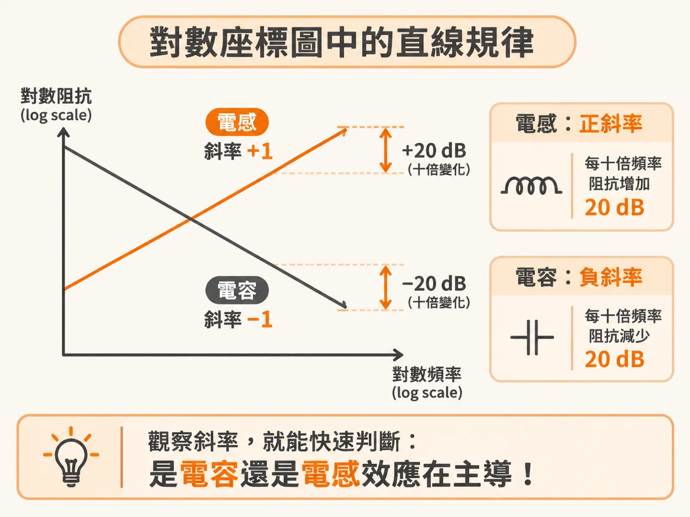

# 阻抗在時域與頻域的定義，以及頻域化簡為 jω 的原因

在分析高速數位電路與電源完整性（PDN）時，工程師幾乎天天看著頻率對阻抗的波德圖。我們對阻抗的直覺往往來自歐姆定律——電壓除以電流。事實上，無論在時域還是頻域，阻抗的本質完全相同，但實際計算時，兩者在數學形式上的複雜度卻天差地遠。

## 阻抗在時域與頻域都是 V/I

從基本物理定義來看，任何元件兩端的阻抗（$Z$），永遠是該元件兩端的電壓（$V$）與流入並流出兩端子的電流（$I$）之比值：

$$Z = \frac{V}{I}$$

這個基本定義在時域與頻域完全成立，甚至可以擴展到多端子元件上。例如在電源完整性設計中，量測不同位置的兩個平面之間的電壓與注入電流之比，就是以此定義為基礎，進一步衍生出轉移阻抗（transfer impedance）的概念。

雖然阻抗在時域與頻域都有清楚嚴謹的定義，但在時域分析理想電路元件（如電容或電感）時，實際計算會變得相當棘手。

## 時域中的阻抗：取決於波形斜率

以一顆理想電容為例，在時域中，流經電容的電流大小取決於端電壓隨時間變化的速率：

$$I(t) = C \frac{dV(t)}{dt}$$

若套用阻抗的基本定義 $Z = V / I$，電容在時域中的阻抗表示式就會是：

$$Z(t) = \frac{V(t)}{C \cdot \frac{dV(t)}{dt}}$$

這個結果符合我們的物理直覺：電壓變化的斜率（$dV/dt$）越陡峭，瞬間流過電容的電流就越大，代表此時電容呈現的阻抗越低。

數學式本身完全正確，但在實際工程應用中卻很難操作。在真實電路裡，電壓波形可能包含雜訊、方波邊緣震盪或多重階躍，當電壓波形形狀複雜時，$dV/dt$ 隨時間劇烈跳動，阻抗就會與當下的波形形狀產生極為複雜的相依關係，讓人難以直接用單一數值或簡單公式來描述元件特性。

## 為何頻域能簡化成 jω 的形式？

解決這個難題的關鍵，就是把訊號切換到頻域。

在頻域中，系統只允許單一頻率的連續正弦波存在。正弦波有一個特殊的數學性質：它的微分依然是同頻率的正弦波，只是振幅乘上了角頻率 $\omega$（$\omega = 2\pi f$），相位則旋轉了 90 度（在複數運算中以虛數單位 $j = \sqrt{-1}$ 表示）。

正因為波形被限定為純粹的正弦波，時域中複雜的微分運算 $d/dt$ 直接簡化成單純的代數乘法 $j\omega$。原本包含動態斜率的阻抗式子，在頻域中瞬間化簡為固定的代數形式：

- 理想電容的阻抗：$Z = \frac{1}{j\omega C}$
- 理想電感的阻抗：$Z = j\omega L$

儘管電路最終的效能表現多半需要在時域評估（例如電源軌上的電壓漣波峰對峰值），但如果在時域直接解微分方程，過程通常既漫長又容易出錯。透過頻域這條捷徑，微積分變成了純代數四則運算，工程師能更迅速推導出系統響應，這也是電源完整性分析普遍採用頻域的主因。

## 複數阻抗與電抗

頻域阻抗式子中的 $j$，代表阻抗本質上是一個複數。這意味著在任何特定頻率下，阻抗都同時包含兩個維度的資訊：可以是「大小與相位」，也可以拆成「實部與虛部」。在工程實務中，大小與相位是最常觀察的呈現方式。

當阻抗拆為實部與虛部時，虛數部分稱為「電抗」（reactance），習慣以符號 $X$ 表示。由電阻（R）、電感（L）與電容（C）組成的電路中，電抗主要由 L 與 C 決定。

以常見的 R 與 C 串聯電路為例，其總阻抗為：

$$Z = R + \frac{1}{j\omega C} = R - j\frac{1}{\omega C}$$

此時實部是電阻 $R$，而代表虛部的電抗則是：

$$X = -\frac{1}{\omega C}$$

## 對數座標圖中的直線規律

電容與電感的電抗與頻率之間，呈現極具規律的比例關係：

單一理想電容的電抗大小與頻率成反比（$1/\omega C$）。當頻率增加 10 倍時，阻抗大小會縮小為原本的 1/10。在分貝（dB）刻度中，振幅比值縮減 10 倍等於衰減 20 dB，因此單一電容的阻抗變化率被稱為「每十倍頻下降 20 dB」（$-20\text{ dB/decade}$）。

相對地，單一理想電感的電抗大小為 $\omega L$，阻抗隨頻率增加而等比放大。頻率增加 10 倍，阻抗就增加 10 倍，變化率為「每十倍頻上升 20 dB」（$+20\text{ dB/decade}$）。

如果將縱軸取為對數阻抗、橫軸取為對數頻率（雙對數座標，log-log scale），電感的阻抗曲線會是一條斜率為 $+1$ 的直線，電容則是一條斜率為 $-1$ 的直線。這項特性讓複雜的電源分配網路在不同頻率區間的行為一目了然，工程師只要觀察斜率，就能快速辨認系統當下是由電容還是電感效應在主導。

