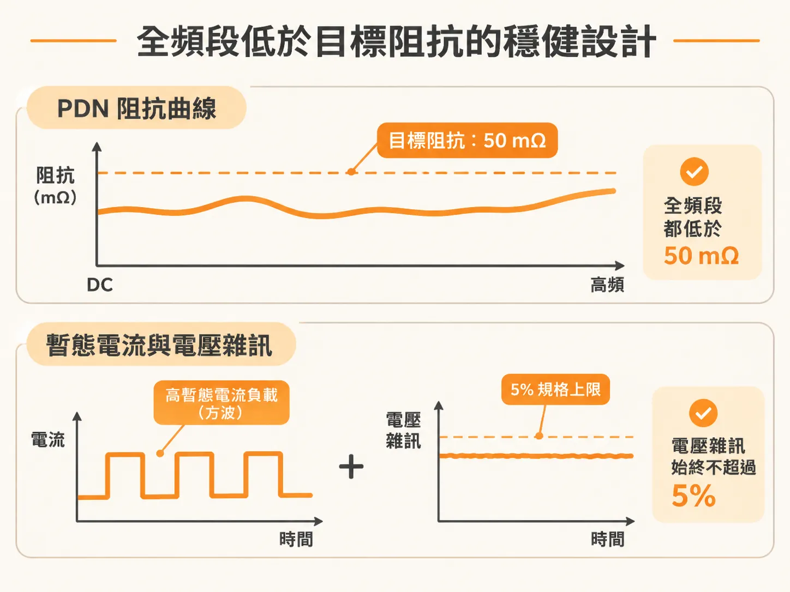
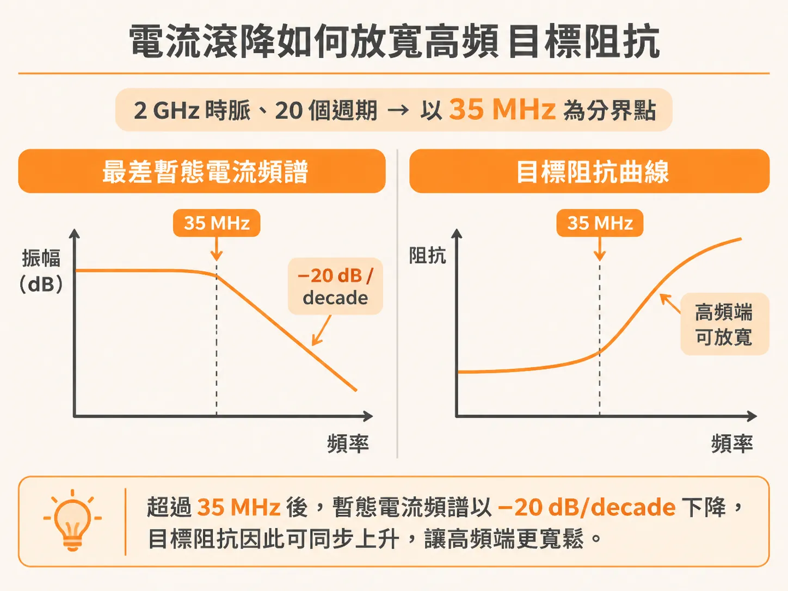

# 從全頻段壓制到高頻放寬：PDN 目標阻抗設計

在高速數位電路中，晶片內部的大量邏輯閘同時切換時，瞬間抽取的電流容易引發電源軌電壓塌陷（rail collapse）。要確保系統在最嚴苛的運作情境下依然穩定，電源分配網路（PDN）的核心設計準則就是目標阻抗（target impedance）。

## 全頻段低於目標阻抗的穩健設計

一個完全穩健的 PDN，取決於目標阻抗的定義。如果從晶片裸晶焊墊（die pads）看進去，整個 PDN 生態系在全頻段的阻抗都低於目標阻抗，那麼暫態電流流經 PDN 阻抗所產生的最差電源軌塌陷雜訊，除了極罕見的「瘋狗浪」（rogue wave）諧振疊加情境之外，都不會超過雜訊規格。

目標阻抗是評估 PDN 效能最重要的指標。PDN 阻抗超出目標阻抗越多，系統發生錯誤的風險就越高。

舉例來說，若將目標阻抗設定為 50 mΩ，並透過工程設計讓 PDN 從直流（DC）一路到極高頻寬的阻抗曲線都壓在 50 mΩ 以下，那麼即使面對時脈驅動的高暫態電流負載（通常呈現方波特徵），電源軌產生的電壓雜訊也能始終控制在 5% 的規格限制之內。

## 電流滾降如何放寬高頻目標阻抗

在實際運作中，晶片內部流經的最差暫態電流並不會在所有頻率下都維持平坦。高頻端的最差電流振幅通常會往下掉（即滾降，roll-off），這與晶片能在多短的時間內開啟最大數量的開關邏輯閘直接相關。

具體的上升速度取決於晶片架構、管線（pipeline）的位元數，以及微碼（microcode）的執行特性。其有效上升時間短可能只有時脈邊緣本身的上升時間，長則可能需要累積 100 個時脈週期。

以一個具體情境為例：

* 晶片時脈頻率為 2 GHz，對應的時脈週期為 0.5 ns。
* 系統需要 20 個時脈週期，才能累積開啟最大數量的切換邏輯閘。
* 最差暫態電流開啟的最短上升時間即為 0.5 ns × 20 週期 = 10 ns。

當暫態電流的上升時間為 10 ns 時，其頻譜分量的最大振幅大約在 0.35 / 10 ns = 35 MHz 以上開始滾降。超過 35 MHz 之後，最差暫態電流頻譜會以 −20 dB/decade 的斜率快速衰減。

電流振幅既然隨頻率降低，要維持相同的電壓雜訊上限，容許的阻抗上限就可以隨頻率提高。若假設電源軌雜訊上限為 50 mV、最差電流振幅為 1 A，在電流於 20 個時脈週期內達到最大值的條件下，35 MHz 以上的目標阻抗便不再需要死守低值，而是會隨頻率上升而放寬。

## 轉折頻率的估算與工程判斷

這種高頻放寬的現象能減輕 PDN 設計的負擔，但要準確估算這個轉折頻率（knee frequency）的起點往往相當困難，除非設計者掌握了暫態電流的完整細節與最差情境下的微碼行為。

在實務上，精確計算暫態電流以及 PDN 目標阻抗的嚴格需求極度不容易。工程師必須運用工程判斷，將現有的有限資訊轉化為合理規範，才能在避免過度設計的前提下，做出兼顧穩定性與成本效益的設計。
