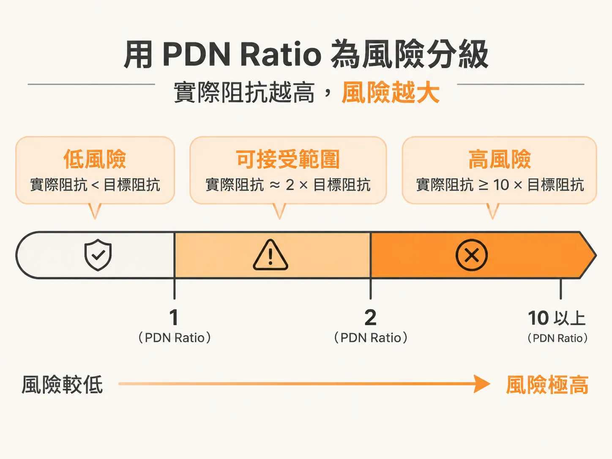
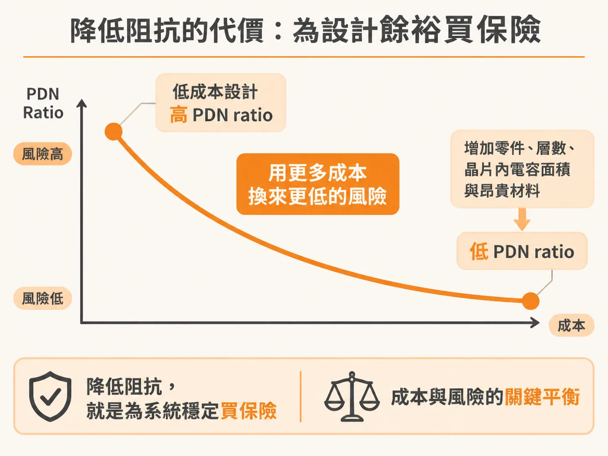
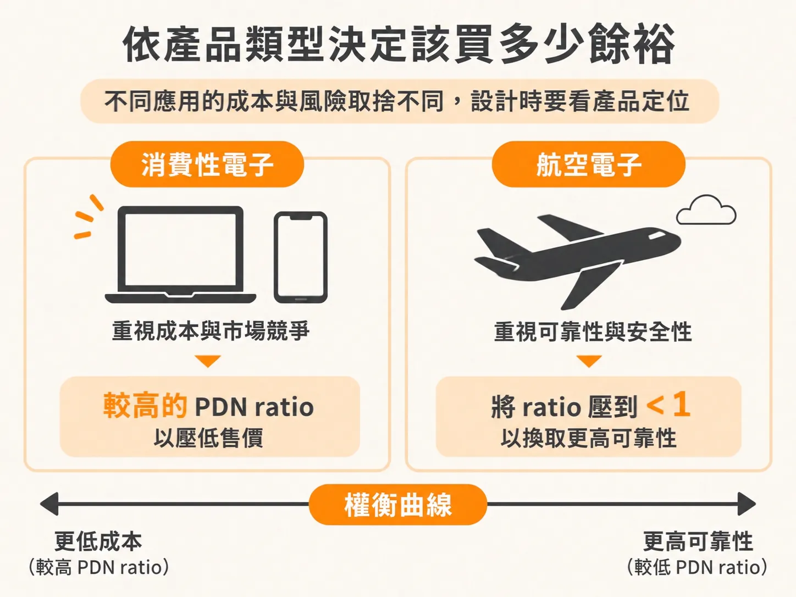

# 以 PDN Ratio 評估電源設計風險與餘裕拿捏

在設計高速數位產品的電源分配網路（PDN，Power Distribution Network）時，工程師往往會面臨一個難題：阻抗壓得越低，電源雜訊越不容易超標，但整機成本也隨之暴增。究竟規格要做到多嚴格，才不會白白浪費預算？

規劃 PDN 的工程流程大致包含三個關鍵步驟：

1. 根據晶片的功能與實際應用情境，對目標阻抗（target impedance）做出最合理的初步推估。
2. 在可行範圍內進行各種工程取捨，盡可能滿足該阻抗曲線。
3. 在達成目標阻抗所需的實作成本，以及產品在現場發生失效（field failure）的風險之間取得平衡。

要粗略衡量電路無法在額定效能下穩定運作的風險，關鍵指標是實際 PDN 阻抗（特別是峰值阻抗）與目標阻抗的比值，這個數值稱為「PDN ratio」（PDN 比值）。

## 用 PDN Ratio 為風險分級

當實際阻抗高於當初推算的目標阻抗時，風險便隨之攀升。實務上可以將 PDN ratio 分為以下幾個風險水準：

- **比值小於 1**：代表實際阻抗完全壓在目標阻抗之下，與 PDN 相關的失效風險極低。
- **比值在 2 左右**：從工程實務經驗來看，這個比值帶來的風險通常仍在可接受範圍內。
- **比值達到 10 以上**：幾乎必然會造成無法承受的風險。儘管許多微碼（microcode）在一般額定效能下仍能正常運作，但某些特定的運算指令很可能會激發 PDN 的共振，導致電源雜訊劇烈震盪，進而引發產品穩定度問題。

## 降低阻抗的代價：為設計餘裕買保險

要做出更低阻抗的 PDN 來降低風險比值，代價必然是提高成本。阻抗壓低意味著：

- 需要增加更多的去耦電容等零件。
- 採用更嚴苛的組裝設計規則，進而衝擊生產良率。
- 印刷電路板（PCB）或晶片封裝需要更多疊層。
- 晶片端需要保留更多面積給晶片內電容（die capacitance）。
- 必須改用更昂貴的基板材料。

成本與風險之間的拿捏，本質上是「你願意承擔多少風險」。多花錢增加設計餘裕（design margin），就像是為了系統穩定「買保險」來壓低風險，這也是整個 PDN 設計最核心的權衡。

## 依產品類型決定該買多少餘裕

不同應用對成本與風險比值的容忍度完全不同，設計時不應一味追求最小的比值，而是要看產品定位：

- **消費性電子產品**：這類應用通常受到極強的成本驅動。工程上選擇承受較高的風險比值（例如接近 2），換取低成本的架構設計，往往是更符合商業效益的平衡點。
- **航空電子系統（Avionics）**：在攸關人身安全的航太系統中，現場失效的代價難以估量。此時多花成本進行嚴格設計，將風險比值壓到小於 1，反而才是最具成本效益的解法。

釐清產品本身的成本敏感度與失效後果，再以 PDN ratio 檢視當前的峰值阻抗，就能清楚判斷手中的設計究竟是過度保護，還是冒了不該冒的風險。
