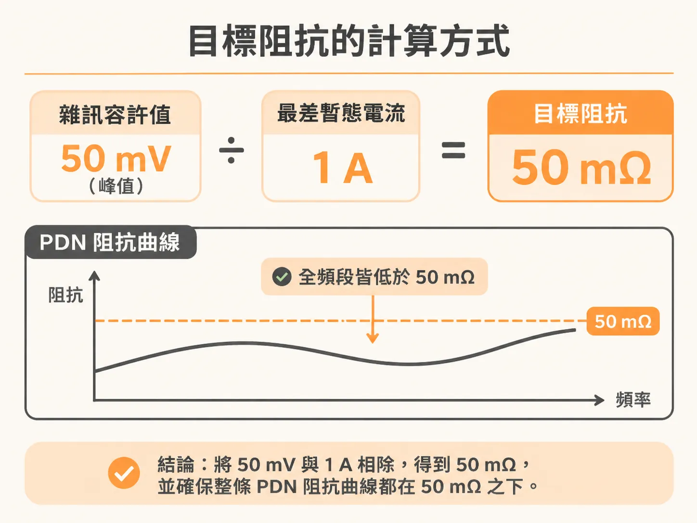
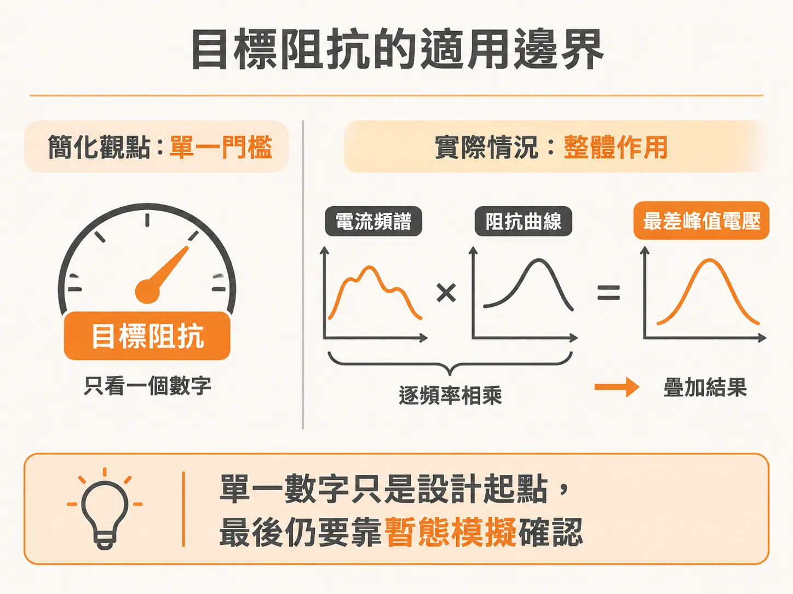

# 目標阻抗的計算與適用邊界

在電源完整性（PDN）設計中，為了確保電路能穩定運作，電源分配網路在各頻率下允許的最大阻抗上限，就稱為目標阻抗（target impedance，以 $Z_{\mathrm{target}}$ 表示）。

### 目標阻抗的計算方式

目標阻抗的推導公式非常直接：

$$
Z_{\mathrm{target}} = \frac{\Delta V_{\mathrm{noise}}}{I_{\mathrm{max\text{-}transient}}}
$$

公式中各項參數的定義如下：

- $Z_{\mathrm{target}}$：在任何頻率下，PDN 所允許的最大阻抗。
- $\Delta V_{\mathrm{noise}}$：為了符合系統效能要求，所規範的最大電源軌雜訊容許值。
- $I_{\mathrm{max\text{-}transient}}$：在任何可能的操作情境下，所會發生的最差情況暫態電流。

舉例來說，若電源雜訊規格訂為 $\pm 50\text{ mV}$（即容許峰值為 $50\text{ mV}$），而最差情況下的暫態電流是 $1\text{ A}$，那麼算出來的目標阻抗就是：

$$50\text{ mV} / 1\text{ A} = 50\text{ m}\Omega$$

如果 $\Delta V_{\mathrm{noise}}$ 或 $I_{\mathrm{max\text{-}transient}}$ 其中任一項會隨頻率改變，那麼 $Z_{\mathrm{target}}$ 也會跟著變成頻率的函數。

### 目標阻抗的適用邊界

在理論上，真正造成最差情況峰值電壓雜訊的，其實是整個電流頻譜分佈與完整阻抗曲線相互作用的結果。

單靠一個阻抗數值無法涵蓋所有的波形互動細節。嚴格來說，唯有在模擬中同時納入整套 PDN 的阻抗曲線，以及暫態電流波形的細節，透過暫態模擬（transient simulation）才能精確求出最差情況的電壓雜訊。

因此在實務上，目標阻抗並不是最終驗證的絕對標準，而是一個極具價值的品質指標（figure of merit）。它提供了一個合理的近似目標，讓工程師在著手設計穩健的 PDN 時，能快速抓住重點並找到合適的起點；而電源設計的最終評估，仍須交由包含完整 PDN 與暫態電流波形的暫態模擬來做最後把關。
