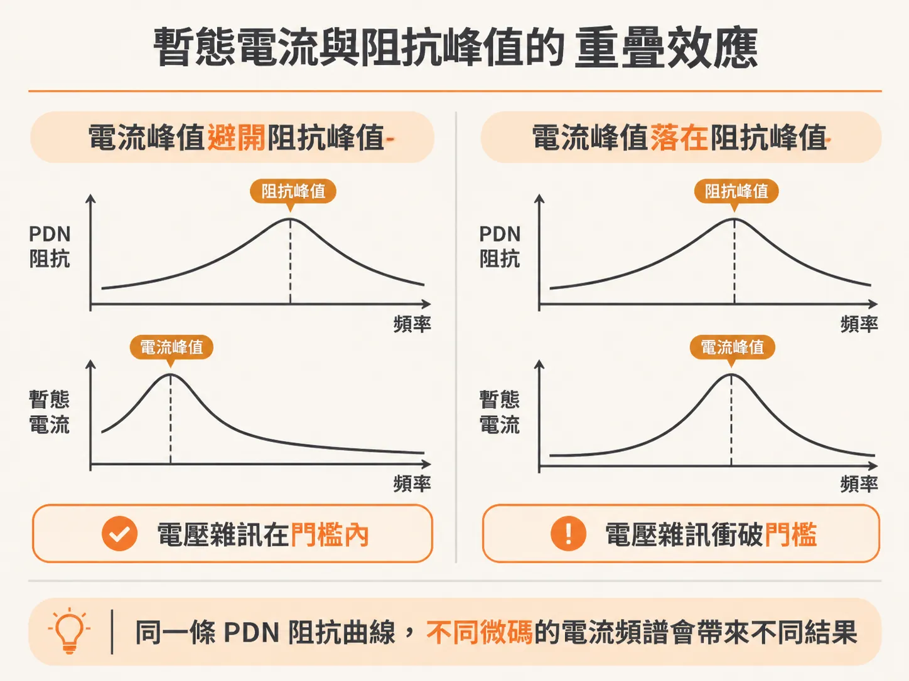
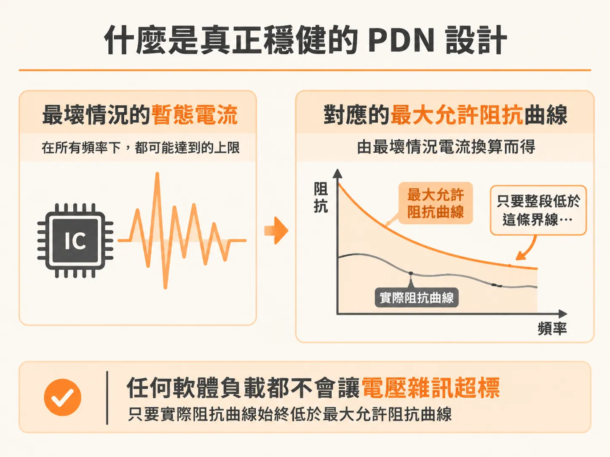

# 能開機不等於穩健：微碼與軟體如何改變電流頻譜並影響 PDN 設計

在硬體開發過程中，只要板子能順利開機、跑完驗證測試套件（test suite），團隊往往會鬆一口氣，認定電源分配網路（PDN）已經設計過關。然而，許多在實驗室評估時運作正常的產品，送到客戶手上執行實際應用時，卻經常出現無法預期的當機與故障。

這種「在實驗室能動，在現場卻失敗」的落差，關鍵在於產品只是「剛好能用」（working），而不是真正「穩健」（robust）。

## 暫態電流與阻抗峰值的重疊效應

電源軌（power rail）上實際產生的電壓雜訊，取決於通過晶片的暫態電流頻譜，以及晶片端感受到的 PDN 阻抗曲線（impedance profile）。

如果微碼（microcode）以某種演算法驅動晶片上的邏輯閘，電流頻譜峰值出現的位置剛好避開了 PDN 的高阻抗峰值，兩者交互作用產生的暫態雜訊就會落在規格門檻以內，系統不會發生錯誤。

但是，微碼的演算法只要稍微變動，即便驅動的是同一批邏輯閘，只要切換頻率有些微差異，暫態電流的頻譜峰值位置就會改變。一旦這個電流峰值正好撞上 PDN 阻抗曲線上的較大峰值，電源軌上的瞬間電壓雜訊就會飆高，超出可容許的上限，導致產品運作失敗。

這代表 PDN 上的雜訊大小，不僅取決於實體板端的阻抗分佈，同時也高度取決於晶片端暫態電流的頻譜成分。微碼實作細節與邏輯閘的使用率（gate utilization），對電源軌雜訊有著決定性的影響。

## 開機與測試程式為何無法保證穩健

微碼驅動晶片內部邏輯閘切換的方式千變萬化，這讓 PDN 設計的驗證變得格外棘手。

當產品在開機或跑特定的測試軟體時，所激發的電流頻譜峰值與阻抗峰值剛好沒有高度重疊，暫態雜訊低於指定門檻，產品自然能順利過關並被標記為「功能正常」。但這只代表該特定程式下的電流行為被容忍，不代表硬體本身禁得起各種軟體負載。

如果客戶換了另一套軟體，驅動了更多的內部邏輯閘，或是主迴圈頻率（dominant loop frequency）與測試程式不同，這個切換頻率一旦巧合落在 PDN 阻抗曲線的峰值上，就會引發巨大的瞬間壓降（voltage drop），讓同一顆晶片當場出錯。

能成功開機、順利跑完測試腳本，固然是好的開始，但絕不等於系統達到了穩健運作的水準。

## 什麼是真正穩健的 PDN 設計

真正穩健的 PDN 設計，不能寄望軟體或微碼「剛好避開」高阻抗頻率。

穩健的定義是：無論晶片端執行什麼軟體程式碼、在任何任意頻率下切換，或是產生任何時域波形特徵的最大暫態電流，此電流通過 PDN 阻抗曲線所引發的最壞情況電壓雜訊，都必須永遠低於會造成系統失效的臨界值。

設計者必須結合最壞情況下的暫態電流振幅，以及系統允許的電壓雜訊規格，共同推導出 PDN 的最大允許阻抗上限。只要整個頻譜範圍內的阻抗都壓在這個上限之下，無論微碼如何變更、軟體如何切換，電源軌的電壓雜訊就永遠不會超標。
