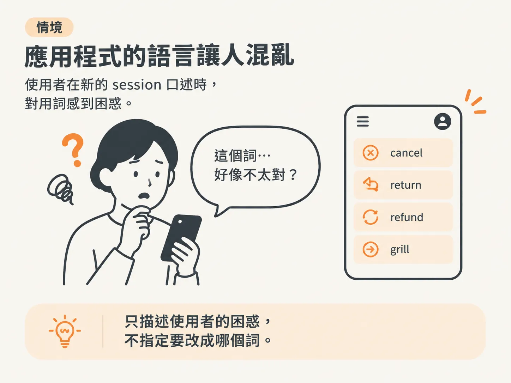
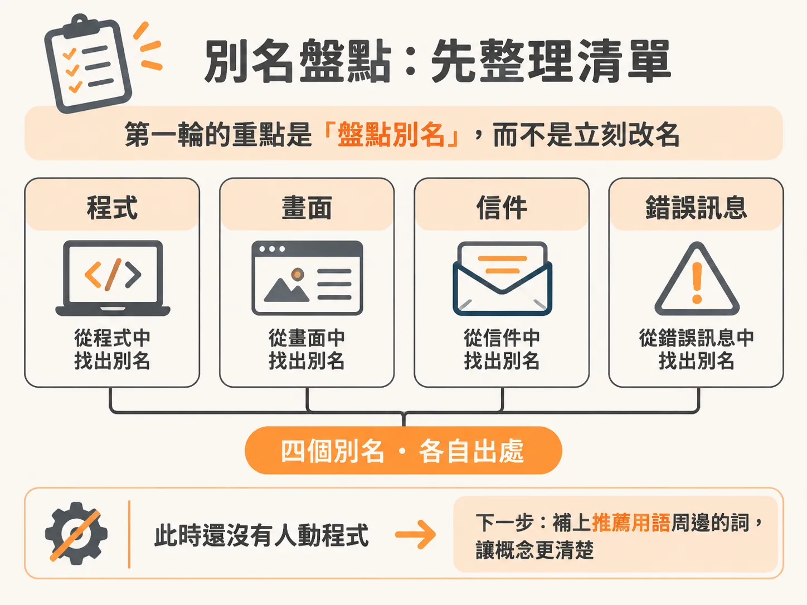
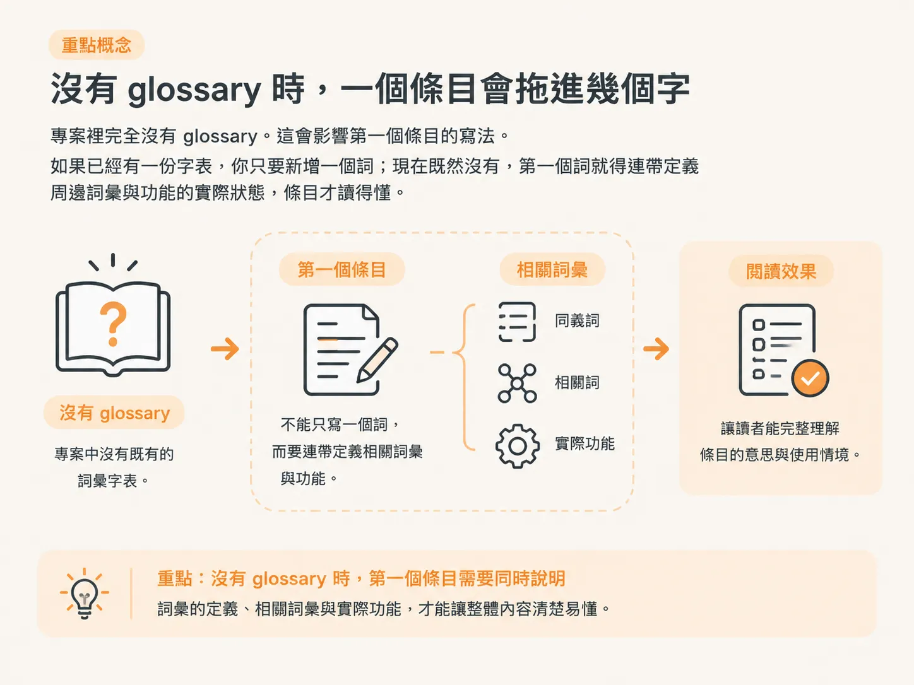

# 用 Grill with Docs 找出正確的字

上一步提到，同一個詞在三個地方都要一致。但「正確的字」不會自己冒出來，得透過一場 grill 把它問出來。任務只有兩件事：找出正確的字，然後讓整個應用程式統一使用這個字。

## 開場只描述症狀，不指定答案

開一個新的 session，載入 Grill with Docs。這個 skill 疊加在 grilling 上，再加入一層 domain modeling。grilling 負責提問；domain modeling 則負責挑戰你的用語、設計邊界案例，並在語言定案時把它寫進 glossary 與 ADR。這一場只需要它把用語問清楚。

開場只描述症狀，不要指定答案。第一句話不要寫「把 cancel 改成 refund」，因為那已經是你的答案，grill 就沒有發揮的空間。

改為描述你看到的混亂：應用程式對 pending chargeback 和 reversal 的用法很不一致，寄給使用者的信件用語也和畫面上的文字對不起來。你想開始建立一份 glossary，把這一類用語定下來，讓語言更一致。說完就讓它開始運作。

這段口述只交代問題在哪裡，以及大致想往哪個方向走，不替 agent 決定答案。接下來就交給第一輪。

## 第一輪要的是別名盤點，不是改名

第一輪回覆時，兩個 skill 都成功載入。它表示自己讀過 refund 相關的程式，接著列出找到的名稱。

清單如下：database schema、root file 和 commit messages 都用 refund；course page 的按鈕與表單用 cancel my purchase；confirmation email 用 reversal；settings page 用 pending chargeback。另外，錯誤訊息裡還藏著一個落單的 cancel：「You have watched too much of this course to cancel it.」

錯誤訊息絕對也要算在內。許多應用都有這個通病：錯誤訊息的文字和其他部分使用的 domain language 對不上。要盤點完整，就得把錯誤訊息也納入。

第一輪的重點是整理出一份盤點，而不是立刻改名。它只完成了第一項工作；第二項工作，是補上推薦用語周邊必要的詞，讓概念足夠清楚。此時還沒有人動程式。

## 沒有 glossary 時，一個條目會牽涉好幾個字

專案裡完全沒有 glossary。這會影響第一個條目的寫法。如果已經有一份字表，你只要新增一個詞；現在既然沒有，第一個詞就得連帶定義周邊幾個詞，條目才讀得懂。沒有 glossary 時，第一個條目不能只寫一行。

它也可能需要先釐清這項功能實際處於什麼狀態，才能替它命名。你要的是能讓團隊開始動工的用語，不是聽起來順口的字。因此，第一輪不會只給你一個詞，而是會提供一個詞，以及讓這個詞站得住腳的周邊詞彙。

第一輪也把下一個問題丟了回來：這個概念該用一個詞，還是兩個詞？這不是能隨口點頭帶過的問題。接下來要問的是：該怎麼用情境來判斷？
