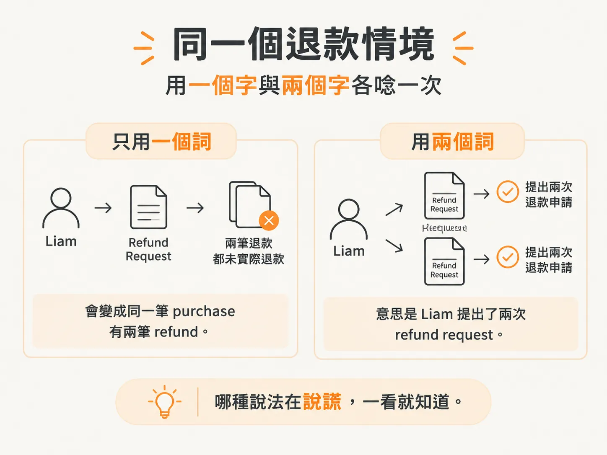
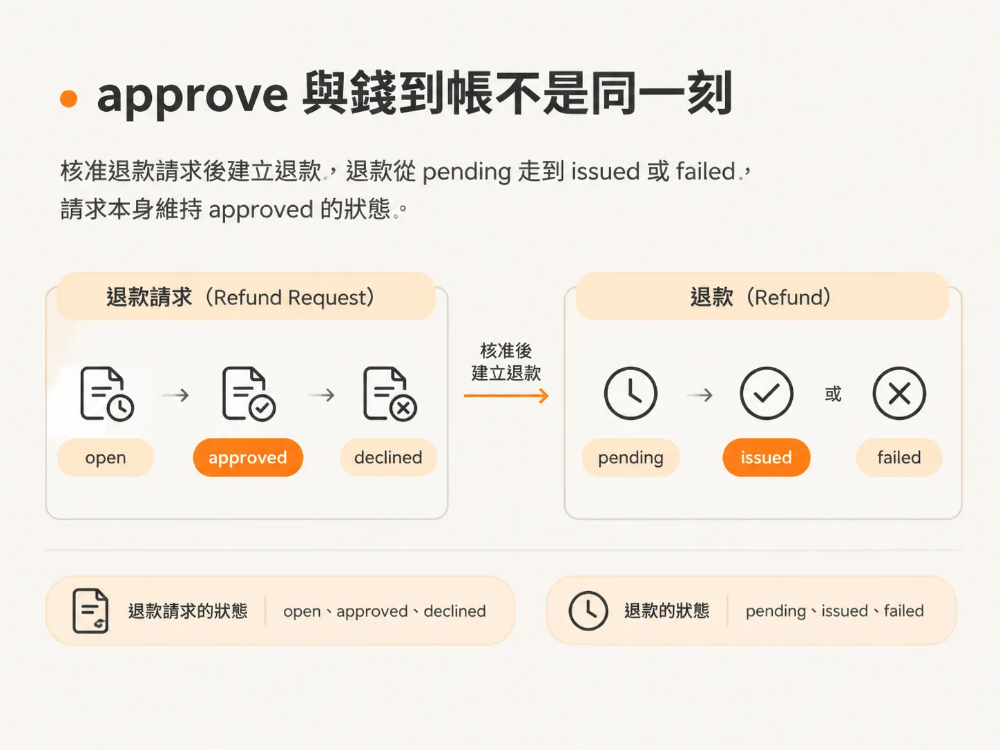

# Scenario testing：一個詞還是兩個詞

第一輪討論又回到了「一個詞還是兩個詞」這個問題。回答之前，得先處理另一個更基本的問題：這個字到底屬不屬於我們的 domain？先畫好邊界，再來唸情境。

## 先問「這個字屬於我們的 domain 嗎？」

問題是：bank-initiated chargeback 屬不屬於我們的 domain？這不是在問 chargeback 是什麼，而是在問 glossary 應該定義什麼，也同時在問它不應該定義什麼。

程式裡沒有任何地方定義 chargeback。未來也許會處理它，也許會需要先備好一個定義。但這次的決定是把它排除在 scope 之外：它不屬於這份字表。

不過，它後來還是被寫進了 glossary。你可以在下一個 prompt 裡請我拿掉：「我不想要 chargeback，它不屬於我們的 glossary。」

這個問題只是在畫一條邊界，不是通用的判準，而是這次的取捨。先畫好邊界，才能回答該用一個詞還是兩個詞。

## 同一個情境，用一個詞和兩個詞各唸一遍

Scenario testing 的做法很簡單：用兩個詞描述同一個情境，再用一個詞描述一次。把兩種說法並排比較，看哪一種說得通。

| 情境 | 用兩個詞 | 只用一個詞 |
|---|---|---|
| Liam 要求退 $79，尚未有人審核 | Liam has an open refund request | Liam has a requested refund |
| admin 拒絕 | his refund request was declined and no refund was issued | his refund was declined |
| Liam 被拒絕後再次提出要求 | He submitted two refund requests. | One purchase, two refunds, neither of them issued. |

第三列最清楚。用兩個詞，意思是 Liam 提出了兩次 refund request。只用一個詞，意思就變成同一筆 purchase 有兩筆 refund，而且兩筆都沒有實際退款。哪種說法在說謊，一看就知道。

部分退款會讓差異更加明顯。admin 只核准 $40，而不是 $79。如果只有 refund 這個詞，你就得另外創造 requested amount 和 refunded amount 這兩個概念。有了 refund request，就可以直接說：refund request 的金額是 $79，實際退款金額是 $40。

這張表把功能在語言上的差異具體呈現出來。只要能用語言描述邊界案例，就代表能在程式裡把它們建模。因此，這題的答案是兩個詞：refund request 和 refund。

## 核准與款項到帳不是同一回事

再看一個情境：refund 在週一核准，processor 到週四才確認。Liam 在週二會看到什麼？

如果只有 refund 這個詞，畫面就只能顯示 refunded。這句話會連續三天都在說謊：錢還沒到，狀態卻已經先顯示退款完成。因此，我們需要一套 refund lifecycle：request 的狀態是 approved，refund 的狀態則是 pending。

第二個情境更棘手：processor 因為 Liam 的卡已經關閉而拒絕退款。此時 request 是 approved，refund 卻是 failed。兩個詞都需要各自的狀態。

結論是：核准一筆 refund request 後，會建立一筆 refund。refund 一開始是 pending，之後會變成 issued 或 failed；refund request 則維持 approved。字表現在列出了 request 的 open、approved、declined，以及 refund 的 pending、issued、failed。

字表定稿了，但程式裡仍然使用 requested 和 chargeback。接下來的問題是：如何讓整個應用程式統一使用這套詞彙？
