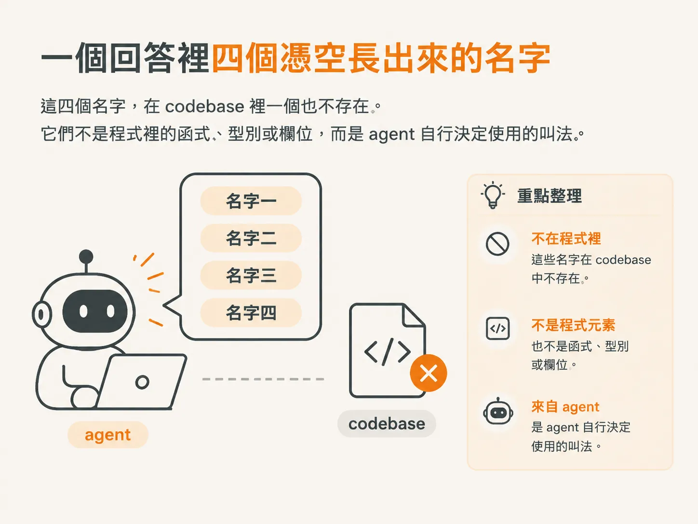
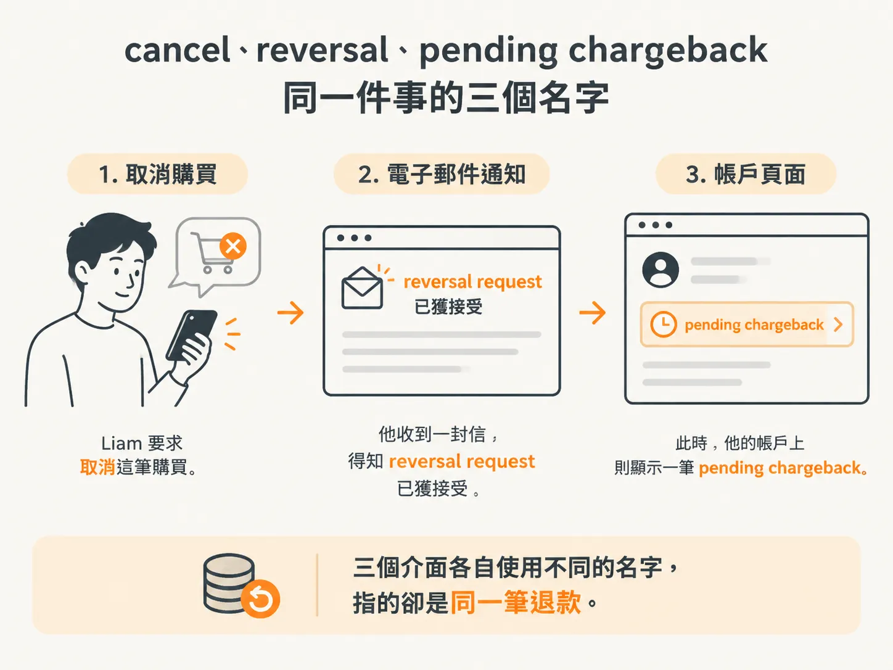

# 同一個東西，三個名字

## 前言

同一個概念，在按鈕上有一個名字，在通知信裡有另一個，在程式裡又是第三個。這不影響功能是否正常運作，卻讓每次修改前都得先猜一次。猜錯了，agent 就會再造一個名字。這個 node 要把這些叫法收斂成同一個詞，寫進 `GLOSSARY.md`，再回頭修改程式，讓用語一致。

這種情況並不少見。你的 repo 裡可能有大量由 agent 產出的 node 與 step，同義詞散落在標題、識別字與說明文字裡。別人的專案也一樣：同一個退款流程，在按鈕、信件和設定頁上各有不同說法。打開 grep，看到的是三個名字，而不是同一個概念。

這個 node 會依序回答幾個問題：一個概念為什麼會長出三個名字？代價為什麼會落在程式上？共用一份字表，究竟要共用得多徹底？正確的詞要怎麼問出來？一個概念需要一個詞，還是兩個詞？字表定稿後，又該怎麼讓 enum、變數、文案與 migration 都使用同一個詞？

讀完之後，你應該能指出自己 repo 裡一組同義詞，並說明它們指的是同一個概念。你也會知道，下一步不是修改文案，而是替這個概念建立一份字表。先從第一個問題開始：一個概念為什麼會長出三個名字？

## 一個回答裡四個憑空長出來的名字

問 agent 一個很普通的問題：Cadence 上，learner 可以拿回自己的錢嗎？它回了一段話。`reversal eligibility envelope` 由 `cancellation gate` 判斷，`cancellation gate` 再交給 `chargeback settlement handler`，等 `entitlement lease` 釋出。

這四個名字，在 codebase 裡一個也不存在。它們不是程式裡的函式、型別或欄位，而是 agent 自行決定使用的叫法。

它這麼做有個很實際的理由：節省 token。用一個簡短的名字承載大量資訊，就能反覆使用，不必每次都重新解釋一次。名字越短，所需的脈絡就越少。

代價則由讀者承擔。你不懂這些詞，因為 agent 沒有向你解釋；它只向自己解釋。一個 token 效率很高的回答，對使用者來說可能是一場災難。這也是為什麼，與 agent 溝通時，語言品質會直接影響輸出品質。你如何定義問題、使用多精簡的語言，都會反過來影響它給你的答案。

## cancel、reversal、pending chargeback：同一件事的三個名字

換到另一個更貼近日常的場景。Cadence 上有個實際問題，但它不是 bug。用 Liam Thompson 的帳號登入，進入 Introduction to TypeScript 這門課，然後按下「cancel my purchase」。

畫面顯示，他的帳戶有一筆 pending chargeback。終端機裡顯示寄出的信件內容，信上則說他的 reversal request 正在處理。三個介面，三種說法。

把整個流程再說一遍：Liam 要求取消這筆購買。他收到一封信，得知 reversal request 已獲接受；此時，他的帳戶上則顯示一筆 pending chargeback。三個介面各自使用不同的名字，指的卻是同一筆錢。

三個名字算是極端情況；兩個名字指同一件事，卻非常常見。這種不一致對使用者來說是一種折磨。它不會讓功能故障，卻讓人每看一句話，都得重新翻譯一次。

## 修法不是改文案，而是讓 agent 跟我共用一份字表

看到這裡，很容易想先去改文案：把 cancel 改成 refund，把 reversal 改成 refund，再把 chargeback 也改成 refund。但這只修正了其中一個介面。下一次 agent 進來，還是得自己猜哪個名字才算數。

更簡單的結構性解法，是建立一份共用字表，放在你與 agent 都能讀到的地方。你用它跟 agent 溝通，agent 也用它來約束自己的用語。聽起來很簡單，但這個做法往下會帶出很多改變：它能提升你與 agent 的溝通品質和 agent 的輸出品質，讓 codebase 更一致，也改善使用者最後看到的體驗。

這一步先不談字表條目該怎麼寫。先接受一件事：多個名字同時造成了產品文字與程式上的混亂。解法是讓所有人共用一份字表。那麼下一個問題就是：「共用」究竟要共用得多徹底？
