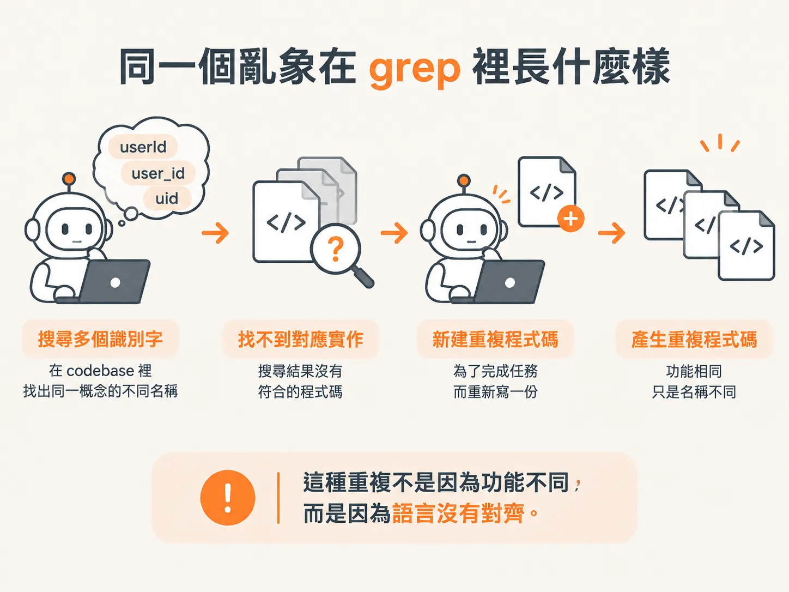
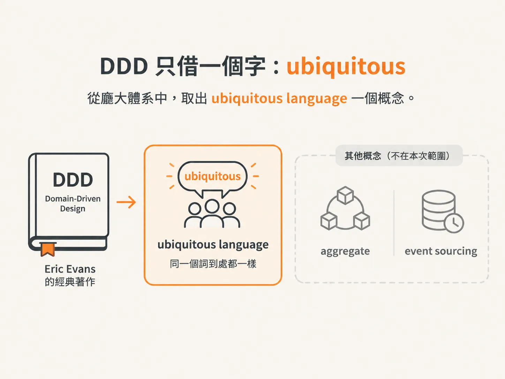
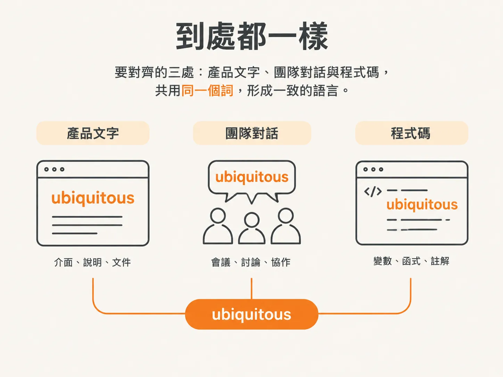

# Ubiquitous language：每個地方都用同一個字

上一步留下的問題是：「共用」究竟要共用到什麼程度？先把同一個亂象丟進 grep，看看它在程式碼裡呈現什麼樣子。搜尋結果會告訴我們，「徹底」到底是什麼意思。

## 同一個亂象在 grep 裡長什麼樣

在 codebase 裡搜尋 cancellation、reversal 和 chargeback，你會找到 `getCancellationOffer`、`pendingChargebacks`、`buildReversalEmail`。三個識別字，指的卻是同一個概念。

任何 agent 要走過這段程式碼，都得先找出這些名字，並知道它們指的是同一件事。找不到，它就可能重造一份。於是，程式碼裡出現重複。這種重複不是因為功能不同，而是因為語言沒有對齊。

解法不是等 agent 變聰明，而是在決定要建什麼的同時，也決定要用什麼語言來建。做法就是 grill with docs。這個 skill 是從 grill me 改編而來，疊加在 grilling 之上，並再加入一層 domain modeling。

## DDD 只借一個字：ubiquitous

這套想法來自 Eric Evans 的 Domain-Driven Design。DDD 把「同一個詞到處都一樣」稱為 ubiquitous language。這本書涵蓋的內容很多，我們只取其中一個字：ubiquitous。

刻意不採用的部分也很重要：我們不碰 aggregate，也不碰 event sourcing。我們只需要一份 glossary，以及把這份 glossary 的詞彙套用到程式裡。可以說，我們借用的是那個字，而不是整套方法。

為什麼只借一個字就夠了？因為語言是否一致，會決定我們能不能把事情說清楚。團隊談論產品時使用的詞，必須和產品完全一致；程式裡使用的詞，也必須和這一切一致。即使在沒有 AI 的專案裡，使用者、團隊和程式碼也常常各自使用不同的詞來稱呼同一件事。

反過來說，當你替正在建造的東西找到正確的名字，其實就已經開始把它建出來了。你知道怎麼在對話中使用這個名字、怎麼討論它，也知道怎麼把它界定清楚，讓 AI 建出來。

## 「到處都一樣」要對齊的三處

ubiquitous 要求三處使用同一個詞：產品文字、團隊對話和程式碼。也就是說，同一個詞在這三處都必須一致。

這三處並非各自獨立。團隊談論產品時使用的語言，必須完全對上產品；程式碼使用的語言，也必須與前兩者一致。只要有一處改用別的名字，這個詞就不再是 everywhere。團隊和 agent 就得先翻譯，才能開始動工。

這也解釋了為什麼 glossary 不能只供人閱讀。其他 skill 也會從這份 glossary 取用詞彙，確保使用同一套語言。glossary 是大家共用的詞彙來源，而不是一份只寫給新人看的文件。

原則到這裡就清楚了：同一個詞，三處都要一致。但「正確的字」不會憑空出現。接下來的問題是：要怎麼把它問出來？
