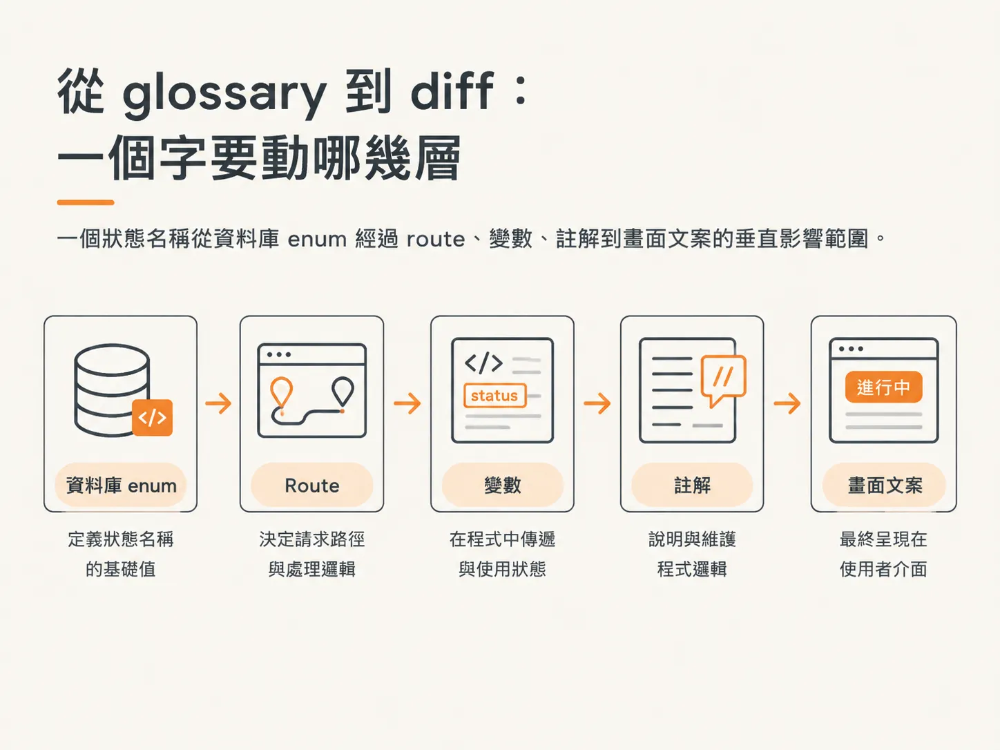
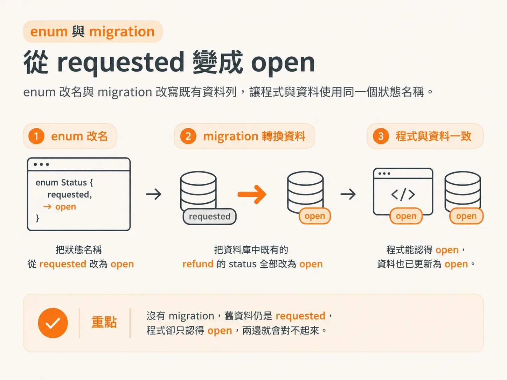
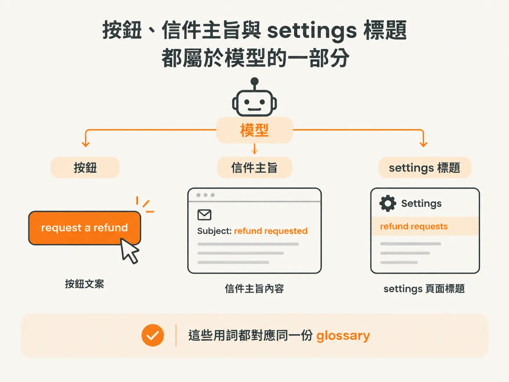

# 把應用程式統一在那個字上

上一步定稿的 glossary 裡，request 有 open、approved、declined 三種狀態；refund 則有 pending、issued、failed。程式裡卻還在用 requested 和 chargeback。這一步要做的，就是讓程式也用上同一套詞。

## 從 glossary 到 diff：一個詞要改動哪些層面

這一步的字表更完整了。除了 refund 和 refund request，還新增了 pending refund、issued refund、failed refund。

名稱定下來，接著就要看 diff。這次改名會涉及好幾個層面：

- `schema.ts` 裡的 refund status enum
- 一支 database migration
- settings route 與區域變數
- code comment
- 畫面文案：按鈕、信件主旨、settings 標題

不是每次 rename 都會牽涉這麼多地方。但一個 status 的名稱，可能一路從資料庫延伸到畫面。

## enum 與 migration：requested 怎麼變成 open

先定名稱。一筆還沒有人決定的 refund request，該叫什麼？agent 建議用 open。它一開始提出 requested，也就是你原本的想法，接著卻說出了有些彆扭的 a requested refund request。你同意改用更順口的 open refund request。

名稱定下來，才開始修改 enum。`schema.ts` 裡的 refund status enum，會把 requested 改成 open。

資料庫裡已經有 status 為 requested 的紀錄，因此還需要一支 migration，把這些 refund 的 status 全部改成 open。這支 migration 負責更新資料庫裡既有的 refund。若沒有它，程式認得 open，舊資料卻仍是 requested，兩邊就對不起來。

改完之後，settings route 裡的 pendingChargebacks 改成了 openRefundRequests。區域變數也一併改名，統一使用 openRefundRequests，並寫成 openRefundRequest.length。讀這段程式時，看到的就是 glossary 裡的用詞。

## 畫面上的每個字都要符合 glossary

按鈕、信件主旨和 settings 標題，算不算模型的一部分？算。agent 建議的文案是：按鈕用 request a refund，信件主旨用 refund requested，settings 標題用 refund requests。每個用詞都對得上 glossary。

這不只是順手修改文案。如果畫面上的字和 glossary 不一致，使用者學到的就會是另一套語言。前面那套由 cancel、reversal、chargeback 組成的流程，就是這樣逐漸形成的。

程式裡還有其他地方也要一併對齊。courses slug 函式裡的 requested refund，改成了 open refund request。code comment 則把 get cancellation offer 改成 get refund offer，後面再接上「If this purchase cannot be refunded, get open refund request」。這些都不是功能變更，而是讓同一套說法出現在每個檔案裡。

現在做這件事的成本低多了。agent 可以走遍整個 codebase，統一用詞，讓它們符合你的 domain language。這類 refactor 也比以前更容易說服人，因為 diff 清楚呈現了背後的決策。

現在，字表和程式說的是同一套話。接下來的 ADR、spec 和 ticket，才有共同的詞彙可以使用。
