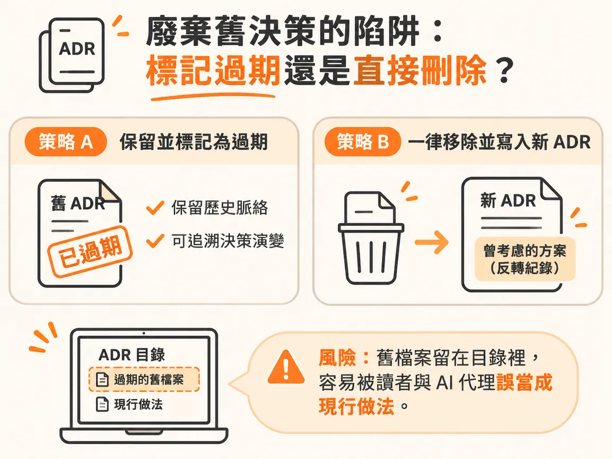

# 修剪 ADR 堆：用三問檢驗與替換過期決策

專案進行一段時間後，`docs/adr` 目錄往往會堆滿幾十份架構決策紀錄（ADR）。如果這些紀錄沒有定期維護，不僅新加入的團隊成員會讀得一頭霧水，AI 代理在讀取這批文件時，也很容易把早就廢棄的作法當成現行標準。

要清理這堆 ADR，最核心的工具就是領域建模中用過的「三問檢驗」（Three-part test）：

1. **很難逆轉嗎？**（Hard to reverse）
2. **結果令人意外嗎？**（Surprising）
3. **這是否來自真正的取捨？**（Real trade-off）

只要一項決策不符合這三個條件，它通常就不值得佔用一份 ADR 的位置。

---

## 廢棄舊決策的陷阱：標記過期還是直接刪除？

在清理過程中，我們通常有兩種做法：直接刪除檔案，或是將它標記為廢棄（deprecated）。

這裡存在兩種策略：
- **策略 A**：從一開始就不算真正決策的檔案直接刪除；如果是真正的決策但後來被推翻，則保留檔案並標記為過期。
- **策略 B**：不管是從未達標的瑣碎紀錄，還是已經失效的過期決策，一律從目錄中移除；如果推翻了重大決策，就在新決策的「曾考慮方案（considered options）」中記錄這次反轉。

實務上強烈建議採用**策略 B**。因為一份被標記為 superseded（已被取代）的舊 ADR 繼續留在 `docs/adr/` 裡，對新讀者與 AI 代理來說都是陷阱，很容易被誤當成現行的做法。

刪除檔案並不代表歷史遺失，Git 的 commit 紀錄永遠都能找回過去的內容。把真正的反轉寫進新 ADR，目錄才能維持乾淨可靠。

---

## 哪些決策該直接砍掉？

對照三問標準，有兩種類型的 ADR 最應該優先刪除：

### 1. 瑣碎且理所當然的技術選擇
例如一份標題為「使用 Prettier」的 ADR，內容寫著「使用 Prettier 並保持預設設定，所有檔案都用專案剛建立時的 `.prettierrc` 排版」。這在多數專案中都是標準做法，既不令人意外，要換掉也極其容易，完全不值得寫成 ADR。

另一個例子是「選用 Lucide React 作為圖示庫」。理由是它比 Heroicons、Phosphor 涵蓋範圍廣，而且能搭配專案已使用的 shadcn/ui。這項選擇非常直觀、沒有艱難的權衡，逆轉成本也很低，同樣沒有達到 ADR 的門檻。

### 2. 暫時性的實作細節
例如一份寫著「在選定郵件服務商前，先將退款通知郵件印在伺服器 Log」的 ADR。當團隊後來選了 Postmark，並實作了一層可重複使用的郵件傳輸介面（mail transport interface）後，這份舊紀錄就完全過期了。

郵件服務隨時可以替換，加上程式碼底層已經有介面隔離，這類過渡期實作根本不需要專門留一份 ADR。

---

## 被推翻的決策：寫進新 ADR 的考慮方案

有些決策本身確實具備足夠的影響力，但後續業務方向改變了。這時正確的做法是：**移除舊 ADR，建立新 ADR，並在新檔案裡寫清楚為什麼放棄舊做法。**

以專案中的地理位置定價為例：
- **舊做法（ADR 008）**：當請求沒有帶國家資訊時，呼叫 `ipapi.com` 查詢 IP 來取得國家。
- **新變更**：程式碼不再呼叫 IP API，如果拿不到國家資訊，就直接收取全額費用。

這種「決定不做某件事」的脈絡，很難單純從程式碼看出來。因此，正確的重構方式是撰寫一份新的 ADR（例如 `0012`），將舊作法列在「曾考慮過的方案」中：

> **曾考慮方案**：讀取 `X-Forwarded-For` 第一個 IP 並向 `ipapi.com` 查詢國家。
> **結論**：過去曾採用此做法，但現已棄用，改為直接收取全額費用。

寫下這段紀錄後，未來 AI 代理或新工程師在檢視該功能時，就不會疑惑「為什麼這裡不串 IP 查詢」，也不會試圖重新把這個被淘汰的方案加回來。

---

## 順手修剪與對齊詞彙

清理 ADR 堆時，還有兩件細節可以順便完成：

1. **詞彙對齊（Glossary）**：檢查保留下來的 ADR（例如確認依然有效且達標的決策），確認內文使用的名詞是否與專案的詞彙表一致（例如統一改為 `platform admins`、`instructors`）。
2. **避免過度指示**：刪除 ADR 後，工具可能會建議在 `AGENTS.md` 補上一條「所有圖示一律來自 Lucide React」。這類規則 AI 代理讀程式碼就能自行理解，不需要塞進專案說明文件，直接捨棄即可。

透過這套流程——砍掉不合標準的瑣碎記錄、把推翻的決策移入新 ADR 的考慮選項、同步全域詞彙——原本膨脹失控的 ADR 堆就能迅速收斂成八到九份真正具有指導價值的核心資產。
