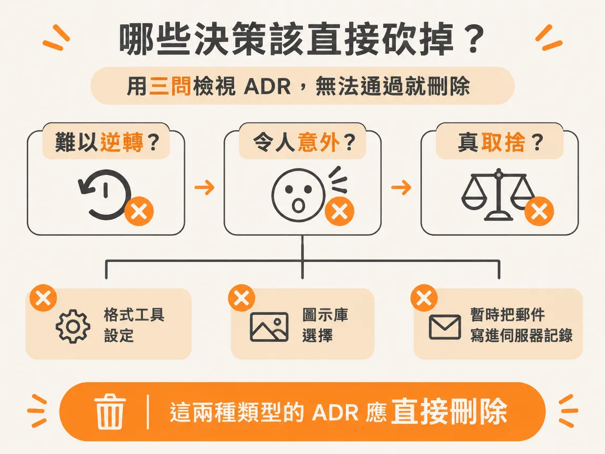
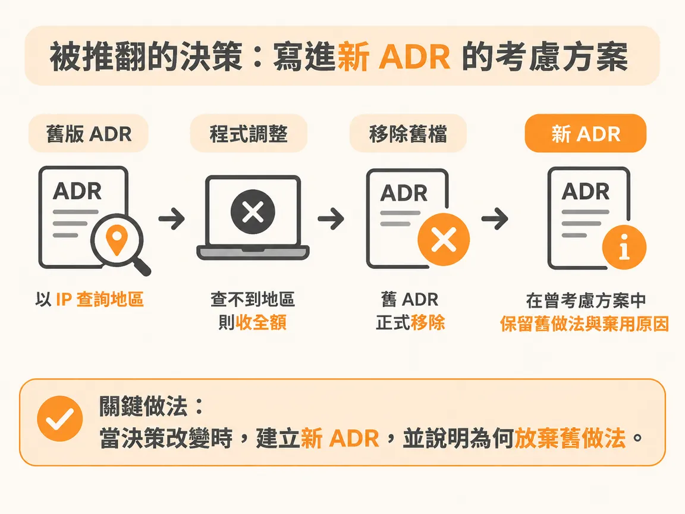

# 修剪 ADR 堆：用三問檢驗與替換過期決策

專案跑了一陣子之後，`docs/adr` 資料夾常常會累積幾十份架構決策紀錄（ADR）。
這些紀錄如果沒有定期整理，新進成員會看得一頭霧水。
AI 代理在讀取文件時，也容易把早就不用的舊做法當成現行規範。

清理 ADR 的核心方法是「三問檢驗」（Three-part test）：

1. **很難逆轉嗎？**（Hard to reverse）
2. **結果令人意外嗎？**（Surprising）
3. **這是否來自真正的取捨？**（Real trade-off）

一項決策只要不同時符合這三個條件，就不需要特地寫成一份 ADR。

---

## 廢棄舊決策的做法：標記過期還是直接刪除？

在清理過程中，我們通常有兩種做法：直接刪除檔案，或是標記為廢棄（deprecated）。

實務上有兩種處理策略：
- **策略 A**：一開始就不算決策的檔案直接刪除。原本是真正決策但後來推翻的，保留檔案並標記為過期。
- **策略 B**：無論是未達門檻的瑣碎紀錄，或是已經失效的決策，全部從目錄中刪除。如果推翻了重要決策，改在新決策的「曾考慮方案（considered options）」中記錄這段轉折。

實務上應該採用**策略 B**。
標記為 superseded（已被取代）的舊 ADR 留在 `docs/adr/` 裡，對新讀者與 AI 代理都是干擾，很容易被誤認成現行做法。

直接刪除檔案並不會遺失歷史，Git commit 隨時能找回過去的內容。
把決策轉折寫進新 ADR，目錄才能維持乾淨可靠。

---

## 哪些決策該直接刪除？

對照三問標準，有兩種類型的 ADR 最應該優先刪除：

### 1. 瑣碎且理所當然的技術選擇
一份標題為「使用 Prettier」的 ADR，內容寫著「使用 Prettier 並保持預設設定，所有檔案都用專案剛建立時的 `.prettierrc` 排版」。
這在多數專案中都是常見標準做法。
它既不令人意外，替換成本也極低，不需要寫成 ADR。

另一個例子是「選用 Lucide React 作為圖示庫」，理由是圖示涵蓋範圍比 Heroicons 或 Phosphor 廣，而且能搭配現有的 shadcn/ui。
這項選擇非常直覺，沒有複雜的權衡考量，隨時可以換掉，並未達到 ADR 的標準。

### 2. 暫時性的實作細節
一份 ADR 如果寫著「在選定郵件服務商前，先將退款通知郵件印在伺服器 Log」。
後續選用 Postmark，並且設計了可重複使用的郵件傳輸介面（mail transport interface）後，原本的紀錄就完全失效了。

更換郵件服務很簡單，底層程式碼也已有介面隔離，這種過渡期的實作細節不需要留存 ADR。

---

## 被推翻的決策：寫進新 ADR 的考慮方案中

有些決策本身確實具備足夠的影響力，但後續業務方向改變了。
這時的做法是：**刪除舊 ADR，建立新 ADR，並在新檔案寫明放棄舊做法的原因。**

以地理位置定價為例：
- **舊做法（ADR 008）**：請求若沒有帶國家資訊，就呼叫 `ipapi.com` 查詢 IP 來判斷國家。
- **新變更**：程式碼不再打 IP API；拿不到國家資訊時，直接收全額。

「決定不做某件事」的脈絡很難單看程式碼看出來。
處理方式是新增一份 ADR（例如 `0012`），把舊做法列在「曾考慮方案」中：

> **曾考慮方案**：讀取 `X-Forwarded-For` 第一個 IP，並向 `ipapi.com` 查詢國家。
> **結論**：過去曾採用此做法，現已停用，改為直接收全額。

記下這個脈絡後，未來的工程師或 AI 代理看到這段邏輯時，就不會困惑「為什麼不查 IP」，更不會把已經淘汰的做法加回來。

---

## 順便整理名詞與精簡提示

整理 ADR 時，可以順手處理兩件事：

1. **對齊詞彙（Glossary）**：檢查留下來的有效 ADR，確認用詞與專案詞彙表一致（例如統一改為 `platform admins`、`instructors`）。
2. **避免過度指示**：刪除圖示 ADR 後，輔助工具可能會建議在 `AGENTS.md` 加上「所有圖示一律使用 Lucide React」。這種規則 AI 代理直接看程式碼就能掌握，不需要寫進專案指引，直接略過即可。

刪掉未達標的瑣碎紀錄、把推翻的決策放進新 ADR 的考慮選項、同步專案詞彙。
這套整理流程可以讓原本失控膨脹的 ADR，精簡成八到九份真正具備參考價值的核心資產。
