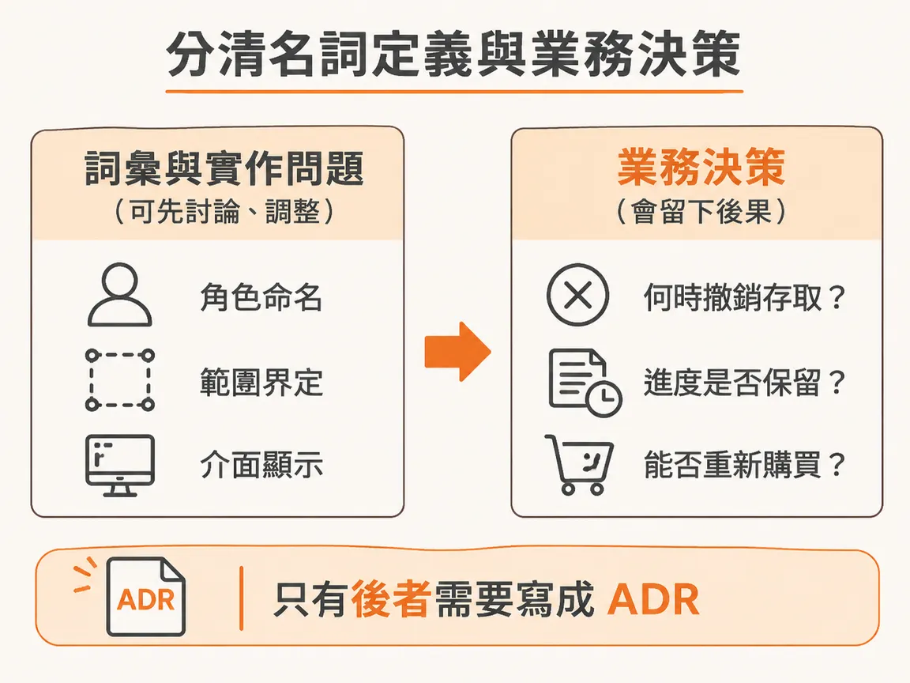

# 退款功能設計：從對齊名詞到抓出架構決策

當系統裡出現第一筆退款請求，例如學員 Liam 在《Introduction to TypeScript》送出了退款申請，後台卻完全沒有審核或核發退款的功能時，團隊就必須著手補上退款審核畫面。

退款功能牽涉到金錢，底下往往藏著棘手的架構問題。如果一個學員看了一半的課程後申請退款，資料庫裡的學習進度到底該怎麼辦？是直接把紀錄全數抹除、永久保留，還是保留特定天數？這類決定不管選哪一邊都有相應的代價，非常適合作為架構決策紀錄（ADR，Architectural Decision Record）的主題。

但在撰寫 ADR 之前，往往會發現另一個更大的障礙：人與 AI、甚至工程師彼此之間的對話極度混亂。要把真正需要記錄的架構決策抓出來，第一步是分清楚哪些爭端只是「詞彙庫（Glossary）沒對齊」，哪些才是「業務與資料流的關鍵決策」。

## 混亂是更新詞彙庫的訊號

在與 AI 進行嚴格審核（Grilling）並規劃退款審核畫面時，如果發現對話輸出讀起來卡手、意思模糊，直覺的困惑通常意味著名詞定義出現漏洞。

例如在檢查既有程式碼與文件時，可能會遇到這樣的矛盾：
- 課程的存取權限來自「註冊（Enrollment）」而非「購買（Purchase）」。如果退款通過後註冊依然保留，學員不只繼續擁有課程，系統還會因為防重複購買機制，導致他永遠無法再次購買這堂課。
- 進度並不是存在註冊紀錄上，課程進度、觀看歷史與測驗紀錄都是按「學員」與「章節」個別儲存。
- 資料結構裡的「Admin」有雙重含意，既可以是系統後台的管理員，也可以是購買團隊授權的管理員。
- 詞彙庫原本寫著「團隊（team）可以核准或拒絕退款」，但「team」在系統其他地方指的卻是團隊授權。
- 前端頁面會在學員完成超過 50% 課程時隱藏退款按鈕，但後端伺服器動作（Server Action）根本沒做這層檢查，學員直接用 curl 就能繞過限制發送請求。

在處理核心邏輯前，這類用詞與角色衝突必須先在詞彙庫（`Glossary.md`）裡梳理清楚。例如將管理角色拆解為「平台管理員（Platform Admin）」與「團隊管理員（Team Admin）」，並在全域文件統一名稱；同時定義清楚只有平台管理員有權限決定退款請求的准駁。

## 分清名詞定義與業務決策

理清名詞後，退款審核流程中就會浮現一系列必須逐項定調的問題。這些問題有些純粹是介面或名詞延伸，有些則是不可逆的架構決策：



1. **誰有權決定退款請求？**
   - 屬於名詞與角色權限：只有「平台管理員」可以核准或拒絕。
2. **拒絕退款是否在本次範圍內？**
   - 屬於範圍界定：拒絕退款必須納入範圍。
3. **學員何時失去課程存取權？**
   - 屬於核心業務決策：選項包括「發出退款申請時」、「管理員核准時」或「款項實際退回時」。合理的決定是「管理員核准時」才撤銷權限；如果申請被拒絕，學員理應繼續保有課程存取權。
4. **存取權撤銷後，進度如何處理？**
   - 屬於關鍵架構決策：保留學員的章節進度、觀看紀錄與測驗嘗試，不直接刪除資料庫紀錄。
5. **退款後的學員能否重新購買？**
   - 屬於狀態轉換決策：退款完成並撤銷權限後，系統應允許學員再次購買該課程。
6. **審核畫面上管理員該看到哪些進度指標？**
   - 屬於介面實作細節。
7. **50% 的退款資格限制以何者為準？**
   - 屬於安全與業務規則：完成超過 50% 章節的學員不可退款，且後端必須強制校驗。
8. **審核畫面應列出哪些請求？**
   - 屬於介面實作細節：僅列出待處理（Open）的退款請求。

這些問題裡，大部分介面細節依照既有慣例實作即可，但「何時撤銷權限」與「進度是否保留」直接牽涉到資料保存策略與後續購買體驗，就是必須明確落成 ADR 的決策。

## 用情境測試釐清團體授權邏輯

當退款情境延伸到多人的團隊授權（Team License）時，邏輯往往會變得更加模糊。例如：團隊管理員買了 10 個席次（Seats），在無人領取的情況下送出退款申請，如果第三天在審核尚未完成前有人領取了席次，系統該如何應對？


當程式碼把兌換機制稱為 coupon、退款程式碼稱為 seat、業務層又稱為 team license，且存取權完全沒有綁定是哪一筆購買時，問題就會爆發。系統甚至可能在退款時只去抓該學員「最近一次購買紀錄」，導致退錯訂單。

面對這種混亂，進行「情境測試（Scenario Testing）」是抓出邊界條件的最佳方式：

- **情境一：個人購買與團隊授權是否為同一件事？**
  Priya 身為團隊管理員，花了 790 美元購買 10 個席次但自己不上課，這與 Liam 花 79 美元為自己購買完全不同。因此詞彙庫必須分立出「個人購買（Individual Purchase）」與「團隊授權（Team License）」，兩者皆隸屬於廣義的「購買（Purchase）」，但團隊授權會產生「席次（Seats）」。
- **情境二：完全無人領取時退款**
  Priya 申請退款且無人領取席次，一旦退款通過，整張團隊授權底下的席次全部作廢。
- **情境三：退款申請審核中被領取席次**
  為了避免狀態混亂，必須立下一條硬性規則：退款請求處於待處理（Open）期間，所有席次皆凍結、禁止領取。由此在詞彙庫中正式確立「已領取席次（Claimed Seat）」與「未領取席次（Unclaimed Seat）」的狀態概念。
- **情境四：先自購又購買團隊授權**
  Liam 為自己買了課程，隨後又買了團隊授權。這代表退款請求不能只綁定學員與課程，必須精準對應到特定的「購買紀錄（Purchase ID）」。
- **情境五：領取席次的學員想退款**
  Ben 領取了 Priya 購買的席次，上課後覺得不喜歡，想申請退款。規則必須明確定為「不行」，因為席次領取者並非實際付費者。
- **情境六：個人退款後又領取團隊席次**
  Liam 退掉了個人購買的課程，失去存取權；一週後 Priya 給了他一個團隊授權席次。此時 Liam 重新獲得存取權，且系統依然保留他過去的學習進度。

退款與購買的關聯，在資料表設計中可以清楚體現出來：

<!-- source: sources/real-engineer/20261116/supplement/cohort-005-project/app/db/schema.ts#L232-L254 -->

```typescript
export const refunds = sqliteTable(
  "refunds",
  {
    id: integer("id").primaryKey({ autoIncrement: true }),
    purchaseId: integer("purchase_id")
      .notNull()
      .references(() => purchases.id),
    status: text("status")
      .notNull()
      .$type<RefundStatus>()
      .default(RefundStatus.Requested),
    // The learner's own words, in the box on the course page.
    reason: text("reason").notNull(),
    // Null until someone approves — a declined request refunds nothing.
    amountRefunded: integer("amount_refunded"),
    requestedAt: text("requested_at")
      .notNull()
      .$defaultFn(() => new Date().toISOString()),
    resolvedAt: text("resolved_at"),
    resolvedByUserId: integer("resolved_by_user_id").references(() => users.id),
  },
  (table) => [index("refunds_purchase_idx").on(table.purchaseId)]
);
```

而在處理購買時，個人購買會直接完成註冊，團隊購買則僅建立授權與席次，購買者本身不會被自動註冊：

<!-- source: sources/real-engineer/20261116/supplement/cohort-005-project/app/routes/courses.$slug.purchase.tsx#L341-L380 -->

```tsx
export async function action({ params, request }: Route.ActionArgs) {
  const { slug } = parseParams(params, purchaseParamsSchema);
  const course = getCourseBySlug(slug);
...
  if (parsed.data.intent === "confirm-purchase") {
    if (isUserEnrolled(currentUserId, course.id)) {
      throw redirect(`/courses/${slug}`);
    }
    createPurchase(currentUserId, course.id, pppPrice, country);
    enrollUser(currentUserId, course.id, false, false);
    throw redirect(`/courses/${slug}/welcome`);
  }

  // Team purchase — user does NOT get enrolled themselves
  const { quantity } = parsed.data;
  const totalPrice = pppPrice * quantity;
  createTeamPurchase(currentUserId, course.id, totalPrice, country, quantity);
  throw redirect(`/team`);
}
```

## 總結

面對複雜的業務變更時，不要急著把所有的爭議都塞進 ADR：

1. **先辨識出感受**：只要在規格討論或與 AI 協作時覺得文意模糊、定義打結，代表詞彙庫存在漏洞。
2. **用情境測試對齊詞彙**：透過具體的「誰付了錢、誰拿到權限、退款時誰受影響」情境，定義出精確的名詞（例如 Platform Admin、Team License、Claimed/Unclaimed Seats）。
3. **只對有代價的架構選擇寫 ADR**：當名詞定位清楚後，剩下的如「撤銷權限的時間點」以及「使用者資料與進度的保留策略」等涉及狀態機、資料一致性與金錢流向的不可逆決定，才是真正需要寫入架構決策紀錄的核心。
