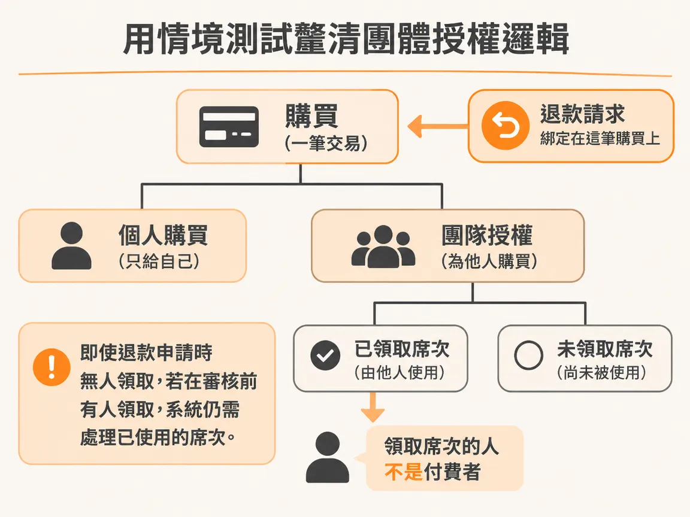

# 退款功能設計：從對齊名詞到抓出架構決策

當系統收到第一筆退款請求，例如學員 Liam 申請退款《Introduction to TypeScript》，後台卻沒有審核與退款功能時，就必須補上退款審核介面。

退款牽涉到金流，背後往往藏著棘手的架構問題。

學員看完一半課程後退款，資料庫裡的學習進度該如何處理？

直接刪除、永久保留，還是保留特定天數？

這些做法各有代價，很適合寫成架構決策紀錄（ADR，Architectural Decision Record）。

但在動筆寫 ADR 之前，人與 AI、甚至工程師之間的溝通往往非常混亂。

要找出真正需要記錄的架構決策，第一步是區分哪些是「詞彙庫（Glossary）未對齊」，哪些才是「業務與資料流的關鍵決策」。

## 混亂代表該更新詞彙庫

規劃退款審核介面並由 AI 進行嚴格審核（Grilling）時，如果對話輸出讀起來不順、意思模糊，通常代表名詞定義有缺漏。

檢查既有程式碼與文件時，常見以下矛盾：

- 課程存取權來自「註冊（Enrollment）」而非「購買（Purchase）」。退款後若保留註冊，學員能繼續上課，系統還會因為防重複購買機制，導致他無法再次購買。
- 進度不在註冊紀錄上，課程進度、觀看紀錄與測驗紀錄是按「學員」與「章節」個別儲存。
- 資料結構裡的「Admin」有雙重含意，能代表後台管理員，也能代表購買團隊授權的管理員。
- 詞彙庫寫著「團隊（team）可以核准或拒絕退款」，但「team」在其他地方代表團隊授權。
- 前端在學員完成超過 50% 課程時會隱藏退款按鈕，後端 Server Action 卻沒有檢查，學員用 curl 就能繞過限制發送請求。

處理核心邏輯之前，必須先在詞彙庫（`Glossary.md`）釐清這些用詞與角色衝突。

管理角色應拆分為「平台管理員（Platform Admin）」與「團隊管理員（Team Admin）」，並在全域文件統一名稱。

同時明確規定只有平台管理員有權准駁退款。

## 分清名詞定義與業務決策

釐清名詞後，退款審核流程中會浮現必須逐一確認的問題。這些問題有些純粹是介面或名詞延伸，有些則是不可逆的架構決策：


1. **誰有權決定退款請求？**
   屬於名詞與角色權限：只有「平台管理員」可以核准或拒絕。
2. **拒絕退款是否在本次範圍內？**
   屬於範圍界定：拒絕退款必須納入範圍。
3. **學員何時失去課程存取權？**
   屬於核心業務決策：選項包括「送出申請時」、「管理員核准時」或「款項退回時」。在「管理員核准時」撤銷權限最合理；申請若被拒絕，學員應保有存取權。
4. **存取權撤銷後，進度如何處理？**
   屬於關鍵架構決策：保留學員的章節進度、觀看紀錄與測驗嘗試，不刪除資料庫紀錄。
5. **退款後的學員能否重新購買？**
   屬於狀態轉換決策：退款完成並撤銷權限後，系統應允許學員重新購買該課程。
6. **審核畫面上管理員該看到哪些進度指標？**
   屬於介面實作細節。
7. **50% 的退款資格限制以何者為準？**
   屬於安全與業務規則：完成超過 50% 章節的學員不可退款，且後端必須強制驗證。
8. **審核畫面應列出哪些請求？**
   屬於介面實作細節：只列出待處理（Open）的退款請求。

多數介面細節依照既有慣例實作即可。

「何時撤銷權限」與「進度是否保留」直接影響資料保存策略與後續購買體驗，必須明確寫成 ADR。

## 用情境測試釐清團隊授權邏輯

當退款情境延伸到多人的團隊授權（Team License）時，邏輯通常更複雜。

團隊管理員買了 10 個席次（Seats），在無人領取時申請退款；若第三天審核尚未完成前有人領取席次，系統該如何處理？



如果程式碼把兌換機制稱為 coupon、退款程式碼稱為 seat、業務層稱為 team license，且存取權沒有綁定特定購買紀錄，系統就會出錯。

退款時系統可能只抓該學員「最近一次購買紀錄」，造成退錯訂單。

進行「情境測試（Scenario Testing）」是找出邊界條件的最佳做法：

- **情境一：個人購買與團隊授權是否為同一件事？**
  Priya 身為團隊管理員，花 790 美元購買 10 個席次但自己不上課；Liam 則是花 79 美元為自己購買。詞彙庫必須分開定義「個人購買（Individual Purchase）」與「團隊授權（Team License）」。兩者都是「購買（Purchase）」，但團隊授權會產生「席次（Seats）」。
- **情境二：完全無人領取時退款**
  Priya 申請退款且無人領取席次。退款通過後，整張團隊授權底下的席次全部失效。
- **情境三：退款申請審核中被領取席次**
  退款請求處於待處理（Open）期間，所有席次一律凍結、禁止領取。詞彙庫需正式確立「已領取席次（Claimed Seat）」與「未領取席次（Unclaimed Seat）」的狀態概念。
- **情境四：先自購又購買團隊授權**
  Liam 為自己買了課程，隨後又買了團隊授權。退款請求不能只綁定學員與課程，必須對應到特定的「購買紀錄（Purchase ID）」。
- **情境五：領取席次的學員想退款**
  Ben 領取了 Priya 購買的席次，上課後想申請退款。規則必須定為不行，因為席次領取者不是實際付費者。
- **情境六：個人退款後又領取團隊席次**
  Liam 退掉個人購買的課程，失去存取權；一週後 Priya 給他一個團隊授權席次。此時 Liam 重新獲得存取權，系統依然保留他過去的學習進度。

退款與購買的關聯，在資料表設計中清楚呈現：

<!-- source: sources/real-engineer/20261116/supplement/cohort-005-project/app/db/schema.ts#L232-L254 -->

```typescript
export const refunds = sqliteTable(
  "refunds",
  {
    id: integer("id").primaryKey({ autoIncrement: true }),
    purchaseId: integer("purchase_id")
      .notNull()
      .references(() => purchases.id),
    status: text("status")
      .notNull()
      .$type<RefundStatus>()
      .default(RefundStatus.Requested),
    // The learner's own words, in the box on the course page.
    reason: text("reason").notNull(),
    // Null until someone approves — a declined request refunds nothing.
    amountRefunded: integer("amount_refunded"),
    requestedAt: text("requested_at")
      .notNull()
      .$defaultFn(() => new Date().toISOString()),
    resolvedAt: text("resolved_at"),
    resolvedByUserId: integer("resolved_by_user_id").references(() => users.id),
  },
  (table) => [index("refunds_purchase_idx").on(table.purchaseId)]
);
```

處理購買時，個人購買會直接完成註冊；團隊購買只建立授權與席次，購買者本身不會被自動註冊：

<!-- source: sources/real-engineer/20261116/supplement/cohort-005-project/app/routes/courses.$slug.purchase.tsx#L341-L380 -->

```tsx
export async function action({ params, request }: Route.ActionArgs) {
  const { slug } = parseParams(params, purchaseParamsSchema);
  const course = getCourseBySlug(slug);
...
  if (parsed.data.intent === "confirm-purchase") {
    if (isUserEnrolled(currentUserId, course.id)) {
      throw redirect(`/courses/${slug}`);
    }
    createPurchase(currentUserId, course.id, pppPrice, country);
    enrollUser(currentUserId, course.id, false, false);
    throw redirect(`/courses/${slug}/welcome`);
  }

  // Team purchase — user does NOT get enrolled themselves
  const { quantity } = parsed.data;
  const totalPrice = pppPrice * quantity;
  createTeamPurchase(currentUserId, course.id, totalPrice, country, quantity);
  throw redirect(`/team`);
}
```

## 總結

面對複雜的業務變更時，不需要把所有爭議都塞進 ADR：

1. **辨識模糊感**：規格討論或與 AI 協作時感到語意不清，代表詞彙庫有漏洞。
2. **用情境測試對齊詞彙**：透過「誰付費、誰取得權限、退款時影響誰」等具體情境，定義精確名詞（如 Platform Admin、Team License、Claimed/Unclaimed Seats）。
3. **只對有代價的架構選擇寫 ADR**：名詞定義清楚後，牽涉到狀態機、資料一致性與金流的不可逆決定（例如撤銷權限時間點、資料與進度保留策略），才是 ADR 需要記錄的核心內容。
